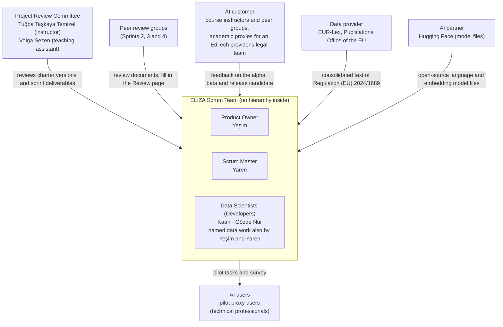

# Project Organization

This page shows who does what in the team, and how the team relates to the people who govern, review and influence the project. Team members hold the template's project roles, with the two Scrum roles, Product Owner and Scrum Master, as defined in the Scrum Guide [1]. Stakeholders outside the team can be named with the stakeholder roles of ISO/IEC 5339 [3].

"Data Scientist: develops the model" is a weak entry. It does not say which model, which work, or when. A strong entry makes the role concrete for your project and separates it from the other roles: "Data Scientist (Members 1 and 2): build the retrieval pipeline and the answer model, run and record the experiments, and test each increment against the Definition of Done." (illustrative only)

This page is a red cell of the Project Canvas, so it must be completed in the first version.

## 1. Project Team Structure

Use an organizational chart to show the structure of the project team and the relationships between team members. Show how the team relates to the governance structure of the project. For a small project, show the roles of the team members; for a larger one, name the groups that form the project teams.

Governance in DI 502:

- **The instructors are the Project Review Committee.**
- **Peer groups also review your documents at Sprints 2, 3 and 4.** After a sprint, an assigned group reviews your documents and fills in your Review page. For Sprint 2 the pairing is announced in the sprint instructions.
- **The AI customer is the course instructors and the peer groups.** The MVP and other customer-facing deliverables are built for them, not for the team.
- **There is no sponsor**, and there is no single manager: every member manages the project in some capacity.

In Scrum, the Scrum Team is one Scrum Master, one Product Owner and Developers, with no sub-teams or hierarchies inside it [1]. Draw the chart that way: the team as one box, with the Project Review Committee, the peer groups and the outside stakeholders around it. Show every member, including those in non-technical roles.

**ELIZA team chart.** The Scrum Team is one box with no sub-teams or hierarchy inside it: Yeşim is the Product Owner, Yaren is the Scrum Master, and Kaan and Gözde Nur are Data Scientists (the Developers in Scrum terms). The Scrum Master is the same person in every sprint. Yeşim and Yaren also do named data work next to their Scrum roles, as the Scrum Guide allows. Every member owns at least one assumption in [Assumptions & Constraints](03-assumptions-and-constraints.md).

Team chart (as a list):

- Project Review Committee: Tuğba Taşkaya Temizel (course instructor) and Volga Sezen (teaching assistant). Peer review groups at Sprints 2, 3 and 4.
- ELIZA Scrum Team (Yeşim, Yaren, Kaan, Gözde Nur), no hierarchy inside:
  - Product Owner: Yeşim.
  - Scrum Master: Yaren.
  - Data Scientists (Developers in Scrum terms): Kaan, Gözde Nur; Yeşim and Yaren also do named data work.
- Outside: AI customer (course instructors and peer groups); AI users (pilot proxy users); data provider (EUR-Lex); AI partner (Hugging Face).

## 2. Roles and Responsibilities

Define the roles and responsibilities of each team member, and of any stakeholders and working groups that have a significant influence on the project.

### Fields

| Field | What it means | Question it answers |
|---|---|---|
| **Project Role** | For a team member: a role from the template's list, spelled as there. For an outside stakeholder: an ISO/IEC 5339 stakeholder role where one fits [3] | Which role is this? |
| **Responsibilities** | What this role does in *your* project: which artefacts, decisions or meetings it owns | What work does this role own, and how does it differ from the other roles? |
| **Assigned to** | Named team members, or the outside organization or person | Who holds this role? |

### Project roles (team members)

| Role | What it covers |
|---|---|
| **Product Owner** | One person, not a committee [1]. Sets and communicates the product goal; writes the Product Backlog items and orders them; keeps the backlog visible and understood [1]. Writes most of the user stories and refines them with the team [2]. May hand some of this work to others but stays accountable for it [1]. |
| **Scrum Master** | One person [1]. Accountable for how effectively the team works: coaches the team in self-management, gets impediments removed, and makes sure the Scrum events happen and are useful [1]. Together with the Product Owner, guides the team towards user stories that meet the INVEST criteria [2]. |
| **Data Scientist** | Builds the product. In Scrum terms, everyone in the team who is neither the Product Owner nor the Scrum Master is a Developer [1]. Developers plan the sprint, meet the Definition of Done, adapt the plan daily towards the Sprint Goal, and decide among themselves how to turn backlog items into working increments [1]. |
| **Business Analyst** | Owns work the Product Owner does not, for example gathering requirements from a named outside stakeholder and handing them to the Product Owner as draft stories. |
| **Group Manager** | Coordinates a named area, for example the shared resources in [Facilities & Resources](03-project-canvas_v2/09-facilities-and-resources.md). Coordinating gives no authority over other members. |
| **Team Lead** | Coordinates a named area, for example technical design decisions and code review. Coordinating gives no authority over other members. |
| **Project Lead** | Coordinates a named area that differs from the Scrum Master's, for example tracking progress against the success criteria in the [Project Executive Summary](03-project-canvas_v2/01-project-executive-summary.md). |
| **Project Review Committee** | The course instructors. |

Delete a row only if nobody in your team holds that role. Business Analyst, Group Manager, Team Lead and Project Lead are often unnecessary in a small team.

### Stakeholders outside the team

Add a row for each outside stakeholder with a significant influence on the project. Use these ISO/IEC 5339 role names where one fits [3]; responsibilities are paraphrased. Never use them for team members.

| Stakeholder role | Who it is (paraphrased) |
|---|---|
| **AI customer** | Uses the product or provides it to users; consulted for requirements at the start and involved in verification, validation and acceptance. In DI 502: the course instructors and the peer groups. |
| **Data provider** | Collects or prepares the data the model uses, for example the organization that publishes or licenses your dataset. |
| **AI partner** | Provides services to the project within a business relationship, for example a cloud or model API service. |
| **AI user** | Uses the product; need not be the AI customer. |
| **Community** | People affected by the application beyond its customers and users. |
| **Regulators and policy makers** | The authorities where the system is used that set and enforce legal requirements for AI. |

## Rules

1. Every team member's Project Role is a role from the template's list, spelled as there. A new role is added only when no template role covers the work.
2. The table has a Product Owner, a Scrum Master and at least one Data Scientist row, because the Scrum Team is made of these three [1].
3. The Product Owner is one person, and the Scrum Master is one person [1].
4. Every team member appears at least once in Assigned to.
5. Every Responsibilities entry defines what the role does in this specific project: which artefacts, decisions or meetings it owns.
6. No two rows share a responsibility. If the same task appears in two rows, keep it in one.
7. Group Manager, Team Lead and Project Lead rows name an area they coordinate, not authority over other members [1].
8. Every role held by more than one person lists each person by name.
9. The Project Review Committee row names the course instructors, not team members.
10. The AI customer row names the course instructors and the peer groups.
11. Outside stakeholders use an ISO/IEC 5339 stakeholder role where one fits, and each names the team member who holds the contact [3].
12. The team chart shows how the team relates to governance: the Project Review Committee, the peer groups and the outside stakeholders.
13. Every person named as an owner, approver or contact on another page appears here: deliverable approvers in [Deliverables](03-project-canvas_v2/05-deliverables.md), risk owners in [Risks](03-project-canvas_v2/11-risks.md), contacts in [Dependencies](03-project-canvas_v2/06-dependencies.md).

## Test to apply to your draft

Cover the Project Role column and read only the Responsibilities column. Can you tell which role each row belongs to? If two rows could swap places, they overlap.

Then collect every name and role that appears on [Milestones](03-project-canvas_v2/02-milestones.md), [Dependencies](03-project-canvas_v2/06-dependencies.md) and [Risks](03-project-canvas_v2/11-risks.md). Can you find each one on this page?

## Not this / this

The left column shows weak entries, each tagged with the rule it breaks.

| Not this | Rule broken | This (illustrative only) |
|---|---|---|
| "Project Review Committee: reviews project outcomes, ensures alignment with goals, tests and validations. Assigned to: two team members." | The committee is the instructors (rule 9) | "Project Review Committee: reviews the charter and the sprint deliverables. Assigned to: course instructors." Testing and validation go under Data Scientist. |
| "Scrum Master: manages sprint planning and team coordination" and "Project Lead: manages overall project execution and ensures objectives are met", given to the same person. A peer reviewer flagged the two as overlapping. | Two rows share a responsibility (rule 6) | "Scrum Master: runs sprint planning, reviews and retrospectives; tracks impediments in Jira." "Project Lead: checks progress against the success criteria in the [Project Executive Summary](03-project-canvas_v2/01-project-executive-summary.md) at each sprint review." Or delete the Project Lead row. |
| "Group Manager: oversees group-level project progress and resource allocation." | No area named; reads as authority over others (rules 5, 7) | "Group Manager: coordinates the shared resources in [Facilities & Resources](03-project-canvas_v2/09-facilities-and-resources.md) (cloud credit, repository access) and reports their status at each sprint review." |
| "Data Scientist: develops and fine-tunes the model." | Not specific to this project (rule 5) | "Data Scientist (Members 1 and 2): fine-tune the answer model on the prepared document set, record each run in an experiment card, and test each increment against the Definition of Done." |
| "AI developer: builds the retrieval pipeline. Assigned to: Members 1 and 2." | An ISO stakeholder role used for team members (rules 1, 11) | "Data Scientist (Members 1 and 2): build the retrieval pipeline." |
| A roles table with no team chart. | No chart or governance relation (rule 12) | A chart with the Scrum Team as one box, the instructors as Project Review Committee, the peer groups, and the outside stakeholders (data provider, AI partner). |

## Patterns to use if you are stuck

- **One person, several roles:** one row per role, with the person's name in each.
- **Several Data Scientists:** one row, with each person's name and the part of the product each one builds.
- **Product Owner work done by others:** keep the Product Owner row as the person accountable, and name the others in its Responsibilities [1].
- **Outside data owner:** a data provider row for the organization that publishes or licenses the dataset, with the team member who handles it [3].
- **Cloud or model API service:** an AI partner row [3].
- **Domain expert outside the team:** a row with the expert's area and the team member who holds the contact.

## What doesn't belong here

- **The stakeholders who benefit from the project** go in [Project Executive Summary](03-project-canvas_v2/01-project-executive-summary.md). This page gives responsibilities, not benefits.
- **Team size and weekly hours** are constraints in [Assumptions & Constraints](03-project-canvas_v2/03-assumptions-and-constraints.md).
- **Who approves each deliverable** goes in [Deliverables](03-project-canvas_v2/05-deliverables.md).
- **Who owns each risk** goes in [Risks](03-project-canvas_v2/11-risks.md).

## Roles and Responsibilities table

| Project Role | Responsibilities | Assigned to |
|---|---|---|
| Product Owner | Set the product goal from the [Project Executive Summary](01-project-executive-summary.md) and keep it visible; write and order the user stories in the Jira backlog (project KAN); accept or reject each increment against its acceptance criteria; sign off the deliverables marked "Product Owner" in [Deliverables](05-deliverables.md); coordinate the resolution and logging of disagreements in the evaluation review (one reviewer for every answer, a second reviewer for a sample) using the evaluation rubric (O2); own the O1 and O3 success criteria; agree on any feature deferral (D9) and on any change of the designated source version (A-02); bring the target levels to the Project Review Committee (A-06). | Yeşim |
| Scrum Master | Run sprint planning, the daily check-ins, sprint reviews and retrospectives; keep the Jira board and the impediment list up to date; check that stories meet INVEST before sprint planning; keep the working conventions (Jira key in every branch, commit and pull request); agree the Definition of Ready and Done with the team before each sprint; keep the burndown chart; prepare the sprint folder's welcome page and the Jira backlog export at each upload; check team availability at each sprint start (A-09). | Yaren |
| Data Scientist | **Yeşim**: source corpus and preprocessing: source manifest and provision list (D3), parsing and chunking by Article/paragraph (D5), check of the consolidated text against the Official Journal (A-01, A-05), licence check and adaptation of the published benchmark questions (D2). **Yaren**: evaluation pipeline: scripts that score O2 and O4 on the `val` and `test` splits, Weights & Biases runs, the experiment cards and the technical summary of each sprint, the SBOM (`10-software-bill-of-materials.md`). **Kaan**: retrieval and answer generation: embedding, vector store, retriever, the open-source quantized LLM and its prompt templates, their spike notes and ADRs (D4), the answer time of the model on CPU (A-07, R-13), model licence check (A-10), gold-source mapping of the evaluation questions (A-03). **Gözde Nur**: user interface, local run and safety checks: web page, running the whole pipeline from `README.md` on a team computer (C-05), Check the source (Feature 6) and, only if time allows, guided start and follow-up questions, rule-based safety checks before and after the model call (input check, decision-phrase and verdict check, personal-data reminder, C-10), pilot protocol and pilot users (D10, A-04). **All four**: write and cross-check evaluation questions, including questions taken or adapted from published work (D2, D8), write a learning spike note (D4), plan the sprint, and test each increment against the Definition of Done. | Kaan, Gözde Nur; Yeşim and Yaren for the named data work next to their Product Owner and Scrum Master roles |
| Project Review Committee | Review each charter version and the sprint deliverables; set the course constraints (RAG solution, open-source quantized model, $100 Google Cloud credit); give feedback on the O2 and O4 target levels (A-06); co-approve D10 and D11. | Tuğba Taşkaya Temizel (course instructor), Volga Sezen (teaching assistant) |
| AI customer | Try the alpha, beta and release candidate at the sprint reviews and the final demonstration and give feedback that the Product Owner turns into backlog items ([Milestones](02-milestones.md) M4, M7, M10), acting as academic proxies for the legal and compliance team of an EdTech provider (scenario in the [Project Executive Summary](01-project-executive-summary.md)); peer groups review the team's documents after Sprints 2, 3 and 4 and fill in the Review page. Contact: Yeşim. | Course instructors and peer groups |
| AI user | Do the timed search tasks and answer the survey in the pilot, in person on a team computer (16/12–23/12/2026, D10). Contact: Gözde Nur. | At least 5 pilot proxy users: technical professionals working on software or AI, at least 3 of them on an AI or education software product (A-08) (named participants anonymised as P1, P2, …) |
| Data provider | Publishes the consolidated text of Regulation (EU) 2024/1689 (CELEX 02024R1689-20260727) that the assistant uses; its reuse terms (Commission Decision 2011/833/EU) apply (C-09). Contact: Yeşim. | EUR-Lex, Publications Office of the European Union |
| AI partner | Hosts the open-source language model and embedding model files that the team downloads and runs locally (C-03, A-10). The course's Google Cloud credit is kept as a reserve (C-06); Google Cloud would become a second AI partner only if the credit is used (R-13). Contact: Kaan. | Hugging Face (model hub) |

Business Analyst, Group Manager, Team Lead and Project Lead rows are removed: nobody in the team holds these roles; in a team of four, their work is covered by the Product Owner, the Scrum Master and the named areas in the Data Scientist row.

## Example (illustrative only)

Scenario: a legal research assistant. Member names are placeholders.

Team chart (as a list):

- Project Review Committee: course instructors. Peer review group at Sprints 2–4.
- Scrum Team (Members 1–4), no hierarchy inside:
  - Product Owner: Member 1.
  - Scrum Master: Member 4.
  - Data Scientists: Members 1–4.
  - Business Analyst: Member 3. Team Lead: Member 2.
- Outside: data provider (document publisher); AI partner (cloud service under the university credit); legal expert who reviews answers; AI users (associates in the pilot group).

| Project Role | Responsibilities | Assigned to |
|---|---|---|
| Product Owner | Write and order the user stories; keep the backlog in Jira up to date; agree the target metric with the AI customer. | Member 1 |
| Scrum Master | Run sprint planning, reviews and retrospectives; track impediments; check that stories meet INVEST before planning. | Member 4 |
| Business Analyst | Gather requirements from the legal expert and hand them to the Product Owner as draft stories; hold the contact with the data provider ([Dependencies](03-project-canvas_v2/06-dependencies.md) row 2). | Member 3 |
| Team Lead | Coordinate technical design decisions and code review across the pipeline. | Member 2 |
| Data Scientist | Member 1: cloud set-up and retrieval pipeline ([Facilities & Resources](03-project-canvas_v2/09-facilities-and-resources.md) row 1). Member 2: answer model and LLM API (row 2). Member 3: data pipeline and PII masking (C-03). Member 4: staging deployment (row 7). All: experiments and the Definition of Done. | Members 1, 2, 3, 4 |
| Project Review Committee | Review the charter and the sprint deliverables. | Course instructors |
| AI customer | Accept the MVP ([Milestones](03-project-canvas_v2/02-milestones.md)). | Course instructors and peer groups |
| Data provider | Publishes the document set under its licence. Contact: Member 3. | Document publisher |
| AI partner | Provides GPU compute and hosting under the university credit. Contact: Member 1. | Cloud service |
| Legal expert | Reviews answers at least 2 hours per week (A-02). Contact: Member 3. | Named expert |
| AI user | Asks research questions and rates answers during the pilot. Contact: Member 4. | Associates in the pilot group (scenario) |

Group Manager and Project Lead are deleted: in a team of four, their work is already covered by the Scrum Master and the Team Lead.

## Checklist before submitting

- [x] Every team member's role comes from the template's list, spelled as there (rule 1)
- [x] There is a Product Owner, a Scrum Master and at least one Data Scientist (rule 2)
- [x] The Product Owner and the Scrum Master are one person each (rule 3)
- [x] Every team member appears at least once (rule 4)
- [x] Every Responsibilities cell is specific to this project (rule 5)
- [x] No responsibility appears in two rows (rule 6)
- [x] Lead and manager rows name an area, not authority over others (rule 7)
- [x] Every shared role lists each person by name (rule 8)
- [x] The Project Review Committee is the course instructors (rule 9)
- [x] The AI customer row names the course instructors and peer groups (rule 10)
- [x] Outside stakeholders use ISO/IEC 5339 role names where one fits, each with a team contact (rule 11)
- [x] The team chart shows the relation to governance (rule 12)
- [x] Every owner, approver and contact on [Milestones](03-project-canvas_v2/02-milestones.md), [Dependencies](03-project-canvas_v2/06-dependencies.md) and [Risks](03-project-canvas_v2/11-risks.md) appears here (rule 13)

---

## References

[1] K. Schwaber and J. Sutherland, *The Scrum Guide: The Definitive Guide to Scrum: The Rules of the Game*, Nov. 2020. [Online]. Available: https://scrumguides.org/scrum-guide.html (accessed Oct. 7, 2026).

[2] A. Ben Salem, "Creating the Perfect User Story with INVEST Criteria," Scrum-Master·Org, Dec. 5, 2023 (updated Jun. 20, 2024). [Online]. Available: https://scrum-master.org/en/creating-the-perfect-user-story-with-invest-criteria/ (accessed Oct. 5, 2026).

[3] ISO/IEC JTC 1/SC 42, *ISO/IEC 5339:2024 Information technology — Artificial intelligence — Guidance for AI applications*, 1st ed. Geneva, Switzerland: International Organization for Standardization and International Electrotechnical Commission, Jan. 2024. UK implementation: BS ISO/IEC 5339:2024, London, UK: BSI Standards Limited, 2024.
