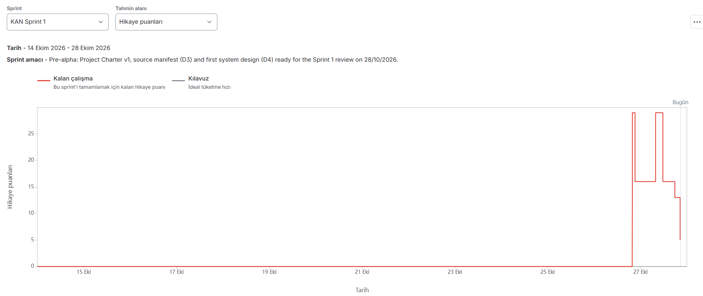

# Burndown Chart

Please present the burndown chart for each sprint.

## Sprint 1

From Jira (board "KAN", sprint "KAN Sprint 1", estimation: story points), taken on 27/10/2026 at the upload.

**How to read it.** The seven Sprint 1 stories (55 story points) were estimated with planning poker at the team meeting on 26/10/2026, near the end of the sprint. Before that the stories had no points, so the line stays at 0 from 14/10 to 26/10 and Jira draws no guideline. When the points were entered, three stories were already done (KAN-67, KAN-70, KAN-79), so the line starts at the 29 points of the four open stories:

| When | Change | Remaining |
|---|---|---|
| 26/10, points entered | KAN-69 (8), KAN-80 (5), KAN-81 (13), KAN-82 (3) open | 29 |
| 26/10 | KAN-81 done | 16 |
| 27/10 | KAN-81 reopened, because its design document sub-task (KAN-59) was not finished | 29 |
| 27/10 | KAN-81 done again, after KAN-59 | 16 |
| 27/10 | KAN-82 done (learning spikes) | 13 |
| 27/10 | KAN-69 done (assumptions, constraints, dependencies, resources, risks) | 5 |

The remaining 5 points are KAN-80, which closes after the Sprint 1 review on 28/10/2026 because its sub-task KAN-44 includes the review.

**What we change in Sprint 2.** The chart shows the work done only in the last two days, because the stories were estimated late. In Sprint 2, every story is estimated with planning poker and assigned at the sprint planning on 28/10/2026, before the work starts ([Definition of Ready](03-definition-of-ready-definition-of-done.md), Sprint 2), so the burndown follows the whole sprint.

## Sprint 2

## Sprint 3

## Sprint 4
