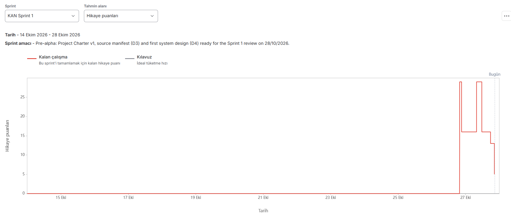
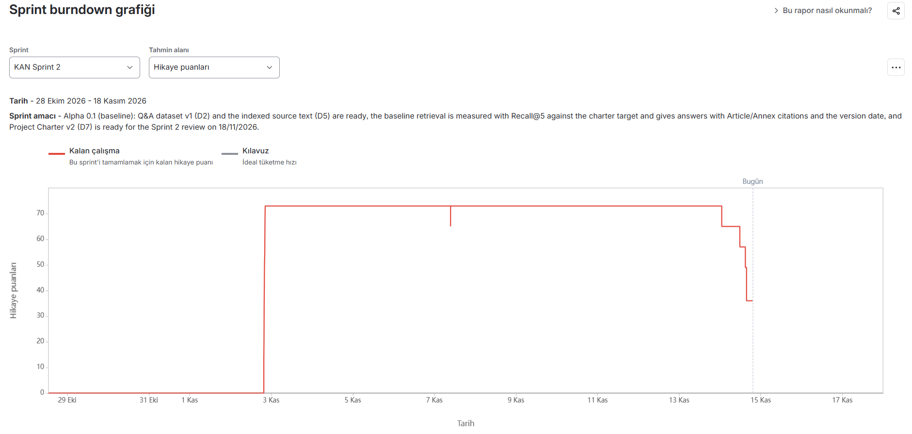

# Burndown Chart

Please present the burndown chart for each sprint.

## Sprint 1

From Jira (board "KAN", sprint "KAN Sprint 1", estimation: story points), taken on 27/10/2026 at the upload.

**How to read it.** The seven Sprint 1 stories (55 story points) were estimated with planning poker at the team meeting on 26/10/2026, near the end of the sprint. Before that the stories had no points, so the line stays at 0 from 14/10 to 26/10 and Jira draws no guideline. When the points were entered, three stories were already done (KAN-67, KAN-70, KAN-79), so the line starts at the 29 points of the four open stories:

| When | Change | Remaining |
|---|---|---|
| 26/10, points entered | KAN-69 (8), KAN-80 (5), KAN-81 (13), KAN-82 (3) open | 29 |
| 26/10 | KAN-81 done | 16 |
| 27/10 | KAN-81 reopened, because its design document sub-task (KAN-59) was not finished | 29 |
| 27/10 | KAN-81 done again, after KAN-59 | 16 |
| 27/10 | KAN-82 done (learning spikes) | 13 |
| 27/10 | KAN-69 done (assumptions, constraints, dependencies, resources, risks) | 5 |

The remaining 5 points are KAN-80, which closes after the Sprint 1 review on 28/10/2026 because its sub-task KAN-44 includes the review.

**What we change in Sprint 2.** The chart shows the work done only in the last two days, because the stories were estimated late. In Sprint 2, every story is estimated with planning poker and assigned at the sprint planning on 28/10/2026, before the work starts ([Definition of Ready](03-definition-of-ready-definition-of-done.md), Sprint 2), so the burndown follows the whole sprint.

## Sprint 2

From Jira (board "KAN", sprint "KAN Sprint 2", estimation: story points), taken on 14/11/2026 before the ODTUClass submission; the sprint ends with the review on 18/11/2026.

**How to read it.** Sprint 2 has 3 user stories and 6 tasks, 73 story points. The points were entered in Jira on 02/11/2026, after the sprint planning of 28/10/2026, so the line stays at 0 until then and Jira draws no guideline for the story points (the issue-count view draws one from the 9 issues of 28/10). The remaining work stayed at 73 points until 14/11, apart from a brief dip on 07/11 when [KAN-86](https://yarengursoy.atlassian.net/browse/KAN-86) was closed and then reopened ten seconds later. The four completed items were recorded as Done in Jira on 14/11, although the work was done during the sprint (for example the baseline answers on 12/11/2026).

| When | Change | Remaining |
|---|---|---|
| 02/11, points entered | 9 items open | 73 |
| 14/11 | [KAN-86](https://yarengursoy.atlassian.net/browse/KAN-86), [KAN-88](https://yarengursoy.atlassian.net/browse/KAN-88) and [KAN-90](https://yarengursoy.atlassian.net/browse/KAN-90) done, 8 points each, one after another (73 → 65 → 57 → 49) | 49 (after the three) |
| 14/11 | [KAN-87](https://yarengursoy.atlassian.net/browse/KAN-87) done | 36 |

The remaining 36 points are [KAN-8](https://yarengursoy.atlassian.net/browse/KAN-8) (8), [KAN-65](https://yarengursoy.atlassian.net/browse/KAN-65) (13) and [KAN-83](https://yarengursoy.atlassian.net/browse/KAN-83) (5), whose carry-over to Sprint 3 is planned, [KAN-89](https://yarengursoy.atlassian.net/browse/KAN-89) (5), open until the pilot users are confirmed (KAN-158, due 18/11/2026), and [KAN-91](https://yarengursoy.atlassian.net/browse/KAN-91) (5), open until the demo and the review on 18/11/2026 ([Sprint 2 welcome page](05-sprint-2/README.md)).

**Board correction on 14/11/2026.** Until then the KAN board had "Devam ediyor" (in progress) as its rightmost column and "Çözüldü" (done) before it, so Jira counted work as done when it started and as remaining again when it was closed. The column order was corrected on 14/11/2026, before this chart was taken; Jira draws the chart from the status history with the current columns.

**What we change in Sprint 3.** The line shows the work only at the end, because the points were entered late and the items were closed in Jira only on the upload date, 14/11/2026 ([Sprint 2 retrospective](05-sprint-2/02-sprint-2-retrospective.md): "Jira was updated later, so the burndown stayed flat and dropped at the end"). In Sprint 3, the points are entered at the sprint planning on 18/11/2026, and every item is closed in Jira on the day its Definition of Done is met, so the burndown follows the whole sprint.

## Sprint 3

## Sprint 4
