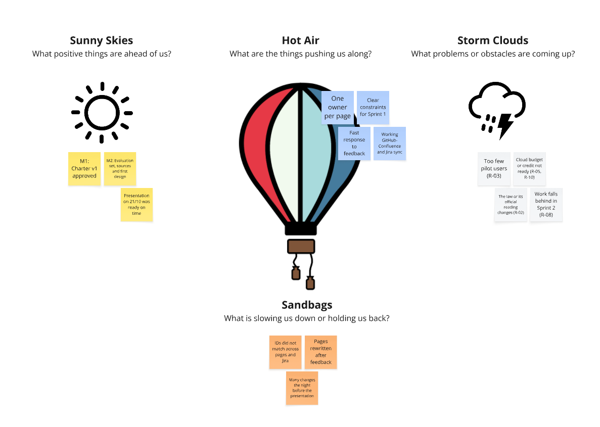

# Sprint 1 Retrospective

Retrospective meetings allow teams to identify points of strength, issues faced during the sprint, and let members discuss how to handle them next time. 

While holding the retrospective meeting, assess promised time-commitments outlined in the constraints/budget sections and evaluate whether these were fulfilled. Everyone must also individually comment on their learning journey and their ability to contribute in this sprint.

The table below is very basic, but feel free to follow a template from Miro. For holding the retro you can use [Scrum Powder | Retro](https://scrumpowder.com/retro).

**Sprint 1:** 14/10/2026 – 28/10/2026 · **Team:** ELIZA (Yeşim, Yaren, Kaan, Gözde Nur)

| What went well? | What went bad? | Action | Assigned to |
|---|---|---|---|
| All ten Project Canvas pages were written on time, each with one owner. | Pages were written separately, so IDs (A-xx, R-xx) did not match across pages and Jira. | Before each review, one person checks that IDs match on all pages and in Jira. | Yaren (Scrum Master) |
| Jira stories have acceptance criteria and traceability; epics and releases are set up. | Some stories were left without an epic or a sprint. | Every story gets an epic and a sprint at sprint planning. | Yeşim (Product Owner) |
| Feedback from the review was applied quickly. | Some pages were read differently from what the instructor expected (for example, what counts as a risk), so they were rewritten after feedback. | Share an early draft of each page and ask for feedback before the review. | Everyone |
| The GitHub–Confluence and Jira sync works. | The sync stopped once because of missing secrets. | Check the sync and the course template updates at the start of every sprint. | Kaan, Gözde Nur |
| The presentation for 21/10 was ready on time. | Many pages changed the night before the presentation, and not everyone saw the changes. | Freeze the pages 2 days before a review; announce changes that affect other pages in the group. | Everyone |

## Hot Air Balloon Retrospective

We also looked at Sprint 1 with the Hot Air Balloon retrospective on our [Miro board](https://miro.com/app/board/uXjVEWMJhwo=/?share_link_id=854607532110): sunny skies are the positive things ahead, hot air is what pushes us along, storm clouds are the problems coming up, and sandbags are what slows us down.

| ☀️ Sunny Skies (positive things ahead) | 🔥 Hot Air (what pushes us along) | ⛈️ Storm Clouds (problems coming up) | 🎒 Sandbags (what slows us down) |
|---|---|---|---|
| M1: Charter v1 approved | One owner per page | Too few pilot users (R-03) | IDs did not match across pages and Jira |
| M2: Evaluation set, sources and first design | Clear constraints for Sprint 1 | Cloud budget or credit not ready (R-05, R-10) | Pages rewritten after feedback |
| Sprint 2: first working alpha | Fast response to feedback | The law or its official reading changes (R-02) | Many changes the night before the presentation |
| Presentation on 21/10 was ready on time | Working GitHub–Confluence and Jira sync | Work falls behind in Sprint 2 (R-08) | Unanswered questions in the group chat |

## Commitments check

| Commitment | Promised in | Fulfilled? | Notes |
|---|---|---|---|
| No production code is written in Sprint 1 | [Assumptions & Constraints](../03-project-canvas/03-assumptions-and-constraints.md), constraint C-07 (course rule) | Yes | Sprint 1 produced only documents, spike notes and the course's sync scripts. |
| Sprint 1 runs from 14/10 to 28/10/2026, as the first of 4 sprints | [Assumptions & Constraints](../03-project-canvas/03-assumptions-and-constraints.md), constraint C-07 (duration) | Yes | Sprint 1 started on 14/10/2026 as planned and ends with the sprint review on 28/10/2026; Sprint 2 starts on 04/11/2026 as planned. |
| The project is done by the four team members, with no new members | [Assumptions & Constraints](../03-project-canvas/03-assumptions-and-constraints.md), constraint C-07 (team) | Yes | All four members contributed in Sprint 1. |
| Development runs on Google Colab or the team members' own computers; paid cloud use stays within the $100 Google Cloud credit | [Assumptions & Constraints](../03-project-canvas/03-assumptions-and-constraints.md), constraints C-05 and C-06 | Yes | No code or deployment was started in Sprint 1, so no cloud credit was used. |

## Individual comments

**Yeşim (Product Owner):** [to be added]

**Yaren (Scrum Master):** [to be added]

**Kaan (Development Team Member):** [to be added]

**Gözde Nur (Development Team Member):** I wrote the Assumptions & Constraints and Risks pages and my learning spike. I learned how assumptions, constraints, dependencies and risks link to each other, and after the instructor's feedback I learned how the instructor separates a risk from a design task. I rewrote the Risks page based on that feedback.

## Lessons Learned

List lessons learned from the retrospective, with special emphasis on actions to be taken to improve, for example: the development environment, the process, or team collaboration.

- **Process:** Ask for feedback on an early draft. Most rework in Sprint 1 came from reading a template rule differently from the instructor.
- **Team collaboration:** Pages depend on each other. A change to one page (for example a risk number) must be announced, and IDs must be checked across all pages before a review.
- **Planning:** Finish and freeze the pages 2 days before a review, so the whole team can read the final version.
- **Development environment:** Check the GitHub–Confluence and Jira sync and the course template updates at every sprint start, so reviewers always see the current pages. Before coding starts in Sprint 2, agree on one Python version and a shared `requirements.txt`, so the code runs the same on Colab and on every laptop.
