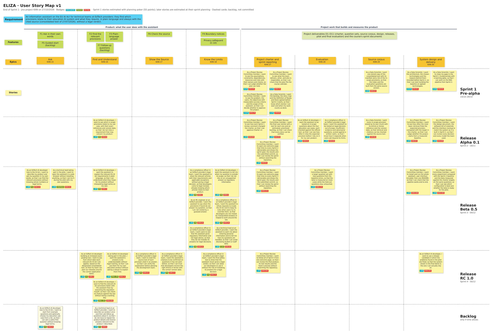

# User Story Map v1

**Version:** v1, end of Sprint 1 (27/10/2026) · **Source:** Jira project KAN on 27/10/2026 · **Owner:** Yeşim (Product Owner) · **Next version:** [User Story Map v2](02-user-story-map-v2.md), at the end of Sprint 2

## How to read the map

- **Rows, top to bottom (as in the course's example map):** the requirement the product answers; the features from the [Project Executive Summary](../03-project-canvas/01-project-executive-summary.md); the eight epics; then the user stories in the row of the release they belong to, from the [Release Plan](../03-project-canvas/10-release-plan.md): Sprint 1 (pre-alpha), Alpha 0.1 (Sprint 2), Beta 0.5 (Sprint 3), Release candidate 1.0 (Sprint 4) and the backlog.
- **Columns:** the first four epics are what the user does with the assistant: ask, find and understand the provisions, check the source, and know where the assistant stops. Each product epic groups one or more charter features, and every product story is tagged with the feature it builds. The other four epics hold the project work that builds and measures the product (deliverables D1–D11).
- **Cards:** the story as written in Jira, its story points, its feature and its Jira key. Sprint 1 stories were estimated with planning poker; the stories of Sprints 2–4 are estimated at their sprint planning, so their cards show "– SP".
- **Tasks:** every story's sub-tasks are listed in the [full hierarchy](#full-hierarchy-feature--epic--story--task) below. Each epic's story requirements page gives the acceptance criteria, the sub-tasks with their "Done when" condition, the test cases and the traceability to the charter.

## Map

To read the cards at any zoom, open the [PDF version of the map](../../docs/images/user-story-map-v1.pdf). The same content is in the table and the full hierarchy below.

## The map as a table

Sprints as columns and epics as rows, with links to Jira. Story points in brackets.

| Epic | **Sprint 1** · Pre-alpha 14/10–28/10/2026 | **Sprint 2** · Alpha 0.1 28/10–18/11/2026 | **Sprint 3** · Beta 0.5 18/11–09/12/2026 | **Sprint 4** · Release candidate 1.0 09/12–30/12/2026 | **Backlog** only if time allows |
|---|---|---|---|---|---|
| *Goal* | *Charter v1, source manifest and first system design, no production code (C-07)* | *Baseline: question set v1, indexed source text, baseline retrieval measured; Charter v2* | *MVP (Features 1–4): the whole pipeline with the web page runs end to end* | *Pilot with Beta 0.5 plus Feature 6 and application dates; final evaluation and live demo* | *Not committed* |
| **Product** | | | | | |
| **Ask** [KAN-15](https://yarengursoy.atlassian.net/browse/KAN-15) | – | – | [KAN-19](https://yarengursoy.atlassian.net/browse/KAN-19) Ask about my product in my own words [KAN-21](https://yarengursoy.atlassian.net/browse/KAN-21) Use the assistant in my browser | – | [KAN-20](https://yarengursoy.atlassian.net/browse/KAN-20) Start from example questions or my use case |
| **Find and Understand** [KAN-16](https://yarengursoy.atlassian.net/browse/KAN-16) | – | [KAN-8](https://yarengursoy.atlassian.net/browse/KAN-8) See the provisions that relate to my use case, with their references | [KAN-4](https://yarengursoy.atlassian.net/browse/KAN-4) Understand the relevant requirements in plain language | [KAN-3](https://yarengursoy.atlassian.net/browse/KAN-3) See when the AI Act rules apply to our product [KAN-72](https://yarengursoy.atlassian.net/browse/KAN-72) Understand the assistant's answers without legal training [KAN-202](https://yarengursoy.atlassian.net/browse/KAN-202) Find the provisions faster than with manual search | [KAN-6](https://yarengursoy.atlassian.net/browse/KAN-6) Ask follow-up questions about our product in the same session |
| **Show the Source** [KAN-17](https://yarengursoy.atlassian.net/browse/KAN-17) | – | – | – | [KAN-22](https://yarengursoy.atlassian.net/browse/KAN-22) Read the cited source text behind an answer [KAN-77](https://yarengursoy.atlassian.net/browse/KAN-77) Rely on cited provisions confirmed on unseen questions | – |
| **Know the Limits** [KAN-18](https://yarengursoy.atlassian.net/browse/KAN-18) | – | – | [KAN-2](https://yarengursoy.atlassian.net/browse/KAN-2) See the relevant articles without a legal decision [KAN-5](https://yarengursoy.atlassian.net/browse/KAN-5) Get a notice when my question is out of scope [KAN-23](https://yarengursoy.atlassian.net/browse/KAN-23) Get a notice when the provisions do not answer my question [KAN-24](https://yarengursoy.atlassian.net/browse/KAN-24) Refuse requests to get around the law [KAN-25](https://yarengursoy.atlassian.net/browse/KAN-25) See that answers are not legal advice [KAN-26](https://yarengursoy.atlassian.net/browse/KAN-26) Avoid sharing personal information when asking questions | [KAN-75](https://yarengursoy.atlassian.net/browse/KAN-75) Be sure the assistant never gives a legal verdict | – |
| **Project work** | | | | | |
| **Project charter and sprint reporting** [KAN-27](https://yarengursoy.atlassian.net/browse/KAN-27) | [KAN-69](https://yarengursoy.atlassian.net/browse/KAN-69) Judge whether the plan can hold (8) [KAN-70](https://yarengursoy.atlassian.net/browse/KAN-70) Check that the delivery plan fits the course calendar (8) [KAN-79](https://yarengursoy.atlassian.net/browse/KAN-79) Decide whether to approve the project's purpose and scope (13) [KAN-80](https://yarengursoy.atlassian.net/browse/KAN-80) Know which stories I can start and when my work is done (5) | [KAN-89](https://yarengursoy.atlassian.net/browse/KAN-89) Check that the Sprint 1 feedback changed the charter [KAN-90](https://yarengursoy.atlassian.net/browse/KAN-90) Judge the final user stories and how each one is tested [KAN-91](https://yarengursoy.atlassian.net/browse/KAN-91) Follow Sprint 2 from one welcome page | [KAN-171](https://yarengursoy.atlassian.net/browse/KAN-171) Follow Sprint 3 from one welcome page | [KAN-204](https://yarengursoy.atlassian.net/browse/KAN-204) Follow Sprint 4 from one welcome page | – |
| **Evaluation** [KAN-28](https://yarengursoy.atlassian.net/browse/KAN-28) | – | [KAN-65](https://yarengursoy.atlassian.net/browse/KAN-65) Test the assistant on in-scope questions checked against the official text [KAN-83](https://yarengursoy.atlassian.net/browse/KAN-83) Test the assistant's safety responses against a written rubric | [KAN-170](https://yarengursoy.atlassian.net/browse/KAN-170) Extend the question set for the beta | – | – |
| **Source corpus** [KAN-29](https://yarengursoy.atlassian.net/browse/KAN-29) | [KAN-67](https://yarengursoy.atlassian.net/browse/KAN-67) Work from one verified copy of the source (5) | [KAN-86](https://yarengursoy.atlassian.net/browse/KAN-86) Index every in-scope provision with its reference and version date | – | – | – |
| **System design and delivery** [KAN-30](https://yarengursoy.atlassian.net/browse/KAN-30) | [KAN-81](https://yarengursoy.atlassian.net/browse/KAN-81) Agree on the technologies for the baseline (13) [KAN-82](https://yarengursoy.atlassian.net/browse/KAN-82) Close my gaps in the Sprint 1 fundamentals (3) | [KAN-87](https://yarengursoy.atlassian.net/browse/KAN-87) Measure how well the baseline retrieval finds the expected provisions [KAN-88](https://yarengursoy.atlassian.net/browse/KAN-88) Review the system design, the models used and the interface plan | [KAN-168](https://yarengursoy.atlassian.net/browse/KAN-168) Run the whole pipeline from one README [KAN-169](https://yarengursoy.atlassian.net/browse/KAN-169) Measure the beta against the baseline and the charter targets | [KAN-203](https://yarengursoy.atlassian.net/browse/KAN-203) Use a release candidate with the pilot problems fixed | – |
| **Stories (points)** | 7 (55) | 9 (at planning) | 13 (at planning) | 8 (at planning) | 2 |

## Users in the stories

The roles come from the [Project Organization](../03-project-canvas/08-project-organization.md), which uses the ISO/IEC 5339 stakeholder roles for people outside the team.

| Who the story is for | Role | Stories |
|---|---|---|
| EdTech AI developer | AI user: a technical team member at an EdTech provider (pilot proxy users in D10) | [KAN-3](https://yarengursoy.atlassian.net/browse/KAN-3), [KAN-4](https://yarengursoy.atlassian.net/browse/KAN-4), [KAN-5](https://yarengursoy.atlassian.net/browse/KAN-5), [KAN-8](https://yarengursoy.atlassian.net/browse/KAN-8), [KAN-19](https://yarengursoy.atlassian.net/browse/KAN-19), [KAN-20](https://yarengursoy.atlassian.net/browse/KAN-20), [KAN-65](https://yarengursoy.atlassian.net/browse/KAN-65), [KAN-72](https://yarengursoy.atlassian.net/browse/KAN-72), [KAN-202](https://yarengursoy.atlassian.net/browse/KAN-202), [KAN-203](https://yarengursoy.atlassian.net/browse/KAN-203) |
| Technical lead | AI user | [KAN-6](https://yarengursoy.atlassian.net/browse/KAN-6), [KAN-21](https://yarengursoy.atlassian.net/browse/KAN-21), [KAN-26](https://yarengursoy.atlassian.net/browse/KAN-26) |
| ML engineer at an EdTech provider | AI user | [KAN-23](https://yarengursoy.atlassian.net/browse/KAN-23) |
| Compliance officer in an EdTech provider's legal team | AI customer: the legal and compliance team (the course instructors and peer groups as academic proxies) | [KAN-2](https://yarengursoy.atlassian.net/browse/KAN-2), [KAN-22](https://yarengursoy.atlassian.net/browse/KAN-22), [KAN-24](https://yarengursoy.atlassian.net/browse/KAN-24), [KAN-25](https://yarengursoy.atlassian.net/browse/KAN-25), [KAN-75](https://yarengursoy.atlassian.net/browse/KAN-75), [KAN-77](https://yarengursoy.atlassian.net/browse/KAN-77), [KAN-83](https://yarengursoy.atlassian.net/browse/KAN-83) |
| Project Review Committee member | Project Review Committee (course instructor and teaching assistant) | [KAN-69](https://yarengursoy.atlassian.net/browse/KAN-69), [KAN-70](https://yarengursoy.atlassian.net/browse/KAN-70), [KAN-79](https://yarengursoy.atlassian.net/browse/KAN-79), [KAN-87](https://yarengursoy.atlassian.net/browse/KAN-87), [KAN-88](https://yarengursoy.atlassian.net/browse/KAN-88), [KAN-89](https://yarengursoy.atlassian.net/browse/KAN-89), [KAN-90](https://yarengursoy.atlassian.net/browse/KAN-90), [KAN-91](https://yarengursoy.atlassian.net/browse/KAN-91), [KAN-168](https://yarengursoy.atlassian.net/browse/KAN-168), [KAN-169](https://yarengursoy.atlassian.net/browse/KAN-169), [KAN-170](https://yarengursoy.atlassian.net/browse/KAN-170), [KAN-171](https://yarengursoy.atlassian.net/browse/KAN-171), [KAN-204](https://yarengursoy.atlassian.net/browse/KAN-204) |
| Data Scientist | Team member (template project role) | [KAN-67](https://yarengursoy.atlassian.net/browse/KAN-67), [KAN-80](https://yarengursoy.atlassian.net/browse/KAN-80), [KAN-81](https://yarengursoy.atlassian.net/browse/KAN-81), [KAN-82](https://yarengursoy.atlassian.net/browse/KAN-82), [KAN-86](https://yarengursoy.atlassian.net/browse/KAN-86) |

## Dependencies between stories

- [KAN-65](https://yarengursoy.atlassian.net/browse/KAN-65) and [KAN-86](https://yarengursoy.atlassian.net/browse/KAN-86) → [KAN-87](https://yarengursoy.atlassian.net/browse/KAN-87): the baseline is measured on question set v1 (D2) and the indexed source text (D5).
- [KAN-8](https://yarengursoy.atlassian.net/browse/KAN-8) → [KAN-22](https://yarengursoy.atlassian.net/browse/KAN-22): the cited provisions must be found before their text can be shown.
- [KAN-168](https://yarengursoy.atlassian.net/browse/KAN-168) → [KAN-21](https://yarengursoy.atlassian.net/browse/KAN-21) and [KAN-26](https://yarengursoy.atlassian.net/browse/KAN-26): the web page needs the whole pipeline (course halfway check on 02/12/2026).
- [KAN-170](https://yarengursoy.atlassian.net/browse/KAN-170) → [KAN-169](https://yarengursoy.atlassian.net/browse/KAN-169): the beta is measured on the frozen question set v2 (D8).
- [KAN-3](https://yarengursoy.atlassian.net/browse/KAN-3) and [KAN-22](https://yarengursoy.atlassian.net/browse/KAN-22) → [KAN-202](https://yarengursoy.atlassian.net/browse/KAN-202) and [KAN-72](https://yarengursoy.atlassian.net/browse/KAN-72): both are in the pilot version by 16/12/2026.
- [KAN-202](https://yarengursoy.atlassian.net/browse/KAN-202) and [KAN-72](https://yarengursoy.atlassian.net/browse/KAN-72) → [KAN-203](https://yarengursoy.atlassian.net/browse/KAN-203): the release candidate fixes the problems found in the pilot.

## Full hierarchy: feature → epic → story → task

Each sub-task is an actionable task with a "Done when" condition in Jira and on its epic's story requirements page. Owners are shown where they are assigned; the others are assigned at the sprint planning.

### Ask ([KAN-15](https://yarengursoy.atlassian.net/browse/KAN-15))

Features: F1 Ask in their own words · F5 Guided start (backlog) · [Story requirements](03-story-requirements-for-epic-kan-15.md)

- **[KAN-19](https://yarengursoy.atlassian.net/browse/KAN-19) Ask about my product in my own words** · Sprint 3 · F1
  - [KAN-137](https://yarengursoy.atlassian.net/browse/KAN-137) Link everyday descriptions to the use case wording
  - [KAN-138](https://yarengursoy.atlassian.net/browse/KAN-138) Answer non-English questions with the English-only notice
  - [KAN-139](https://yarengursoy.atlassian.net/browse/KAN-139) Report the expected-provision rate for questions that name no article
- **[KAN-21](https://yarengursoy.atlassian.net/browse/KAN-21) Use the assistant in my browser** · Sprint 3 · Interface
  - [KAN-154](https://yarengursoy.atlassian.net/browse/KAN-154) Build the one-page interface
  - [KAN-160](https://yarengursoy.atlassian.net/browse/KAN-160) Open the assistant without installation or an account
  - [KAN-161](https://yarengursoy.atlassian.net/browse/KAN-161) Show that the answer is being prepared
  - [KAN-162](https://yarengursoy.atlassian.net/browse/KAN-162) Show a plain error message on a system error
  - [KAN-163](https://yarengursoy.atlassian.net/browse/KAN-163) Measure the answer time on the pilot computer
- **[KAN-20](https://yarengursoy.atlassian.net/browse/KAN-20) Start from example questions or my use case** · Backlog · F5
  - *No sub-tasks yet: written at the sprint planning if the story is taken into a sprint.*

### Find and Understand ([KAN-16](https://yarengursoy.atlassian.net/browse/KAN-16))

Features: F2 Find the relevant provisions · F3 Plain-language answer · F7 Follow-up questions (backlog) · [Story requirements](04-story-requirements-for-epic-kan-16.md)

- **[KAN-8](https://yarengursoy.atlassian.net/browse/KAN-8) See the provisions that relate to my use case, with their references** · Sprint 2 · F2
  - [KAN-125](https://yarengursoy.atlassian.net/browse/KAN-125) Generate answers from the retrieved chunks
  - [KAN-126](https://yarengursoy.atlassian.net/browse/KAN-126) Show each cited provision with its reference and version date
  - [KAN-127](https://yarengursoy.atlassian.net/browse/KAN-127) Show how several provisions relate
  - [KAN-128](https://yarengursoy.atlassian.net/browse/KAN-128) Check every citation against the retrieved chunk IDs
  - [KAN-129](https://yarengursoy.atlassian.net/browse/KAN-129) Report citation coverage and the expected-provision rate on the val split
- **[KAN-4](https://yarengursoy.atlassian.net/browse/KAN-4) Understand the relevant requirements in plain language** · Sprint 3 · F3
  - [KAN-133](https://yarengursoy.atlassian.net/browse/KAN-133) Write the answer template
  - [KAN-134](https://yarengursoy.atlassian.net/browse/KAN-134) Explain defined terms once with their Article 3 point
  - [KAN-135](https://yarengursoy.atlassian.net/browse/KAN-135) Check that answers add nothing beyond the retrieved provisions
  - [KAN-136](https://yarengursoy.atlassian.net/browse/KAN-136) Report the answer format and the conditions result on the val split
- **[KAN-3](https://yarengursoy.atlassian.net/browse/KAN-3) See when the AI Act rules apply to our product** · Sprint 4 · F2 · Gözde Nur
  - [KAN-130](https://yarengursoy.atlassian.net/browse/KAN-130) Answer application-date questions with the supporting provision
  - [KAN-131](https://yarengursoy.atlassian.net/browse/KAN-131) Give an insufficient-evidence response when no date is supported
  - [KAN-132](https://yarengursoy.atlassian.net/browse/KAN-132) Report the application-date result on the val and test splits
- **[KAN-72](https://yarengursoy.atlassian.net/browse/KAN-72) Understand the assistant's answers without legal training** · Sprint 4 · Pilot · O3 · Yaren
  - [KAN-73](https://yarengursoy.atlassian.net/browse/KAN-73) Write the post-task survey
  - [KAN-74](https://yarengursoy.atlassian.net/browse/KAN-74) Report the O3 result and the business outcomes
  - [KAN-198](https://yarengursoy.atlassian.net/browse/KAN-198) Run the survey after the timed tasks
- **[KAN-202](https://yarengursoy.atlassian.net/browse/KAN-202) Find the provisions faster than with manual search** · Sprint 4 · Pilot · O1
  - [KAN-205](https://yarengursoy.atlassian.net/browse/KAN-205) Write the pilot protocol
  - [KAN-206](https://yarengursoy.atlassian.net/browse/KAN-206) Prepare the pilot computer from the README
  - [KAN-207](https://yarengursoy.atlassian.net/browse/KAN-207) Run the timed pilot tasks in person
  - [KAN-208](https://yarengursoy.atlassian.net/browse/KAN-208) Report the O1 pilot result
- **[KAN-6](https://yarengursoy.atlassian.net/browse/KAN-6) Ask follow-up questions about our product in the same session** · Backlog · F7 · Kaan
  - *No sub-tasks yet: written at the sprint planning if the story is taken into a sprint.*

### Show the Source ([KAN-17](https://yarengursoy.atlassian.net/browse/KAN-17))

Features: F6 Check the source · [Story requirements](05-story-requirements-for-epic-kan-17.md)

- **[KAN-22](https://yarengursoy.atlassian.net/browse/KAN-22) Read the cited source text behind an answer** · Sprint 4 · F6
  - [KAN-194](https://yarengursoy.atlassian.net/browse/KAN-194) Open the cited provision under the answer
  - [KAN-195](https://yarengursoy.atlassian.net/browse/KAN-195) Show the stored text with its reference and version date
  - [KAN-196](https://yarengursoy.atlassian.net/browse/KAN-196) Name EUR-Lex and link to the consolidated text
  - [KAN-197](https://yarengursoy.atlassian.net/browse/KAN-197) Check the shown texts on the val split
- **[KAN-77](https://yarengursoy.atlassian.net/browse/KAN-77) Rely on cited provisions confirmed on unseen questions** · Sprint 4 · F6 · Yaren
  - [KAN-78](https://yarengursoy.atlassian.net/browse/KAN-78) Run the release candidate on the held-out test split
  - [KAN-199](https://yarengursoy.atlassian.net/browse/KAN-199) Review the in-scope test answers against the rubric
  - [KAN-200](https://yarengursoy.atlassian.net/browse/KAN-200) Report O2 (a)–(d) on the test split

### Know the Limits ([KAN-18](https://yarengursoy.atlassian.net/browse/KAN-18))

Features: F4 Boundary notices · Privacy safeguard (C-10) · [Story requirements](06-story-requirements-for-epic-kan-18.md)

- **[KAN-2](https://yarengursoy.atlassian.net/browse/KAN-2) See the relevant articles without a legal decision** · Sprint 3 · F4 · Gözde Nur
  - [KAN-146](https://yarengursoy.atlassian.net/browse/KAN-146) Decline legal-decision requests
  - [KAN-147](https://yarengursoy.atlassian.net/browse/KAN-147) Point to the relevant articles when declining
  - [KAN-148](https://yarengursoy.atlassian.net/browse/KAN-148) Add the output check for classifications and compliance verdicts
  - [KAN-149](https://yarengursoy.atlassian.net/browse/KAN-149) Report the legal-decision result on the val split
- **[KAN-5](https://yarengursoy.atlassian.net/browse/KAN-5) Get a notice when my question is out of scope** · Sprint 3 · F4
  - [KAN-140](https://yarengursoy.atlassian.net/browse/KAN-140) Detect fully and partly out-of-scope questions
  - [KAN-141](https://yarengursoy.atlassian.net/browse/KAN-141) Write the out-of-scope notice
  - [KAN-142](https://yarengursoy.atlassian.net/browse/KAN-142) Report the out-of-scope result on the val split
- **[KAN-23](https://yarengursoy.atlassian.net/browse/KAN-23) Get a notice when the provisions do not answer my question** · Sprint 3 · F4
  - [KAN-143](https://yarengursoy.atlassian.net/browse/KAN-143) Detect when the retrieved provisions do not support an answer
  - [KAN-144](https://yarengursoy.atlassian.net/browse/KAN-144) Answer the supported part and name the missing part
  - [KAN-145](https://yarengursoy.atlassian.net/browse/KAN-145) Report the insufficient-evidence result on the val split
- **[KAN-24](https://yarengursoy.atlassian.net/browse/KAN-24) Refuse requests to get around the law** · Sprint 3 · F4
  - [KAN-150](https://yarengursoy.atlassian.net/browse/KAN-150) Add the input check for evasion and prompt-injection patterns
  - [KAN-151](https://yarengursoy.atlassian.net/browse/KAN-151) Fix the system prompt against override instructions
  - [KAN-152](https://yarengursoy.atlassian.net/browse/KAN-152) Keep condition and exception questions out of the refusal path
  - [KAN-153](https://yarengursoy.atlassian.net/browse/KAN-153) Report the adversarial result on the val split
- **[KAN-25](https://yarengursoy.atlassian.net/browse/KAN-25) See that answers are not legal advice** · Sprint 3 · F4
  - [KAN-155](https://yarengursoy.atlassian.net/browse/KAN-155) Write the notice text
  - [KAN-156](https://yarengursoy.atlassian.net/browse/KAN-156) Show the notice on every screen
- **[KAN-26](https://yarengursoy.atlassian.net/browse/KAN-26) Avoid sharing personal information when asking questions** · Sprint 3 · C-10
  - [KAN-164](https://yarengursoy.atlassian.net/browse/KAN-164) Show the personal-data reminder
  - [KAN-165](https://yarengursoy.atlassian.net/browse/KAN-165) Warn about e-mail addresses and phone numbers
  - [KAN-166](https://yarengursoy.atlassian.net/browse/KAN-166) Keep questions out of logs and the index, and delete the session at its end
  - [KAN-167](https://yarengursoy.atlassian.net/browse/KAN-167) Run the privacy check on the system used for the pilot
- **[KAN-75](https://yarengursoy.atlassian.net/browse/KAN-75) Be sure the assistant never gives a legal verdict** · Sprint 4 · F4 · Yaren
  - [KAN-76](https://yarengursoy.atlassian.net/browse/KAN-76) Check that no test answer contains a verdict
  - [KAN-201](https://yarengursoy.atlassian.net/browse/KAN-201) Report O4 per category on the test split

### Project charter and sprint reporting ([KAN-27](https://yarengursoy.atlassian.net/browse/KAN-27))

Features: Charter v1 and v2 (D1, D7), user stories, sprint documents · [Story requirements](07-story-requirements-for-epic-kan-27.md)

- **[KAN-69](https://yarengursoy.atlassian.net/browse/KAN-69) Judge whether the plan can hold** · Sprint 1 · 8 points · Gözde Nur
  - [KAN-14](https://yarengursoy.atlassian.net/browse/KAN-14) Write Risks page and link it to Assumptions & Constraints · Gözde Nur
  - [KAN-33](https://yarengursoy.atlassian.net/browse/KAN-33) Write the Assumptions and Constraints Page · Gözde Nur
  - [KAN-38](https://yarengursoy.atlassian.net/browse/KAN-38) Write the Facilities and Resources Page · Kaan
  - [KAN-39](https://yarengursoy.atlassian.net/browse/KAN-39) Write the Dependencies Page · Yaren
- **[KAN-70](https://yarengursoy.atlassian.net/browse/KAN-70) Check that the delivery plan fits the course calendar** · Sprint 1 · 8 points · Yeşim
  - [KAN-32](https://yarengursoy.atlassian.net/browse/KAN-32) Write the Milestones Page · Yaren
  - [KAN-34](https://yarengursoy.atlassian.net/browse/KAN-34) Write the Deliverables Page · Yeşim
  - [KAN-35](https://yarengursoy.atlassian.net/browse/KAN-35) Write the Project Organization Page · Yeşim
  - [KAN-36](https://yarengursoy.atlassian.net/browse/KAN-36) Write the Major Activities Page · Yeşim
  - [KAN-37](https://yarengursoy.atlassian.net/browse/KAN-37) Write the Release Plan Page · Yeşim
- **[KAN-79](https://yarengursoy.atlassian.net/browse/KAN-79) Decide whether to approve the project's purpose and scope** · Sprint 1 · 13 points · Kaan
  - [KAN-31](https://yarengursoy.atlassian.net/browse/KAN-31) Write the Project Executive Summary (Scope) Page · Kaan
  - [KAN-40](https://yarengursoy.atlassian.net/browse/KAN-40) Check consistency across all charter pages and submit Project Charter v1 · Yeşim
- **[KAN-80](https://yarengursoy.atlassian.net/browse/KAN-80) Know which stories I can start and when my work is done** · Sprint 1 · 5 points · Yaren
  - [KAN-41](https://yarengursoy.atlassian.net/browse/KAN-41) Review and rewrite the user stories in Jira · Yeşim
  - [KAN-42](https://yarengursoy.atlassian.net/browse/KAN-42) Write the Story Requirements pages and User Story Map v1 · Yeşim
  - [KAN-43](https://yarengursoy.atlassian.net/browse/KAN-43) Write the Definition of Ready and Definition of Done · Yaren
  - [KAN-44](https://yarengursoy.atlassian.net/browse/KAN-44) Write the Sprint 1 report and prepare the Sprint 1 review · Yeşim
  - [KAN-64](https://yarengursoy.atlassian.net/browse/KAN-64) Set up the repository folders for Sprint 1 outputs · Yaren
- **[KAN-89](https://yarengursoy.atlassian.net/browse/KAN-89) Check that the Sprint 1 feedback changed the charter** · Sprint 2
  - [KAN-106](https://yarengursoy.atlassian.net/browse/KAN-106) Write the response table for the Sprint 1 review comments
  - [KAN-107](https://yarengursoy.atlassian.net/browse/KAN-107) Update the Scope Definition with the final provision list
  - [KAN-108](https://yarengursoy.atlassian.net/browse/KAN-108) Review the O1 and O3 target levels with the alpha results
  - [KAN-109](https://yarengursoy.atlassian.net/browse/KAN-109) Record the feedback on the O2 and O4 levels
  - [KAN-110](https://yarengursoy.atlassian.net/browse/KAN-110) Update Risks with the Sprint 2 problems
  - [KAN-111](https://yarengursoy.atlassian.net/browse/KAN-111) Mark what is new on every changed page and open the pull request
  - [KAN-158](https://yarengursoy.atlassian.net/browse/KAN-158) Name the five pilot users and confirm their dates
- **[KAN-90](https://yarengursoy.atlassian.net/browse/KAN-90) Judge the final user stories and how each one is tested** · Sprint 2
  - [KAN-112](https://yarengursoy.atlassian.net/browse/KAN-112) Update the User Story Map to v2
  - [KAN-113](https://yarengursoy.atlassian.net/browse/KAN-113) Write the story requirements page for every epic
  - [KAN-114](https://yarengursoy.atlassian.net/browse/KAN-114) Write a test case for every user story
  - [KAN-115](https://yarengursoy.atlassian.net/browse/KAN-115) Estimate the backlog with planning poker
  - [KAN-116](https://yarengursoy.atlassian.net/browse/KAN-116) Check the story roles against ISO/IEC 5339
- **[KAN-91](https://yarengursoy.atlassian.net/browse/KAN-91) Follow Sprint 2 from one welcome page** · Sprint 2
  - [KAN-117](https://yarengursoy.atlassian.net/browse/KAN-117) Agree on the Sprint 2 DoR, DoD and sprint goal
  - [KAN-118](https://yarengursoy.atlassian.net/browse/KAN-118) Add the Sprint 2 burndown chart
  - [KAN-119](https://yarengursoy.atlassian.net/browse/KAN-119) Export the Jira backlog
  - [KAN-120](https://yarengursoy.atlassian.net/browse/KAN-120) Hold the Sprint 2 retrospective
  - [KAN-121](https://yarengursoy.atlassian.net/browse/KAN-121) Write the Sprint 2 welcome page
  - [KAN-122](https://yarengursoy.atlassian.net/browse/KAN-122) Prepare the Sprint 2 demo
  - [KAN-123](https://yarengursoy.atlassian.net/browse/KAN-123) Review the assigned team's Sprint 2 deliverables
  - [KAN-124](https://yarengursoy.atlassian.net/browse/KAN-124) Answer the reviewers and copy the review page
- **[KAN-171](https://yarengursoy.atlassian.net/browse/KAN-171) Follow Sprint 3 from one welcome page** · Sprint 3
  - [KAN-187](https://yarengursoy.atlassian.net/browse/KAN-187) Agree on the Sprint 3 DoR, DoD and sprint goal
  - [KAN-188](https://yarengursoy.atlassian.net/browse/KAN-188) Answer the Sprint 2 review items with links to the fixes
  - [KAN-189](https://yarengursoy.atlassian.net/browse/KAN-189) Add the Sprint 3 burndown chart
  - [KAN-190](https://yarengursoy.atlassian.net/browse/KAN-190) Export the Jira backlog for Sprint 3
  - [KAN-191](https://yarengursoy.atlassian.net/browse/KAN-191) Hold the Sprint 3 retrospective
  - [KAN-192](https://yarengursoy.atlassian.net/browse/KAN-192) Write the Sprint 3 welcome page
  - [KAN-193](https://yarengursoy.atlassian.net/browse/KAN-193) Prepare the Sprint 3 demo and do the reviews
- **[KAN-204](https://yarengursoy.atlassian.net/browse/KAN-204) Follow Sprint 4 from one welcome page** · Sprint 4
  - [KAN-213](https://yarengursoy.atlassian.net/browse/KAN-213) Write the Sprint 4 goal, DoR and DoD with the Sprint 3 follow-ups
  - [KAN-214](https://yarengursoy.atlassian.net/browse/KAN-214) Run every story test and report the results
  - [KAN-215](https://yarengursoy.atlassian.net/browse/KAN-215) Write the Sprint 4 technical summary
  - [KAN-216](https://yarengursoy.atlassian.net/browse/KAN-216) Add the Sprint 4 burndown, Jira export and retrospective
  - [KAN-217](https://yarengursoy.atlassian.net/browse/KAN-217) Write the Sprint 4 welcome page
  - [KAN-218](https://yarengursoy.atlassian.net/browse/KAN-218) Give the final demo

### Evaluation ([KAN-28](https://yarengursoy.atlassian.net/browse/KAN-28))

Features: Q&A datasets (D2, D8), rubric, pilot and final evaluation (D10, D11) · [Story requirements](08-story-requirements-for-epic-kan-28.md)

- **[KAN-65](https://yarengursoy.atlassian.net/browse/KAN-65) Test the assistant on in-scope questions checked against the official text** · Sprint 2 · Yaren
  - [KAN-45](https://yarengursoy.atlassian.net/browse/KAN-45) Write evaluation questions for use case (a) admission · Yeşim
  - [KAN-46](https://yarengursoy.atlassian.net/browse/KAN-46) Write evaluation questions for use case (b) learning-outcome assessment · Yaren
  - [KAN-47](https://yarengursoy.atlassian.net/browse/KAN-47) Write evaluation questions for use case (c) level placement · Kaan
  - [KAN-48](https://yarengursoy.atlassian.net/browse/KAN-48) Select and adapt at least 5 questions from published work on the EU AI Act · Yeşim
  - [KAN-51](https://yarengursoy.atlassian.net/browse/KAN-51) Check the gold sources of all evaluation questions against the official text · Yeşim
  - [KAN-52](https://yarengursoy.atlassian.net/browse/KAN-52) Cross-check the evaluation questions and resolve the flags · Gözde Nur
  - [KAN-53](https://yarengursoy.atlassian.net/browse/KAN-53) Split the evaluation set into val and test and freeze the test split · Yaren
  - [KAN-66](https://yarengursoy.atlassian.net/browse/KAN-66) Write evaluation questions for use case (d) exam monitoring · Yaren
  - [KAN-84](https://yarengursoy.atlassian.net/browse/KAN-84) Map the provision list to the D2 questions
  - [KAN-85](https://yarengursoy.atlassian.net/browse/KAN-85) Write the D2 data card
- **[KAN-83](https://yarengursoy.atlassian.net/browse/KAN-83) Test the assistant's safety responses against a written rubric** · Sprint 2
  - [KAN-49](https://yarengursoy.atlassian.net/browse/KAN-49) Write the safety evaluation questions · Yaren
  - [KAN-50](https://yarengursoy.atlassian.net/browse/KAN-50) Write the evaluation rubric · Kaan
- **[KAN-170](https://yarengursoy.atlassian.net/browse/KAN-170) Extend the question set for the beta** · Sprint 3
  - [KAN-183](https://yarengursoy.atlassian.net/browse/KAN-183) Add new questions from the baseline errors
  - [KAN-184](https://yarengursoy.atlassian.net/browse/KAN-184) Balance the question categories in each split
  - [KAN-185](https://yarengursoy.atlassian.net/browse/KAN-185) Freeze the val split and fix the new test questions
  - [KAN-186](https://yarengursoy.atlassian.net/browse/KAN-186) Update the data card change log

### Source corpus ([KAN-29](https://yarengursoy.atlassian.net/browse/KAN-29))

Features: Source manifest and provision list (D3), preprocessing (D5) · [Story requirements](09-story-requirements-for-epic-kan-29.md)

- **[KAN-67](https://yarengursoy.atlassian.net/browse/KAN-67) Work from one verified copy of the source** · Sprint 1 · 5 points · Yeşim
  - [KAN-54](https://yarengursoy.atlassian.net/browse/KAN-54) Store the consolidated text and write the source manifest · Yeşim
  - [KAN-55](https://yarengursoy.atlassian.net/browse/KAN-55) Write the in-scope provision list · Yeşim
- **[KAN-86](https://yarengursoy.atlassian.net/browse/KAN-86) Index every in-scope provision with its reference and version date** · Sprint 2
  - [KAN-92](https://yarengursoy.atlassian.net/browse/KAN-92) Parse the stored EUR-Lex text into provisions
  - [KAN-93](https://yarengursoy.atlassian.net/browse/KAN-93) Chunk the provisions and add their metadata
  - [KAN-94](https://yarengursoy.atlassian.net/browse/KAN-94) Check 20 random chunks against the source text
  - [KAN-95](https://yarengursoy.atlassian.net/browse/KAN-95) Write the preprocessing report
  - [KAN-96](https://yarengursoy.atlassian.net/browse/KAN-96) Complete the corpus datasheet
  - [KAN-157](https://yarengursoy.atlassian.net/browse/KAN-157) Check EUR-Lex for a newer consolidated version

### System design and delivery ([KAN-30](https://yarengursoy.atlassian.net/browse/KAN-30))

Features: Design document and spikes (D4), alpha, beta, release candidate (D6, D9, D11) · [Story requirements](10-story-requirements-for-epic-kan-30.md)

- **[KAN-81](https://yarengursoy.atlassian.net/browse/KAN-81) Agree on the technologies for the baseline** · Sprint 1 · 13 points · Gözde Nur
  - [KAN-56](https://yarengursoy.atlassian.net/browse/KAN-56) Spike: parse and chunk the EUR-Lex HTML · Gözde Nur
  - [KAN-57](https://yarengursoy.atlassian.net/browse/KAN-57) Spike: run open-source quantized models on CPU, check their licences and record the answer time · Gözde Nur
  - [KAN-58](https://yarengursoy.atlassian.net/browse/KAN-58) Write the ADRs for the model, embedding, vector store and user interface choices · Gözde Nur
  - [KAN-59](https://yarengursoy.atlassian.net/browse/KAN-59) Write the System Architecture Design Document v1 with the architecture diagram · Kaan
- **[KAN-82](https://yarengursoy.atlassian.net/browse/KAN-82) Close my gaps in the Sprint 1 fundamentals** · Sprint 1 · 3 points · Yaren
  - [KAN-60](https://yarengursoy.atlassian.net/browse/KAN-60) Learning spike: RAG indexing and query phases · Yeşim
  - [KAN-61](https://yarengursoy.atlassian.net/browse/KAN-61) Learning spike: LLM basics and prompt engineering · Yaren
  - [KAN-62](https://yarengursoy.atlassian.net/browse/KAN-62) Learning spike: Scrum, Git and prompt engineering · Gözde Nur
  - [KAN-63](https://yarengursoy.atlassian.net/browse/KAN-63) Learning spike: evaluation basics and Recall@5 · Kaan
- **[KAN-87](https://yarengursoy.atlassian.net/browse/KAN-87) Measure how well the baseline retrieval finds the expected provisions** · Sprint 2
  - [KAN-97](https://yarengursoy.atlassian.net/browse/KAN-97) Build the vector index and the retriever
  - [KAN-98](https://yarengursoy.atlassian.net/browse/KAN-98) Set up the README, pinned requirements and prompts folder
  - [KAN-99](https://yarengursoy.atlassian.net/browse/KAN-99) Run Recall@5 and the comparison without and with retrieval on the val split
  - [KAN-100](https://yarengursoy.atlassian.net/browse/KAN-100) Write the baseline experiment card
  - [KAN-101](https://yarengursoy.atlassian.net/browse/KAN-101) Write the Sprint 2 technical summary
- **[KAN-88](https://yarengursoy.atlassian.net/browse/KAN-88) Review the system design, the models used and the interface plan** · Sprint 2
  - [KAN-102](https://yarengursoy.atlassian.net/browse/KAN-102) Update the design document for Sprint 2
  - [KAN-103](https://yarengursoy.atlassian.net/browse/KAN-103) Choose the user interface technology
  - [KAN-104](https://yarengursoy.atlassian.net/browse/KAN-104) Draw the user interface mockup
  - [KAN-105](https://yarengursoy.atlassian.net/browse/KAN-105) Write the Software Bill of Materials
- **[KAN-168](https://yarengursoy.atlassian.net/browse/KAN-168) Run the whole pipeline from one README** · Sprint 3
  - [KAN-172](https://yarengursoy.atlassian.net/browse/KAN-172) Connect the interface to the full pipeline
  - [KAN-173](https://yarengursoy.atlassian.net/browse/KAN-173) Update the README for the full pipeline
  - [KAN-174](https://yarengursoy.atlassian.net/browse/KAN-174) Add a screenshot of the interface answering a question
  - [KAN-175](https://yarengursoy.atlassian.net/browse/KAN-175) Update the design document, spike notes and SBOM for Sprint 3
  - [KAN-176](https://yarengursoy.atlassian.net/browse/KAN-176) Follow the Git rules for Sprint 3 and upload the zip
- **[KAN-169](https://yarengursoy.atlassian.net/browse/KAN-169) Measure the beta against the baseline and the charter targets** · Sprint 3
  - [KAN-177](https://yarengursoy.atlassian.net/browse/KAN-177) Plan the experiments and their parameter space
  - [KAN-178](https://yarengursoy.atlassian.net/browse/KAN-178) Run the experiments in Weights & Biases
  - [KAN-179](https://yarengursoy.atlassian.net/browse/KAN-179) Re-run the best configurations with at least 3 seeds
  - [KAN-180](https://yarengursoy.atlassian.net/browse/KAN-180) Report O2 and O4 on the frozen D8 val split
  - [KAN-181](https://yarengursoy.atlassian.net/browse/KAN-181) Review the in-scope val answers against the rubric
  - [KAN-182](https://yarengursoy.atlassian.net/browse/KAN-182) Write the Sprint 3 technical summary
- **[KAN-203](https://yarengursoy.atlassian.net/browse/KAN-203) Use a release candidate with the pilot problems fixed** · Sprint 4
  - [KAN-209](https://yarengursoy.atlassian.net/browse/KAN-209) Log the problems seen during the pilot
  - [KAN-210](https://yarengursoy.atlassian.net/browse/KAN-210) Fix the pilot errors without adding features
  - [KAN-211](https://yarengursoy.atlassian.net/browse/KAN-211) Update the final documents to describe the demo system
  - [KAN-212](https://yarengursoy.atlassian.net/browse/KAN-212) Follow the Git rules for Sprint 4 and upload the zip

The closed stories KAN-10 to KAN-13 (the four education use-case scenarios) are not on the map: on 25/10/2026 their content was moved into the test cases of KAN-8, KAN-2 and KAN-3 and into the evaluation questions.

## Story requirements pages

- [Ask (KAN-15)](03-story-requirements-for-epic-kan-15.md)
- [Find and Understand (KAN-16)](04-story-requirements-for-epic-kan-16.md)
- [Show the Source (KAN-17)](05-story-requirements-for-epic-kan-17.md)
- [Know the Limits (KAN-18)](06-story-requirements-for-epic-kan-18.md)
- [Project charter and sprint reporting (KAN-27)](07-story-requirements-for-epic-kan-27.md)
- [Evaluation (KAN-28)](08-story-requirements-for-epic-kan-28.md)
- [Source corpus (KAN-29)](09-story-requirements-for-epic-kan-29.md)
- [System design and delivery (KAN-30)](10-story-requirements-for-epic-kan-30.md)
