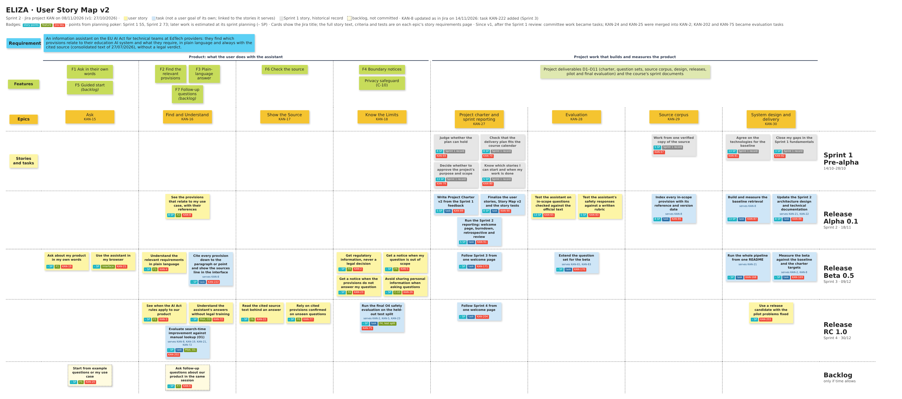

# User Story Map v2

**Version:** v2, Sprint 2 (08/11/2026, for the Sprint 2 review on 18/11/2026) · **Source:** Jira project KAN on 08/11/2026 · **Owner:** Yeşim (Product Owner) · **Previous version:** [User Story Map v1](01-user-story-map-v1.md), end of Sprint 1 (27/10/2026)

Version 2 shows the backlog after the Sprint 1 review: work that is not a user goal of its own is now a task, two overlapping stories are merged, and every current user story now has test cases, written in Sprint 2 ([KAN-114](https://yarengursoy.atlassian.net/browse/KAN-114)). What changed and why is listed [below](#what-changed-since-v1).

## How to read the map

- **Rows, top to bottom (as in the course's example map):** the requirement the product answers; the features from the [Project Executive Summary](../03-project-canvas/01-project-executive-summary.md); the eight epics; then the stories and tasks in the row of the release they belong to, from the [Release Plan](../03-project-canvas/10-release-plan.md): Sprint 1 (pre-alpha), Alpha 0.1 (Sprint 2), Beta 0.5 (Sprint 3), Release candidate 1.0 (Sprint 4) and the backlog.
- **Columns:** the first four epics are what the user does with the assistant: ask, find and understand the provisions, check the source, and know where the assistant stops. The other four epics hold the project work that builds and measures the product (deliverables D1–D11).
- **Cards:** yellow cards are **user stories**, written as in Jira. Blue cards are **tasks**: evaluations, documents and delivery work that serve the users but are not a user goal of their own; each names the user stories it serves ("serves KAN-…"), from the Jira links. Grey cards are **Sprint 1 stories** kept as a historical record (see [below](#sprint-1-stories-historical-records)). Dashed cards are in the backlog and built only if time allows.
- **Badges:** story points, feature and Jira key. Points come from planning poker at the sprint planning; work in Sprints 3 and 4 is estimated at its sprint planning, so it shows "– SP". No point is guessed.
- **Sub-tasks:** every story's and task's sub-tasks are in the [full hierarchy](#full-hierarchy-feature--epic--story-or-task--sub-task) below. Each epic's story requirements page gives the acceptance criteria, the sub-tasks with their "Done when" condition, the test cases and the traceability to the charter.

## Map

To read the cards at any zoom, open the [PDF version of the map](../../docs/images/user-story-map-v2.pdf). The same content is in the table and the full hierarchy below.

## What changed since v1

Found by comparing Jira on 27/10/2026 with Jira on 08/11/2026. The reasons are the instructor's comments on Sprint 1; the full answers are on the [Sprint 1 review page](../04-sprint-1/01-sprint-1-review-page.md#responses-to-the-project-review-committee-feedback-sprint-1).

| Item | Change | Date | Why |
|---|---|---|---|
| [KAN-2](https://yarengursoy.atlassian.net/browse/KAN-2) Get regulatory information, never a legal decision | Renamed from "See the relevant articles without a legal decision"; now holds the criteria and sub-tasks of KAN-24 and KAN-25, with test cases TC-2.4 to TC-2.7 | 07/11/2026 | Sprint 1 review, comment 5 |
| [KAN-24](https://yarengursoy.atlassian.net/browse/KAN-24) Refuse requests to get around the law | Merged into [KAN-2](https://yarengursoy.atlassian.net/browse/KAN-2) (criteria 5–8); its sub-tasks moved to KAN-2; closed without being built separately and taken out of Sprint 3 | 07/11/2026 | Sprint 1 review, comment 5: one story for a user asking for legal advice and its consequences |
| [KAN-25](https://yarengursoy.atlassian.net/browse/KAN-25) See that answers are not legal advice | Merged into [KAN-2](https://yarengursoy.atlassian.net/browse/KAN-2) (criteria 9–11); its sub-tasks moved to KAN-2; closed without being built separately and taken out of Sprint 3 | 07/11/2026 | Sprint 1 review, comment 5: one story for a user asking for legal advice and its consequences |
| [KAN-75](https://yarengursoy.atlassian.net/browse/KAN-75) Run the final O4 safety evaluation on the held-out test split | User story → task; renamed from "Be sure the assistant never gives a legal verdict" | 07/11/2026 | Sprint 1 review, comment 5: the final test-split check of the merged safety story; kept in Sprint 4 so that it does not block [KAN-2](https://yarengursoy.atlassian.net/browse/KAN-2) in Sprint 3 |
| [KAN-86](https://yarengursoy.atlassian.net/browse/KAN-86) Index every in-scope provision with its reference and version date | User story → task | 01/11/2026 | Sprint 1 review, comment 3: indexing the provisions is technical implementation work that supports [KAN-8](https://yarengursoy.atlassian.net/browse/KAN-8), not a user goal of its own |
| [KAN-87](https://yarengursoy.atlassian.net/browse/KAN-87) Build and measure the baseline retrieval | User story → task; renamed from "Measure how well the baseline retrieval finds the expected provisions" | 01/11/2026 | Sprint 1 review, comment 3: building and measuring the baseline retrieval is technical implementation work that supports [KAN-8](https://yarengursoy.atlassian.net/browse/KAN-8), not a user goal of its own |
| [KAN-88](https://yarengursoy.atlassian.net/browse/KAN-88) Update the Sprint 2 architecture design and technical documentation | User story → task; renamed from "Review the system design, the models used and the interface plan" | 01/11/2026 | Sprint 1 review, comment 3: design and documentation work done for the Project Review Committee; it supports [KAN-21](https://yarengursoy.atlassian.net/browse/KAN-21) and [KAN-22](https://yarengursoy.atlassian.net/browse/KAN-22), but is not a user goal |
| [KAN-89](https://yarengursoy.atlassian.net/browse/KAN-89) Write Project Charter v2 from the Sprint 1 feedback | User story → task; renamed from "Check that the Sprint 1 feedback changed the charter" | 01/11/2026 | Sprint 1 review, comment 3: the charter is project documentation for the Project Review Committee, not a user goal |
| [KAN-90](https://yarengursoy.atlassian.net/browse/KAN-90) Finalize the user stories, Story Map v2 and the story tests | User story → task; renamed from "Judge the final user stories and how each one is tested" | 01/11/2026 | Sprint 1 review, comment 3: the story map, story pages and tests are backlog work for the Project Review Committee, not a user goal |
| [KAN-91](https://yarengursoy.atlassian.net/browse/KAN-91) Run the Sprint 2 reporting: welcome page, burndown, retrospective and review | User story → task; renamed from "Follow Sprint 2 from one welcome page" | 01/11/2026 | Sprint 1 review, comment 3: sprint reporting is course documentation for the Project Review Committee, not a user goal |
| [KAN-168](https://yarengursoy.atlassian.net/browse/KAN-168) Run the whole pipeline from one README | User story → task | 07/11/2026 | Sprint 1 review, comment 3: integrating and delivering the pipeline is technical work that supports [KAN-21](https://yarengursoy.atlassian.net/browse/KAN-21), not a user goal of its own |
| [KAN-169](https://yarengursoy.atlassian.net/browse/KAN-169) Measure the beta against the baseline and the charter targets | User story → task | 07/11/2026 | Sprint 1 review, comment 3: measuring the beta is evaluation work for the stories it measures ([KAN-8](https://yarengursoy.atlassian.net/browse/KAN-8), [KAN-2](https://yarengursoy.atlassian.net/browse/KAN-2)), not a user goal of its own |
| [KAN-170](https://yarengursoy.atlassian.net/browse/KAN-170) Extend the question set for the beta | User story → task | 07/11/2026 | Sprint 1 review, comment 3: extending the question set is evaluation work that supports [KAN-65](https://yarengursoy.atlassian.net/browse/KAN-65) and [KAN-83](https://yarengursoy.atlassian.net/browse/KAN-83), not a user goal of its own |
| [KAN-171](https://yarengursoy.atlassian.net/browse/KAN-171) Follow Sprint 3 from one welcome page | User story → task | 07/11/2026 | Sprint 1 review, comment 3: sprint reporting is course documentation for the Project Review Committee, not a user goal |
| [KAN-202](https://yarengursoy.atlassian.net/browse/KAN-202) Evaluate search-time improvement against manual lookup (O1) | User story → task; renamed from "Find the provisions faster than with manual search" | 07/11/2026 | Sprint 1 review, comment 4: speed is an acceptance criterion, not a user goal; it is measured as the O1 pilot evaluation of [KAN-19](https://yarengursoy.atlassian.net/browse/KAN-19), [KAN-8](https://yarengursoy.atlassian.net/browse/KAN-8) and [KAN-21](https://yarengursoy.atlassian.net/browse/KAN-21) |
| [KAN-204](https://yarengursoy.atlassian.net/browse/KAN-204) Follow Sprint 4 from one welcome page | User story → task | 07/11/2026 | Sprint 1 review, comment 3: sprint reporting is course documentation for the Project Review Committee, not a user goal |

Also new since v1: sub-task [KAN-221](https://yarengursoy.atlassian.net/browse/KAN-221) (frequent words for BM25, under task KAN-87), and the cards now show tasks and the stories they serve.

## The map as a table

Sprints as columns and epics as rows, with links to Jira. Story points in brackets. *(task)* marks a task; *(Sprint 1 record)* marks a historical Sprint 1 story.

| Epic | **Sprint 1** · Pre-alpha 14/10–28/10/2026 | **Sprint 2** · Alpha 0.1 28/10–18/11/2026 | **Sprint 3** · Beta 0.5 18/11–09/12/2026 | **Sprint 4** · Release candidate 1.0 09/12–30/12/2026 | **Backlog** only if time allows |
|---|---|---|---|---|---|
| *Goal* | *Charter v1, source manifest and first system design, no production code (C-07)* | *Baseline: question set v1, indexed source text, baseline retrieval measured; Charter v2* | *MVP (Features 1–4): the whole pipeline with the web page runs end to end* | *Pilot with Beta 0.5 plus Feature 6 and application dates; final evaluation and live demo* | *Not committed* |
| **Product** | | | | | |
| **Ask** [KAN-15](https://yarengursoy.atlassian.net/browse/KAN-15) | – | – | [KAN-19](https://yarengursoy.atlassian.net/browse/KAN-19) Ask about my product in my own words [KAN-21](https://yarengursoy.atlassian.net/browse/KAN-21) Use the assistant in my browser | – | [KAN-20](https://yarengursoy.atlassian.net/browse/KAN-20) Start from example questions or my use case |
| **Find and Understand** [KAN-16](https://yarengursoy.atlassian.net/browse/KAN-16) | – | [KAN-8](https://yarengursoy.atlassian.net/browse/KAN-8) See the provisions that relate to my use case, with their references (8) | [KAN-4](https://yarengursoy.atlassian.net/browse/KAN-4) Understand the relevant requirements in plain language | [KAN-3](https://yarengursoy.atlassian.net/browse/KAN-3) See when the AI Act rules apply to our product [KAN-72](https://yarengursoy.atlassian.net/browse/KAN-72) Understand the assistant's answers without legal training [KAN-202](https://yarengursoy.atlassian.net/browse/KAN-202) Evaluate search-time improvement against manual lookup (O1) *(task)* | [KAN-6](https://yarengursoy.atlassian.net/browse/KAN-6) Ask follow-up questions about our product in the same session |
| **Show the Source** [KAN-17](https://yarengursoy.atlassian.net/browse/KAN-17) | – | – | – | [KAN-22](https://yarengursoy.atlassian.net/browse/KAN-22) Read the cited source text behind an answer [KAN-77](https://yarengursoy.atlassian.net/browse/KAN-77) Rely on cited provisions confirmed on unseen questions | – |
| **Know the Limits** [KAN-18](https://yarengursoy.atlassian.net/browse/KAN-18) | – | – | [KAN-2](https://yarengursoy.atlassian.net/browse/KAN-2) Get regulatory information, never a legal decision [KAN-5](https://yarengursoy.atlassian.net/browse/KAN-5) Get a notice when my question is out of scope [KAN-23](https://yarengursoy.atlassian.net/browse/KAN-23) Get a notice when the provisions do not answer my question [KAN-26](https://yarengursoy.atlassian.net/browse/KAN-26) Avoid sharing personal information when asking questions | [KAN-75](https://yarengursoy.atlassian.net/browse/KAN-75) Run the final O4 safety evaluation on the held-out test split *(task)* | – |
| **Project work** | | | | | |
| **Project charter and sprint reporting** [KAN-27](https://yarengursoy.atlassian.net/browse/KAN-27) | [KAN-69](https://yarengursoy.atlassian.net/browse/KAN-69) Judge whether the plan can hold (8) *(Sprint 1 record)* [KAN-70](https://yarengursoy.atlassian.net/browse/KAN-70) Check that the delivery plan fits the course calendar (8) *(Sprint 1 record)* [KAN-79](https://yarengursoy.atlassian.net/browse/KAN-79) Decide whether to approve the project's purpose and scope (13) *(Sprint 1 record)* [KAN-80](https://yarengursoy.atlassian.net/browse/KAN-80) Know which stories I can start and when my work is done (5) *(Sprint 1 record)* | [KAN-89](https://yarengursoy.atlassian.net/browse/KAN-89) Write Project Charter v2 from the Sprint 1 feedback (5) *(task)* [KAN-90](https://yarengursoy.atlassian.net/browse/KAN-90) Finalize the user stories, Story Map v2 and the story tests (8) *(task)* [KAN-91](https://yarengursoy.atlassian.net/browse/KAN-91) Run the Sprint 2 reporting: welcome page, burndown, retrospective and review (5) *(task)* | [KAN-171](https://yarengursoy.atlassian.net/browse/KAN-171) Follow Sprint 3 from one welcome page *(task)* | [KAN-204](https://yarengursoy.atlassian.net/browse/KAN-204) Follow Sprint 4 from one welcome page *(task)* | – |
| **Evaluation** [KAN-28](https://yarengursoy.atlassian.net/browse/KAN-28) | – | [KAN-65](https://yarengursoy.atlassian.net/browse/KAN-65) Test the assistant on in-scope questions checked against the official text (13) [KAN-83](https://yarengursoy.atlassian.net/browse/KAN-83) Test the assistant's safety responses against a written rubric (5) | [KAN-170](https://yarengursoy.atlassian.net/browse/KAN-170) Extend the question set for the beta *(task)* | – | – |
| **Source corpus** [KAN-29](https://yarengursoy.atlassian.net/browse/KAN-29) | [KAN-67](https://yarengursoy.atlassian.net/browse/KAN-67) Work from one verified copy of the source (5) *(Sprint 1 record)* | [KAN-86](https://yarengursoy.atlassian.net/browse/KAN-86) Index every in-scope provision with its reference and version date (8) *(task)* | – | – | – |
| **System design and delivery** [KAN-30](https://yarengursoy.atlassian.net/browse/KAN-30) | [KAN-81](https://yarengursoy.atlassian.net/browse/KAN-81) Agree on the technologies for the baseline (13) *(Sprint 1 record)* [KAN-82](https://yarengursoy.atlassian.net/browse/KAN-82) Close my gaps in the Sprint 1 fundamentals (3) *(Sprint 1 record)* | [KAN-87](https://yarengursoy.atlassian.net/browse/KAN-87) Build and measure the baseline retrieval (13) *(task)* [KAN-88](https://yarengursoy.atlassian.net/browse/KAN-88) Update the Sprint 2 architecture design and technical documentation (8) *(task)* | [KAN-168](https://yarengursoy.atlassian.net/browse/KAN-168) Run the whole pipeline from one README *(task)* [KAN-169](https://yarengursoy.atlassian.net/browse/KAN-169) Measure the beta against the baseline and the charter targets *(task)* | [KAN-203](https://yarengursoy.atlassian.net/browse/KAN-203) Use a release candidate with the pilot problems fixed | – |
| **Total** | 7 Sprint 1 stories (55 points) | 3 user stories, 6 tasks (73 points) | 7 user stories, 4 tasks (points at planning) | 5 user stories, 3 tasks (points at planning) | 2 user stories |

In total: 17 current user stories, 13 tasks and 7 Sprint 1 stories kept as a historical record. KAN-24 and KAN-25 are not counted: they are merged into KAN-2.

## Users in the stories

The roles come from the [Project Organization](../03-project-canvas/08-project-organization.md), which uses the ISO/IEC 5339 stakeholder roles for people outside the team. Since the Sprint 1 review, only people who use the assistant or decide on its use are users in the stories; the Project Review Committee and the team's own roles appear only in the Sprint 1 records.

| Who the story is for | Role (ISO/IEC 5339) | Current user stories |
|---|---|---|
| EdTech AI developer | AI user: a technical team member at an EdTech provider (pilot proxy users in D10) | [KAN-3](https://yarengursoy.atlassian.net/browse/KAN-3), [KAN-4](https://yarengursoy.atlassian.net/browse/KAN-4), [KAN-5](https://yarengursoy.atlassian.net/browse/KAN-5), [KAN-8](https://yarengursoy.atlassian.net/browse/KAN-8), [KAN-19](https://yarengursoy.atlassian.net/browse/KAN-19), [KAN-20](https://yarengursoy.atlassian.net/browse/KAN-20), [KAN-65](https://yarengursoy.atlassian.net/browse/KAN-65), [KAN-72](https://yarengursoy.atlassian.net/browse/KAN-72), [KAN-203](https://yarengursoy.atlassian.net/browse/KAN-203) |
| Technical lead | AI user | [KAN-6](https://yarengursoy.atlassian.net/browse/KAN-6), [KAN-21](https://yarengursoy.atlassian.net/browse/KAN-21), [KAN-26](https://yarengursoy.atlassian.net/browse/KAN-26) |
| ML engineer at an EdTech provider | AI user | [KAN-23](https://yarengursoy.atlassian.net/browse/KAN-23) |
| Compliance officer in an EdTech provider's legal team | AI customer: the legal and compliance team (the course instructors and peer groups as academic proxies) | [KAN-2](https://yarengursoy.atlassian.net/browse/KAN-2), [KAN-22](https://yarengursoy.atlassian.net/browse/KAN-22), [KAN-77](https://yarengursoy.atlassian.net/browse/KAN-77), [KAN-83](https://yarengursoy.atlassian.net/browse/KAN-83) |

## Dependencies between stories and tasks

- [KAN-65](https://yarengursoy.atlassian.net/browse/KAN-65) and [KAN-86](https://yarengursoy.atlassian.net/browse/KAN-86) → [KAN-87](https://yarengursoy.atlassian.net/browse/KAN-87): the baseline is measured on question set v1 (D2) and the indexed source text (D5).
- [KAN-8](https://yarengursoy.atlassian.net/browse/KAN-8) → [KAN-22](https://yarengursoy.atlassian.net/browse/KAN-22): the cited provisions must be found before their text can be shown.
- [KAN-168](https://yarengursoy.atlassian.net/browse/KAN-168) → [KAN-21](https://yarengursoy.atlassian.net/browse/KAN-21) and [KAN-26](https://yarengursoy.atlassian.net/browse/KAN-26): the web page needs the whole pipeline (course halfway check on 02/12/2026).
- [KAN-170](https://yarengursoy.atlassian.net/browse/KAN-170) → [KAN-169](https://yarengursoy.atlassian.net/browse/KAN-169): the beta is measured on the frozen question set v2 (D8).
- [KAN-2](https://yarengursoy.atlassian.net/browse/KAN-2), [KAN-5](https://yarengursoy.atlassian.net/browse/KAN-5) and [KAN-23](https://yarengursoy.atlassian.net/browse/KAN-23) → [KAN-75](https://yarengursoy.atlassian.net/browse/KAN-75): the final safety evaluation on the held-out `test` split checks the safety behaviour built in Sprint 3.
- [KAN-3](https://yarengursoy.atlassian.net/browse/KAN-3) and [KAN-22](https://yarengursoy.atlassian.net/browse/KAN-22) → [KAN-202](https://yarengursoy.atlassian.net/browse/KAN-202) and [KAN-72](https://yarengursoy.atlassian.net/browse/KAN-72): both are in the pilot version by 16/12/2026; the [KAN-72](https://yarengursoy.atlassian.net/browse/KAN-72) survey follows the timed tasks of [KAN-202](https://yarengursoy.atlassian.net/browse/KAN-202).
- [KAN-202](https://yarengursoy.atlassian.net/browse/KAN-202) and [KAN-72](https://yarengursoy.atlassian.net/browse/KAN-72) → [KAN-203](https://yarengursoy.atlassian.net/browse/KAN-203): the release candidate fixes the problems found in the pilot.

## Full hierarchy: feature → epic → story or task → sub-task

Each sub-task is an actionable task with a "Done when" condition in Jira and on its epic's story requirements page. Owners are shown where they are assigned; the others are assigned at the sprint planning.

### Ask ([KAN-15](https://yarengursoy.atlassian.net/browse/KAN-15))

Features: F1 Ask in their own words · F5 Guided start (backlog) · [Story requirements](03-story-requirements-for-epic-kan-15.md)

- **[KAN-19](https://yarengursoy.atlassian.net/browse/KAN-19) Ask about my product in my own words** · User story · Sprint 3 · F1
  - [KAN-137](https://yarengursoy.atlassian.net/browse/KAN-137) Link everyday descriptions to the use case wording
  - [KAN-138](https://yarengursoy.atlassian.net/browse/KAN-138) Answer non-English questions with the English-only notice
  - [KAN-139](https://yarengursoy.atlassian.net/browse/KAN-139) Report the expected-provision rate for questions that name no article
- **[KAN-21](https://yarengursoy.atlassian.net/browse/KAN-21) Use the assistant in my browser** · User story · Sprint 3 · Interface
  - [KAN-154](https://yarengursoy.atlassian.net/browse/KAN-154) Build the one-page interface
  - [KAN-160](https://yarengursoy.atlassian.net/browse/KAN-160) Open the assistant without installation or an account
  - [KAN-161](https://yarengursoy.atlassian.net/browse/KAN-161) Show that the answer is being prepared
  - [KAN-162](https://yarengursoy.atlassian.net/browse/KAN-162) Show a plain error message on a system error
  - [KAN-163](https://yarengursoy.atlassian.net/browse/KAN-163) Measure the answer time on the pilot computer
- **[KAN-20](https://yarengursoy.atlassian.net/browse/KAN-20) Start from example questions or my use case** · User story · Backlog · F5
  - *No sub-tasks yet: written at the sprint planning.*

### Find and Understand ([KAN-16](https://yarengursoy.atlassian.net/browse/KAN-16))

Features: F2 Find the relevant provisions · F3 Plain-language answer · F7 Follow-up questions (backlog) · [Story requirements](04-story-requirements-for-epic-kan-16.md)

- **[KAN-8](https://yarengursoy.atlassian.net/browse/KAN-8) See the provisions that relate to my use case, with their references** · User story · Sprint 2 · 8 points · F2 · Yeşim
  - [KAN-125](https://yarengursoy.atlassian.net/browse/KAN-125) Generate answers from the retrieved chunks · Yeşim
  - [KAN-126](https://yarengursoy.atlassian.net/browse/KAN-126) Show each cited provision with its reference and version date · Yeşim
  - [KAN-127](https://yarengursoy.atlassian.net/browse/KAN-127) Show how several provisions relate · Yeşim
  - [KAN-128](https://yarengursoy.atlassian.net/browse/KAN-128) Check every citation against the retrieved chunk IDs · Yaren
  - [KAN-129](https://yarengursoy.atlassian.net/browse/KAN-129) Report citation coverage and the expected-provision rate on the val split · Yaren
- **[KAN-4](https://yarengursoy.atlassian.net/browse/KAN-4) Understand the relevant requirements in plain language** · User story · Sprint 3 · F3
  - [KAN-133](https://yarengursoy.atlassian.net/browse/KAN-133) Write the answer template
  - [KAN-134](https://yarengursoy.atlassian.net/browse/KAN-134) Explain defined terms once with their Article 3 point
  - [KAN-135](https://yarengursoy.atlassian.net/browse/KAN-135) Check that answers add nothing beyond the retrieved provisions
  - [KAN-136](https://yarengursoy.atlassian.net/browse/KAN-136) Report the answer format and the conditions result on the val split
- **[KAN-3](https://yarengursoy.atlassian.net/browse/KAN-3) See when the AI Act rules apply to our product** · User story · Sprint 4 · F2 · Gözde Nur
  - [KAN-130](https://yarengursoy.atlassian.net/browse/KAN-130) Answer application-date questions with the supporting provision
  - [KAN-131](https://yarengursoy.atlassian.net/browse/KAN-131) Give an insufficient-evidence response when no date is supported
  - [KAN-132](https://yarengursoy.atlassian.net/browse/KAN-132) Report the application-date result on the val and test splits
- **[KAN-72](https://yarengursoy.atlassian.net/browse/KAN-72) Understand the assistant's answers without legal training** · User story · Sprint 4 · Pilot, O3 · Yaren
  - [KAN-73](https://yarengursoy.atlassian.net/browse/KAN-73) Write the post-task survey
  - [KAN-74](https://yarengursoy.atlassian.net/browse/KAN-74) Report the O3 result and the business outcomes
  - [KAN-198](https://yarengursoy.atlassian.net/browse/KAN-198) Run the survey after the timed tasks
- **[KAN-202](https://yarengursoy.atlassian.net/browse/KAN-202) Evaluate search-time improvement against manual lookup (O1)** · Task · Sprint 4 · Pilot, O1 · serves [KAN-8](https://yarengursoy.atlassian.net/browse/KAN-8), [KAN-19](https://yarengursoy.atlassian.net/browse/KAN-19), [KAN-21](https://yarengursoy.atlassian.net/browse/KAN-21), [KAN-72](https://yarengursoy.atlassian.net/browse/KAN-72)
  - [KAN-205](https://yarengursoy.atlassian.net/browse/KAN-205) Write the pilot protocol
  - [KAN-206](https://yarengursoy.atlassian.net/browse/KAN-206) Prepare the pilot computer from the README
  - [KAN-207](https://yarengursoy.atlassian.net/browse/KAN-207) Run the timed pilot tasks in person
  - [KAN-208](https://yarengursoy.atlassian.net/browse/KAN-208) Report the O1 pilot result
- **[KAN-6](https://yarengursoy.atlassian.net/browse/KAN-6) Ask follow-up questions about our product in the same session** · User story · Backlog · F7 · Kaan
  - *No sub-tasks yet: written at the sprint planning.*

### Show the Source ([KAN-17](https://yarengursoy.atlassian.net/browse/KAN-17))

Features: F6 Check the source · [Story requirements](05-story-requirements-for-epic-kan-17.md)

- **[KAN-22](https://yarengursoy.atlassian.net/browse/KAN-22) Read the cited source text behind an answer** · User story · Sprint 4 · F6
  - [KAN-194](https://yarengursoy.atlassian.net/browse/KAN-194) Open the cited provision under the answer
  - [KAN-195](https://yarengursoy.atlassian.net/browse/KAN-195) Show the stored text with its reference and version date
  - [KAN-196](https://yarengursoy.atlassian.net/browse/KAN-196) Name EUR-Lex and link to the consolidated text
  - [KAN-197](https://yarengursoy.atlassian.net/browse/KAN-197) Check the shown texts on the val split
- **[KAN-77](https://yarengursoy.atlassian.net/browse/KAN-77) Rely on cited provisions confirmed on unseen questions** · User story · Sprint 4 · F6 · Yaren
  - [KAN-78](https://yarengursoy.atlassian.net/browse/KAN-78) Run the release candidate on the held-out test split
  - [KAN-199](https://yarengursoy.atlassian.net/browse/KAN-199) Review the in-scope test answers against the rubric
  - [KAN-200](https://yarengursoy.atlassian.net/browse/KAN-200) Report O2 (a)–(d) on the test split

### Know the Limits ([KAN-18](https://yarengursoy.atlassian.net/browse/KAN-18))

Features: F4 Boundary notices · Privacy safeguard (C-10) · [Story requirements](06-story-requirements-for-epic-kan-18.md)

- **[KAN-2](https://yarengursoy.atlassian.net/browse/KAN-2) Get regulatory information, never a legal decision** · User story · Sprint 3 · F4 · Gözde Nur
  - [KAN-146](https://yarengursoy.atlassian.net/browse/KAN-146) Decline legal-decision requests
  - [KAN-147](https://yarengursoy.atlassian.net/browse/KAN-147) Point to the relevant articles when declining
  - [KAN-148](https://yarengursoy.atlassian.net/browse/KAN-148) Add the output check for classifications and compliance verdicts
  - [KAN-149](https://yarengursoy.atlassian.net/browse/KAN-149) Report the legal-decision result on the val split
  - [KAN-150](https://yarengursoy.atlassian.net/browse/KAN-150) Add the input check for evasion and prompt-injection patterns
  - [KAN-151](https://yarengursoy.atlassian.net/browse/KAN-151) Fix the system prompt against override instructions
  - [KAN-152](https://yarengursoy.atlassian.net/browse/KAN-152) Keep condition and exception questions out of the refusal path
  - [KAN-153](https://yarengursoy.atlassian.net/browse/KAN-153) Report the adversarial result on the val split
  - [KAN-155](https://yarengursoy.atlassian.net/browse/KAN-155) Write the notice text
  - [KAN-156](https://yarengursoy.atlassian.net/browse/KAN-156) Show the notice on every screen
- **[KAN-5](https://yarengursoy.atlassian.net/browse/KAN-5) Get a notice when my question is out of scope** · User story · Sprint 3 · F4
  - [KAN-140](https://yarengursoy.atlassian.net/browse/KAN-140) Detect fully and partly out-of-scope questions
  - [KAN-141](https://yarengursoy.atlassian.net/browse/KAN-141) Write the out-of-scope notice
  - [KAN-142](https://yarengursoy.atlassian.net/browse/KAN-142) Report the out-of-scope result on the val split
- **[KAN-23](https://yarengursoy.atlassian.net/browse/KAN-23) Get a notice when the provisions do not answer my question** · User story · Sprint 3 · F4
  - [KAN-143](https://yarengursoy.atlassian.net/browse/KAN-143) Detect when the retrieved provisions do not support an answer
  - [KAN-144](https://yarengursoy.atlassian.net/browse/KAN-144) Answer the supported part and name the missing part
  - [KAN-145](https://yarengursoy.atlassian.net/browse/KAN-145) Report the insufficient-evidence result on the val split
- **[KAN-26](https://yarengursoy.atlassian.net/browse/KAN-26) Avoid sharing personal information when asking questions** · User story · Sprint 3 · C-10
  - [KAN-164](https://yarengursoy.atlassian.net/browse/KAN-164) Show the personal-data reminder
  - [KAN-165](https://yarengursoy.atlassian.net/browse/KAN-165) Warn about e-mail addresses and phone numbers
  - [KAN-166](https://yarengursoy.atlassian.net/browse/KAN-166) Keep questions out of logs and the index, and delete the session at its end
  - [KAN-167](https://yarengursoy.atlassian.net/browse/KAN-167) Run the privacy check on the system used for the pilot
- **[KAN-75](https://yarengursoy.atlassian.net/browse/KAN-75) Run the final O4 safety evaluation on the held-out test split** · Task · Sprint 4 · F4, test split · Yaren · serves [KAN-2](https://yarengursoy.atlassian.net/browse/KAN-2), [KAN-5](https://yarengursoy.atlassian.net/browse/KAN-5), [KAN-23](https://yarengursoy.atlassian.net/browse/KAN-23)
  - [KAN-76](https://yarengursoy.atlassian.net/browse/KAN-76) Check that no test answer contains a verdict
  - [KAN-201](https://yarengursoy.atlassian.net/browse/KAN-201) Report O4 per category on the test split
- ~~[KAN-24](https://yarengursoy.atlassian.net/browse/KAN-24) Refuse requests to get around the law~~ · merged into [KAN-2](https://yarengursoy.atlassian.net/browse/KAN-2) on 07/11/2026
- ~~[KAN-25](https://yarengursoy.atlassian.net/browse/KAN-25) See that answers are not legal advice~~ · merged into [KAN-2](https://yarengursoy.atlassian.net/browse/KAN-2) on 07/11/2026

### Project charter and sprint reporting ([KAN-27](https://yarengursoy.atlassian.net/browse/KAN-27))

Features: Charter v1 and v2 (D1, D7), user stories, sprint documents · [Story requirements](07-story-requirements-for-epic-kan-27.md)

- **[KAN-69](https://yarengursoy.atlassian.net/browse/KAN-69) Judge whether the plan can hold** · Sprint 1 story (historical record) · Sprint 1 · 8 points · Gözde Nur
  - [KAN-14](https://yarengursoy.atlassian.net/browse/KAN-14) Write Risks page and link it to Assumptions & Constraints · Gözde Nur
  - [KAN-33](https://yarengursoy.atlassian.net/browse/KAN-33) Write the Assumptions and Constraints Page · Gözde Nur
  - [KAN-38](https://yarengursoy.atlassian.net/browse/KAN-38) Write the Facilities and Resources Page · Kaan
  - [KAN-39](https://yarengursoy.atlassian.net/browse/KAN-39) Write the Dependencies Page · Yaren
- **[KAN-70](https://yarengursoy.atlassian.net/browse/KAN-70) Check that the delivery plan fits the course calendar** · Sprint 1 story (historical record) · Sprint 1 · 8 points · Yeşim
  - [KAN-32](https://yarengursoy.atlassian.net/browse/KAN-32) Write the Milestones Page · Yaren
  - [KAN-34](https://yarengursoy.atlassian.net/browse/KAN-34) Write the Deliverables Page · Yeşim
  - [KAN-35](https://yarengursoy.atlassian.net/browse/KAN-35) Write the Project Organization Page · Yeşim
  - [KAN-36](https://yarengursoy.atlassian.net/browse/KAN-36) Write the Major Activities Page · Yeşim
  - [KAN-37](https://yarengursoy.atlassian.net/browse/KAN-37) Write the Release Plan Page · Yeşim
- **[KAN-79](https://yarengursoy.atlassian.net/browse/KAN-79) Decide whether to approve the project's purpose and scope** · Sprint 1 story (historical record) · Sprint 1 · 13 points · Kaan
  - [KAN-31](https://yarengursoy.atlassian.net/browse/KAN-31) Write the Project Executive Summary (Scope) Page · Kaan
  - [KAN-40](https://yarengursoy.atlassian.net/browse/KAN-40) Check consistency across all charter pages and submit Project Charter v1 · Yeşim
- **[KAN-80](https://yarengursoy.atlassian.net/browse/KAN-80) Know which stories I can start and when my work is done** · Sprint 1 story (historical record) · Sprint 1 · 5 points · Yaren
  - [KAN-41](https://yarengursoy.atlassian.net/browse/KAN-41) Review and rewrite the user stories in Jira · Yeşim
  - [KAN-42](https://yarengursoy.atlassian.net/browse/KAN-42) Write the Story Requirements pages and User Story Map v1 · Yeşim
  - [KAN-43](https://yarengursoy.atlassian.net/browse/KAN-43) Write the Definition of Ready and Definition of Done · Yaren
  - [KAN-44](https://yarengursoy.atlassian.net/browse/KAN-44) Write the Sprint 1 welcome page and prepare the Sprint 1 review · Yeşim
  - [KAN-64](https://yarengursoy.atlassian.net/browse/KAN-64) Set up the repository folders for Sprint 1 outputs · Yeşim
- **[KAN-89](https://yarengursoy.atlassian.net/browse/KAN-89) Write Project Charter v2 from the Sprint 1 feedback** · Task · Sprint 2 · 5 points · Yaren
  - [KAN-106](https://yarengursoy.atlassian.net/browse/KAN-106) Write the response table for the Sprint 1 review comments · Yeşim
  - [KAN-107](https://yarengursoy.atlassian.net/browse/KAN-107) Update the Scope Definition with the final provision list · Kaan
  - [KAN-108](https://yarengursoy.atlassian.net/browse/KAN-108) Review the O1 and O3 target levels with the alpha results · Yaren
  - [KAN-109](https://yarengursoy.atlassian.net/browse/KAN-109) Record the feedback on the O2 and O4 levels · Kaan
  - [KAN-110](https://yarengursoy.atlassian.net/browse/KAN-110) Update Risks with the Sprint 2 problems · Yaren
  - [KAN-111](https://yarengursoy.atlassian.net/browse/KAN-111) Mark what is new on every changed page and open the pull request · Yeşim
  - [KAN-158](https://yarengursoy.atlassian.net/browse/KAN-158) Name the five pilot users and confirm their dates · Gözde Nur
- **[KAN-90](https://yarengursoy.atlassian.net/browse/KAN-90) Finalize the user stories, Story Map v2 and the story tests** · Task · Sprint 2 · 8 points · Yeşim
  - [KAN-112](https://yarengursoy.atlassian.net/browse/KAN-112) Update the User Story Map to v2 · Yeşim
  - [KAN-113](https://yarengursoy.atlassian.net/browse/KAN-113) Write the story requirements page for every epic · Yeşim
  - [KAN-114](https://yarengursoy.atlassian.net/browse/KAN-114) Write a test case for every user story · Yeşim
  - [KAN-115](https://yarengursoy.atlassian.net/browse/KAN-115) Estimate the backlog with planning poker · Yaren
  - [KAN-116](https://yarengursoy.atlassian.net/browse/KAN-116) Check the story roles against ISO/IEC 5339 · Yaren
- **[KAN-91](https://yarengursoy.atlassian.net/browse/KAN-91) Run the Sprint 2 reporting: welcome page, burndown, retrospective and review** · Task · Sprint 2 · 5 points · Yaren
  - [KAN-117](https://yarengursoy.atlassian.net/browse/KAN-117) Agree on the Sprint 2 DoR, DoD and sprint goal · Yaren
  - [KAN-118](https://yarengursoy.atlassian.net/browse/KAN-118) Add the Sprint 2 burndown chart · Yeşim
  - [KAN-119](https://yarengursoy.atlassian.net/browse/KAN-119) Export the Jira backlog · Yaren
  - [KAN-120](https://yarengursoy.atlassian.net/browse/KAN-120) Hold the Sprint 2 retrospective · Yaren
  - [KAN-121](https://yarengursoy.atlassian.net/browse/KAN-121) Write the Sprint 2 welcome page · Yeşim
  - [KAN-122](https://yarengursoy.atlassian.net/browse/KAN-122) Prepare the Sprint 2 demo · Kaan
  - [KAN-123](https://yarengursoy.atlassian.net/browse/KAN-123) Review the assigned team's Sprint 2 deliverables · Yeşim
  - [KAN-124](https://yarengursoy.atlassian.net/browse/KAN-124) Answer the reviewers and copy the review page · Yeşim
- **[KAN-171](https://yarengursoy.atlassian.net/browse/KAN-171) Follow Sprint 3 from one welcome page** · Task · Sprint 3
  - [KAN-187](https://yarengursoy.atlassian.net/browse/KAN-187) Agree on the Sprint 3 DoR, DoD and sprint goal
  - [KAN-188](https://yarengursoy.atlassian.net/browse/KAN-188) Answer the Sprint 2 review items with links to the fixes
  - [KAN-189](https://yarengursoy.atlassian.net/browse/KAN-189) Add the Sprint 3 burndown chart
  - [KAN-190](https://yarengursoy.atlassian.net/browse/KAN-190) Export the Jira backlog for Sprint 3
  - [KAN-191](https://yarengursoy.atlassian.net/browse/KAN-191) Hold the Sprint 3 retrospective
  - [KAN-192](https://yarengursoy.atlassian.net/browse/KAN-192) Write the Sprint 3 welcome page
  - [KAN-193](https://yarengursoy.atlassian.net/browse/KAN-193) Prepare the Sprint 3 demo and do the reviews
- **[KAN-204](https://yarengursoy.atlassian.net/browse/KAN-204) Follow Sprint 4 from one welcome page** · Task · Sprint 4
  - [KAN-213](https://yarengursoy.atlassian.net/browse/KAN-213) Write the Sprint 4 goal, DoR and DoD with the Sprint 3 follow-ups
  - [KAN-214](https://yarengursoy.atlassian.net/browse/KAN-214) Run every story test and report the results
  - [KAN-215](https://yarengursoy.atlassian.net/browse/KAN-215) Write the Sprint 4 technical summary
  - [KAN-216](https://yarengursoy.atlassian.net/browse/KAN-216) Add the Sprint 4 burndown, Jira export and retrospective
  - [KAN-217](https://yarengursoy.atlassian.net/browse/KAN-217) Write the Sprint 4 welcome page
  - [KAN-218](https://yarengursoy.atlassian.net/browse/KAN-218) Give the final demo

### Evaluation ([KAN-28](https://yarengursoy.atlassian.net/browse/KAN-28))

Features: Q&A datasets (D2, D8), rubric, evaluation runs on the `val` split · [Story requirements](08-story-requirements-for-epic-kan-28.md)

- **[KAN-65](https://yarengursoy.atlassian.net/browse/KAN-65) Test the assistant on in-scope questions checked against the official text** · User story · Sprint 2 · 13 points · Yeşim
  - [KAN-45](https://yarengursoy.atlassian.net/browse/KAN-45) Write evaluation questions for use case (a) admission · Yeşim
  - [KAN-46](https://yarengursoy.atlassian.net/browse/KAN-46) Write evaluation questions for use case (b) learning-outcome assessment · Gözde Nur
  - [KAN-47](https://yarengursoy.atlassian.net/browse/KAN-47) Write evaluation questions for use case (c) level placement · Kaan
  - [KAN-48](https://yarengursoy.atlassian.net/browse/KAN-48) Select and adapt at least 5 questions from published work on the EU AI Act · Yeşim
  - [KAN-51](https://yarengursoy.atlassian.net/browse/KAN-51) Check the gold sources of all evaluation questions against the official text · Yeşim
  - [KAN-52](https://yarengursoy.atlassian.net/browse/KAN-52) Cross-check the evaluation questions and resolve the flags · Yaren
  - [KAN-53](https://yarengursoy.atlassian.net/browse/KAN-53) Split the evaluation set into val and test and freeze the test split · Gözde Nur
  - [KAN-66](https://yarengursoy.atlassian.net/browse/KAN-66) Write evaluation questions for use case (d) exam monitoring · Yaren
  - [KAN-84](https://yarengursoy.atlassian.net/browse/KAN-84) Map the provision list to the D2 questions · Kaan
  - [KAN-85](https://yarengursoy.atlassian.net/browse/KAN-85) Write the D2 data card · Yeşim
- **[KAN-83](https://yarengursoy.atlassian.net/browse/KAN-83) Test the assistant's safety responses against a written rubric** · User story · Sprint 2 · 5 points · Kaan
  - [KAN-49](https://yarengursoy.atlassian.net/browse/KAN-49) Write the safety evaluation questions · Yeşim
  - [KAN-50](https://yarengursoy.atlassian.net/browse/KAN-50) Write the evaluation rubric · Kaan
- **[KAN-170](https://yarengursoy.atlassian.net/browse/KAN-170) Extend the question set for the beta** · Task · Sprint 3 · serves [KAN-65](https://yarengursoy.atlassian.net/browse/KAN-65), [KAN-83](https://yarengursoy.atlassian.net/browse/KAN-83)
  - [KAN-183](https://yarengursoy.atlassian.net/browse/KAN-183) Add new questions from the baseline errors
  - [KAN-184](https://yarengursoy.atlassian.net/browse/KAN-184) Balance the question categories in each split
  - [KAN-185](https://yarengursoy.atlassian.net/browse/KAN-185) Freeze the val split and fix the new test questions
  - [KAN-186](https://yarengursoy.atlassian.net/browse/KAN-186) Update the data card change log

### Source corpus ([KAN-29](https://yarengursoy.atlassian.net/browse/KAN-29))

Features: Source manifest and provision list (D3), preprocessing (D5) · [Story requirements](09-story-requirements-for-epic-kan-29.md)

- **[KAN-67](https://yarengursoy.atlassian.net/browse/KAN-67) Work from one verified copy of the source** · Sprint 1 story (historical record) · Sprint 1 · 5 points · Yeşim
  - [KAN-54](https://yarengursoy.atlassian.net/browse/KAN-54) Store the consolidated text and write the source manifest · Yeşim
  - [KAN-55](https://yarengursoy.atlassian.net/browse/KAN-55) Write the in-scope provision list · Yeşim
- **[KAN-86](https://yarengursoy.atlassian.net/browse/KAN-86) Index every in-scope provision with its reference and version date** · Task · Sprint 2 · 8 points · Gözde Nur · serves [KAN-8](https://yarengursoy.atlassian.net/browse/KAN-8)
  - [KAN-92](https://yarengursoy.atlassian.net/browse/KAN-92) Parse the stored EUR-Lex text into provisions · Gözde Nur
  - [KAN-93](https://yarengursoy.atlassian.net/browse/KAN-93) Chunk the provisions and add their metadata · Gözde Nur
  - [KAN-94](https://yarengursoy.atlassian.net/browse/KAN-94) Check 20 random chunks against the source text · Yaren
  - [KAN-95](https://yarengursoy.atlassian.net/browse/KAN-95) Write the preprocessing report · Yaren
  - [KAN-96](https://yarengursoy.atlassian.net/browse/KAN-96) Complete the corpus datasheet · Yeşim
  - [KAN-157](https://yarengursoy.atlassian.net/browse/KAN-157) Check EUR-Lex for a newer consolidated version · Yeşim

### System design and delivery ([KAN-30](https://yarengursoy.atlassian.net/browse/KAN-30))

Features: Design document and spikes (D4), alpha, beta, release candidate (D6, D9, D11) · [Story requirements](10-story-requirements-for-epic-kan-30.md)

- **[KAN-81](https://yarengursoy.atlassian.net/browse/KAN-81) Agree on the technologies for the baseline** · Sprint 1 story (historical record) · Sprint 1 · 13 points · Gözde Nur
  - [KAN-56](https://yarengursoy.atlassian.net/browse/KAN-56) Spike: parse and chunk the EUR-Lex HTML · Gözde Nur
  - [KAN-57](https://yarengursoy.atlassian.net/browse/KAN-57) Spike: run open-source quantized models on CPU, check their licences and record the answer time · Gözde Nur
  - [KAN-58](https://yarengursoy.atlassian.net/browse/KAN-58) Write the ADRs for the model, embedding, vector store and user interface choices · Gözde Nur
  - [KAN-59](https://yarengursoy.atlassian.net/browse/KAN-59) Write the System Architecture Design Document v1 with the architecture diagram · Kaan
- **[KAN-82](https://yarengursoy.atlassian.net/browse/KAN-82) Close my gaps in the Sprint 1 fundamentals** · Sprint 1 story (historical record) · Sprint 1 · 3 points · Yaren
  - [KAN-60](https://yarengursoy.atlassian.net/browse/KAN-60) Learning spike: RAG indexing and query phases · Yeşim
  - [KAN-61](https://yarengursoy.atlassian.net/browse/KAN-61) Learning spike: LLM basics and prompt engineering · Yaren
  - [KAN-62](https://yarengursoy.atlassian.net/browse/KAN-62) Learning spike: Scrum, Git and prompt engineering · Gözde Nur
  - [KAN-63](https://yarengursoy.atlassian.net/browse/KAN-63) Learning spike: evaluation basics and Recall@5 · Kaan
- **[KAN-87](https://yarengursoy.atlassian.net/browse/KAN-87) Build and measure the baseline retrieval** · Task · Sprint 2 · 13 points · Gözde Nur · serves [KAN-8](https://yarengursoy.atlassian.net/browse/KAN-8)
  - [KAN-97](https://yarengursoy.atlassian.net/browse/KAN-97) Build the vector index and the retriever · Gözde Nur
  - [KAN-98](https://yarengursoy.atlassian.net/browse/KAN-98) Set up the README, pinned requirements and prompts folder · Gözde Nur
  - [KAN-99](https://yarengursoy.atlassian.net/browse/KAN-99) Run Recall@5 and the comparison without and with retrieval on the val split · Gözde Nur
  - [KAN-100](https://yarengursoy.atlassian.net/browse/KAN-100) Write the baseline experiment card · Kaan
  - [KAN-101](https://yarengursoy.atlassian.net/browse/KAN-101) Write the Sprint 2 technical summary · Kaan
  - [KAN-221](https://yarengursoy.atlassian.net/browse/KAN-221) Label the frequent words with an LLM jury and test word removal for BM25 · Gözde Nur
- **[KAN-88](https://yarengursoy.atlassian.net/browse/KAN-88) Update the Sprint 2 architecture design and technical documentation** · Task · Sprint 2 · 8 points · Kaan · serves [KAN-21](https://yarengursoy.atlassian.net/browse/KAN-21), [KAN-22](https://yarengursoy.atlassian.net/browse/KAN-22)
  - [KAN-102](https://yarengursoy.atlassian.net/browse/KAN-102) Update the design document for Sprint 2 · Kaan
  - [KAN-103](https://yarengursoy.atlassian.net/browse/KAN-103) Choose the user interface technology · Kaan
  - [KAN-104](https://yarengursoy.atlassian.net/browse/KAN-104) Draw the user interface mockup · Kaan
  - [KAN-105](https://yarengursoy.atlassian.net/browse/KAN-105) Write the Software Bill of Materials · Kaan
- **[KAN-168](https://yarengursoy.atlassian.net/browse/KAN-168) Run the whole pipeline from one README** · Task · Sprint 3 · serves [KAN-21](https://yarengursoy.atlassian.net/browse/KAN-21)
  - [KAN-172](https://yarengursoy.atlassian.net/browse/KAN-172) Connect the interface to the full pipeline
  - [KAN-173](https://yarengursoy.atlassian.net/browse/KAN-173) Update the README for the full pipeline
  - [KAN-174](https://yarengursoy.atlassian.net/browse/KAN-174) Add a screenshot of the interface answering a question
  - [KAN-175](https://yarengursoy.atlassian.net/browse/KAN-175) Update the design document, spike notes and SBOM for Sprint 3
  - [KAN-176](https://yarengursoy.atlassian.net/browse/KAN-176) Follow the Git rules for Sprint 3 and upload the zip
- **[KAN-169](https://yarengursoy.atlassian.net/browse/KAN-169) Measure the beta against the baseline and the charter targets** · Task · Sprint 3 · serves [KAN-2](https://yarengursoy.atlassian.net/browse/KAN-2), [KAN-8](https://yarengursoy.atlassian.net/browse/KAN-8)
  - [KAN-177](https://yarengursoy.atlassian.net/browse/KAN-177) Plan the experiments and their parameter space
  - [KAN-178](https://yarengursoy.atlassian.net/browse/KAN-178) Run the experiments in Weights & Biases
  - [KAN-179](https://yarengursoy.atlassian.net/browse/KAN-179) Re-run the best configurations with at least 3 seeds
  - [KAN-180](https://yarengursoy.atlassian.net/browse/KAN-180) Report O2 and O4 on the frozen D8 val split
  - [KAN-181](https://yarengursoy.atlassian.net/browse/KAN-181) Review the in-scope val answers against the rubric
  - [KAN-182](https://yarengursoy.atlassian.net/browse/KAN-182) Write the Sprint 3 technical summary
- **[KAN-203](https://yarengursoy.atlassian.net/browse/KAN-203) Use a release candidate with the pilot problems fixed** · User story · Sprint 4
  - [KAN-209](https://yarengursoy.atlassian.net/browse/KAN-209) Log the problems seen during the pilot
  - [KAN-210](https://yarengursoy.atlassian.net/browse/KAN-210) Fix the pilot errors without adding features
  - [KAN-211](https://yarengursoy.atlassian.net/browse/KAN-211) Update the final documents to describe the demo system
  - [KAN-212](https://yarengursoy.atlassian.net/browse/KAN-212) Follow the Git rules for Sprint 4 and upload the zip

## Sprint 1 stories (historical records)

These 7 stories ([KAN-67](https://yarengursoy.atlassian.net/browse/KAN-67), [KAN-69](https://yarengursoy.atlassian.net/browse/KAN-69), [KAN-70](https://yarengursoy.atlassian.net/browse/KAN-70), [KAN-79](https://yarengursoy.atlassian.net/browse/KAN-79), [KAN-80](https://yarengursoy.atlassian.net/browse/KAN-80), [KAN-81](https://yarengursoy.atlassian.net/browse/KAN-81), [KAN-82](https://yarengursoy.atlassian.net/browse/KAN-82)) were written, built and closed in Sprint 1, before the Sprint 1 review. They are kept as they were written, because they are part of the Sprint 1 record (burndown and backlog export). Since the review (comment 3), work of this kind is a task, not a user story. They are retained solely as historical sprint records and are excluded from the Sprint 2 test-case preparation ([KAN-114](https://yarengursoy.atlassian.net/browse/KAN-114)); their original Jira records remain unchanged.

The closed stories KAN-10 to KAN-13 (the four education use-case scenarios) are not on the map: on 25/10/2026 their content was moved into the test cases of KAN-8, KAN-2 and KAN-3 and into the evaluation questions.

## Story requirements pages

- [Ask (KAN-15)](03-story-requirements-for-epic-kan-15.md)
- [Find and Understand (KAN-16)](04-story-requirements-for-epic-kan-16.md)
- [Show the Source (KAN-17)](05-story-requirements-for-epic-kan-17.md)
- [Know the Limits (KAN-18)](06-story-requirements-for-epic-kan-18.md)
- [Project charter and sprint reporting (KAN-27)](07-story-requirements-for-epic-kan-27.md)
- [Evaluation (KAN-28)](08-story-requirements-for-epic-kan-28.md)
- [Source corpus (KAN-29)](09-story-requirements-for-epic-kan-29.md)
- [System design and delivery (KAN-30)](10-story-requirements-for-epic-kan-30.md)
