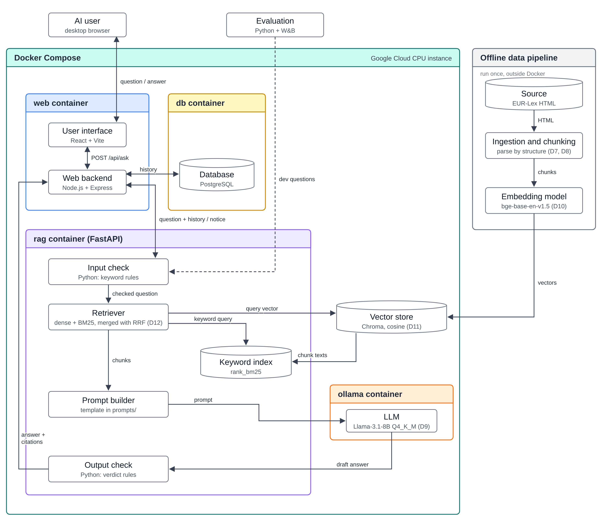

# System Architecture Design Document

**Note: this document uses HTML tags to disable rendering of instructions. View the raw file for further details.**

<!--
How to use this template
- Start short and update the document every sprint. It is a working document, not a finished blueprint [1] [2].
- Propose changes through pull requests [2]. After merge, this page is published to Confluence, where instructors and peer reviewers comment.
-->

| Team  | Sprint   | Status   | Last updated | Updated by    |
| ----- | -------- | -------- | ------------ | ------------- |
| ELIZA | Sprint 1 | proposed | 2026-10-20   | Kaan Kocatürk |

<!--
Status [2]:
- proposed: drafted, waiting for feedback
- accepted: reviewed and agreed; work can start
- revised: changed after feedback or a new decision (see Change log)
- implemented: built as described
-->

## 1. Summary

<!--
One paragraph anyone can follow: what the system does, its main parts, and how they work together [1].
Link to the charter instead of restating it.
-->

ELIZA answers questions from technical teams at EdTech providers about the EU AI Act provisions that relate to their education use case (scope: [Project Executive Summary](03-project-canvas/01-project-executive-summary.md), [C-04](03-project-canvas/03-assumptions-and-constraints.md)). A React page sends each question to a Node.js web backend, which keeps the conversation of the current session in a PostgreSQL database, deletes it when the session ends, and forwards each question with its recent history to a Python RAG service. The RAG service checks the question, retrieves the most relevant provisions, asks a small quantized open-source LLM (C-03) to answer only from them, and checks the answer's citations and wording before it is returned. The provisions are prepared once by an offline script that splits the consolidated text into provision-level chunks and stores their vectors in a vector store. All services, including the database, run with Docker Compose on one CPU machine. The technologies inside the RAG service and the offline pipeline are proposals from Spike 01 and are still open (section 7).

## 2. Goals and non-goals

### Goals

<!-- The charter objectives this design serves, with links to their success criteria [1]. -->

The design serves the four objectives and their success criteria in the [Project Executive Summary](03-project-canvas/01-project-executive-summary.md):

- O1 Faster: answers are produced on a CPU without waiting for a hosted API; the answer time is the main design risk (R-10).
- O2 Grounded: the LLM answers only from the retrieved provisions, and the output check removes citations that are not among them.
- O3 Clear: the prompt asks for a short plain-language summary first, and the interface shows the text of every cited provision.
- O4 Safe: the input check returns a notice for out-of-scope, legal-decision and personal-data questions, and the output check blocks verdict wording (C-08).

### Non-goals

<!-- What this design leaves out on purpose [1]. -->

- Token streaming: the answer is not streamed word by word. The output check runs on the complete answer, so the user only sees checked text.
- Model training or fine-tuning: the LLM and the embedding model are used as published; the design changes only prompts, retrieval and checks (C-03).
- More than one instance: one machine and one process per service. There is no horizontal scaling and no shared cache such as Redis.

## 3. System architecture diagram

<!--
ISO/IEC 5338: 6.4.4 System architecture definition process.
Show which technologies you use and how they connect. Update the diagram as the design changes; give each version a number and date.
Label each box with the component and its technology. Label each arrow with what passes along it.

Use one tool and delete the other option below:
- Miro: https://miro.com/diagramming/software-architecture-diagram/
  Export the board as PNG into docs/images/, embed it, and link the board.
- Mermaid flowchart: https://mermaid.js.org/syntax/flowchart.html
  Write the diagram in a ```mermaid block.
-->

**Version:** v1.1 (2026-10-25)



Diagram source: [system-architecture-v1.svg](../docs/images/system-architecture-v1.svg)

## 4. Components

<!-- One row per box in the diagram. -->

| Component              | Responsibility                                                                                                                                                                                                                                                                                             | Technology and version                                                                                                                                                    | SBOM entry     |
| ---------------------- | ---------------------------------------------------------------------------------------------------------------------------------------------------------------------------------------------------------------------------------------------------------------------------------------------------------- | ------------------------------------------------------------------------------------------------------------------------------------------------------------------------- | -------------- |
| AI user                | Technical team member at an EdTech provider who asks questions in a desktop browser                                                                                                                                                                                                                        | External actor                                                                                                                                                            | —              |
| Evaluation             | Sends the evaluation questions to the RAG service, computes the metrics and logs every run                                                                                                                                                                                                                 | Python scripts (open) + Weights & Biases (course tool)                                                                                                                    | not yet listed |
| Source                 | Official consolidated text of Regulation (EU) 2024/1689, version 27/07/2026 (C-01, C-09)                                                                                                                                                                                                                   | EUR-Lex HTML, CELEX 02024R1689-20260727                                                                                                                                   | not yet listed |
| Ingestion and chunking | Reads the HTML and splits it into one chunk per paragraph or Annex point, with its Article/Annex identifier, heading text and the version date | Python script rag/ingest.py; BeautifulSoup (proposed); parse by structure, no size-based chunking (D7, D8) |
| Embedding model        | Turns each chunk, and each question at query time, into a vector | bge-base-en-v1.5 via sentence-transformers (proposed, D10) |
| User interface         | Question box, answer with cited provisions and their text, permanent not-legal-advice notice, a reminder not to enter personal data with a statement of how questions are stored, and a warning before sending a question that contains an e-mail address or phone number (KAN-21, KAN-22, KAN-25, KAN-26) | React, built with Vite; version pinned in the SBOM                                                                                                                        | not yet listed |
| Web backend            | Session handling with a session cookie, reading and writing the conversation history in the database, rate limiting, anonymous logs without question content, error messages, forwarding questions to the RAG service                                                                                      | Node.js + Express; version pinned in the SBOM                                                                                                                             | not yet listed |
| Database               | Keeps the question-answer pairs of the current session, so a conversation survives a restart of the web backend; deletes them when the session ends. The web backend reads the most recent pairs for each question (D4)                                                                                    | PostgreSQL in the db container, data in data/postgres/; version pinned in the SBOM                                                                                        | not yet listed |
| Input check            | Decides whether a question is in scope, asks for a legal decision or contains personal data, and returns a notice instead of an answer when needed | Python in the RAG service; keyword rules for evasion and out-of-scope questions, tested in the [model selection spike](../docs/spikes/model-selection-spike-gozde-nur.md) ([checks.py](../docs/spikes/model-selection/checks.py)); personal-data rules open ([KAN-49](https://yarengursoy.atlassian.net/browse/KAN-49)) |
| Retriever              | Runs a keyword search and a vector search for every question and combines them into the most relevant chunks | Python in the RAG service; E1 dense top-k, E2 hybrid BM25 + vector search merged with RRF (k = 60); top-k chosen by Recall@k on the dev split; no reranker (proposed, D12) |
| Keyword index          | BM25 index over the chunk texts, rebuilt from the vector store each time the RAG service starts | rank_bm25, in memory (proposed, D12) |
| Prompt builder         | Fills the prompt template with the retrieved chunks and the session history                                                                                                                                                                                                                                | Prompt template file in prompts/; rules open                                                                                                                              | not yet listed |
| LLM                    | Writes the answer from the retrieved chunks, with a citation for every statement | Llama-3.1-8B-Instruct, 4-bit `Q4_K_M`, served by Ollama; fallback Phi-4-mini-instruct `Q4_K_M`; temperature 0 (proposed, D9) |
| Output check           | Removes citations that are not among the retrieved chunks, blocks verdict wording and adds the version date | Python in the RAG service; verdict-wording rules tested in the [model selection spike](../docs/spikes/model-selection-spike-gozde-nur.md) ([checks.py](../docs/spikes/model-selection/checks.py)); citation-ID check open |
| Vector store           | Stores the vectors, chunk texts and metadata; returns the closest chunks to a question vector | Chroma, cosine distance, data in data/vector-store/ (proposed, D11) |

## 5. Design details

### Data pipeline

<!-- Sources, cleaning, labelling, splits, storage, and how data reaches the model. ISO/IEC 5338: 6.4.8 AI data engineering process. -->

**NLP pipeline** (v1, 2026-10-25; decisions D7–D12):


Diagram source: [nlp-pipeline-v1.svg](../docs/images/nlp-pipeline-v1.svg)

- Source: the consolidated text of 27/07/2026 from EUR-Lex is the only source (C-01). The project covers this version only, so the pipeline runs once.
- Preparation: python rag/ingest.py runs once on the host machine, outside Docker. It parses the HTML, splits it into provision-level chunks, attaches the Article/Annex identifier and the version date to each chunk, computes the vectors with the embedding model and writes them to the vector store in data/vector-store/. Each chunk is one Article paragraph or Annex point (D7). Its text starts with its place in the regulation, for example `Article 6 – Classification rules for high-risk AI systems – paragraph 3:`, so that a short point such as "(a) the AI system is intended to perform a narrow procedural task;" still makes sense on its own. Metadata: `article` or `annex`, `paragraph`, `point`, title, chapter and `version_date` = 2026-07-27; the citation shown to the user is built from these fields. The script checks that every in-scope provision is present and that no chunk lacks an identifier (deliverable D5).
- Storage: data/vector-store/ is bind-mounted into the rag container, so the index survives rebuilds of the containers. The keyword index is not stored; the RAG service rebuilds it in memory from the chunk texts in the vector store when it starts (about 190 chunks).
- Consistency: ingest.py and the rag container install the same requirements.txt, so both use the same library versions and the same embedding model.
- No user data in the index: questions and answers never enter the pipeline or the vector index; they are kept only in the database, for the current session (D4).

### Model

<!-- How the model is selected, trained, tuned or prompted. ISO/IEC 5338: 6.4.9 Implementation process. -->

- Selection: Llama-3.1-8B-Instruct, 4-bit (`Q4_K_M`), served by Ollama, with Phi-4-mini-instruct as fallback (D9). Five open-source models were tested on the same questions in the [model selection spike](../docs/spikes/model-selection-spike-gozde-nur.md). The answer time on the deployment CPU is measured in Sprint 2.
- Settings: temperature 0 (the same answer every time, so runs can be compared), at most 300 answer tokens, context window 4,096 tokens.
- No training: the model is not trained or fine-tuned; behaviour is controlled by the prompt, the retrieved chunks and the checks.
- Prompting: the prompt template lives in prompts/ and is versioned. The prompt tested in the model selection spike tells the model to answer only from the retrieved chunks, to cite the provision for every statement, to say when the text does not answer the question, and never to give a classification or compliance verdict. It contains one example answer that is not taken from the evaluation questions.
- Conversation context: the web backend reads the most recent question-answer pairs of the session (how many is open, section 7) from the database and sends them with each question, so follow-up questions can use the product description given earlier (C-04, KAN-6).

### Evaluation

<!-- Metrics, the baseline you compare against, and how validation data is kept separate from test data. ISO/IEC 5338: 6.4.11 Verification process. -->

- How it runs: the evaluation scripts send the questions directly to POST /answer on the RAG service, with the history field for follow-up questions. They do not go through the web backend, which is why all safety checks run in the RAG service.
- Metrics (proposed, open): Recall@5 (the expected provision is among the 5 retrieved chunks), citation match (every cited ID is a retrieved chunk), and the share of safety questions that receive the expected notice. Every run is logged to Weights & Biases.
- Baseline (proposed, open): the same LLM with the same prompt but without retrieved chunks, so the comparison shows what retrieval adds.
- Data separation: the evaluation set (deliverable D2) is split into dev and test; tuning uses only dev, and the test split is frozen and used once per release (R-16).

### Interfaces

<!-- One row per arrow in the diagram. ISO/IEC 5338: 6.4.10 Integration process. -->

| From                   | To                     | What passes                                                                                                    | Format or protocol                                         |
| ---------------------- | ---------------------- | -------------------------------------------------------------------------------------------------------------- | ---------------------------------------------------------- |
| AI user                | User interface         | Question; the answer with the text of each cited provision and the not-legal-advice notice                     | HTTPS, desktop browser                                     |
| User interface         | Web backend            | Question; answer, citations and notice                                                                         | POST /api/ask, JSON; session cookie                        |
| Web backend            | Database               | Session id; read and write the question-answer pairs of the current session, delete them when the session ends | SQL over the internal Docker network (PostgreSQL protocol) |
| Web backend            | Input check            | Question and history; a notice instead of an answer (out_of_scope, verdict_request, personal_data)             | POST /answer on the internal Docker network, JSON          |
| Evaluation             | Input check            | Evaluation questions, with history for follow-ups; responses come back the same way                            | POST /answer, JSON                                         |
| Input check            | Retriever              | Checked question and history                                                                                   | Python function call                                       |
| Retriever              | Vector store           | Question vector; the closest chunks come back                                                                  | Vector store query, Python                                 |
| Retriever              | Keyword index          | Keyword query; the best-matching chunks come back                                                              | Python function call                                       |
| Vector store           | Keyword index          | Chunk texts, at service start                                                                                  | Vector store query, Python                                 |
| Retriever              | Prompt builder         | Most relevant chunks with metadata                                                                             | Python function call                                       |
| Prompt builder         | LLM                    | Prompt with the retrieved chunks and the history                                                               | Ollama HTTP API on the internal Docker network             |
| LLM                    | Output check           | Draft answer                                                                                                   | Ollama HTTP API response                                   |
| Output check           | Web backend            | Answer, citations and version date                                                                             | JSON response of POST /answer                              |
| Source                 | Ingestion and chunking | Consolidated text                                                                                              | HTML page from EUR-Lex, saved in data/                     |
| Ingestion and chunking | Embedding model        | Provision-level chunks with Article/Annex identifier and version date                                          | Python objects in the same process                         |
| Embedding model        | Vector store           | Vectors, chunk texts and metadata                                                                              | Vector store client, files in data/vector-store/           |

### Deployment

<!-- Where each component runs (e.g. a laptop, a university server, a cloud service) at which stage (internal testing versus MVP) and how users reach the system. List the resources themselves in Facilities & Resources. ISO/IEC 5338: 6.4.12 Transition process. -->

| Stage                                                         | Where it runs                                                                                       | How users reach it                                                                                                   |
| ------------------------------------------------------------- | --------------------------------------------------------------------------------------------------- | -------------------------------------------------------------------------------------------------------------------- |
| Development and alpha (deliverable D6)                        | Team members' own computers, docker compose up (C-05)                                               | localhost:3000 on the same computer                                                                                  |
| Beta (deliverable D9) and release candidate (deliverable D12) | One Google Cloud CPU instance paid from the $100 credit, stopped when not in use (C-05, C-06, A-07) | Shared link from a desktop browser outside the team's network (KAN-21, R-15); the HTTPS setup is an open design area |

- Containers: web (React build served by Node.js + Express), db (PostgreSQL), rag (FastAPI) and ollama. Only web publishes a port; db, rag and ollama are reachable only on the internal Docker network.
- Data on the host: data/vector-store/ (bind mount into rag), data/postgres/ (bind mount into db) and the downloaded model files (Docker volume for ollama). data/postgres/ holds only the conversations of active sessions.
- Preparation step: python rag/ingest.py is run once on the instance before the first start.
- Machine size: open; set by the answer-time test in KAN-57 (R-10).

## 6. Decisions

<!--
This section is the project's technical decision log. (ISO/IEC 5338: 6.3.3 Decision management process.)
One record per technology choice and per major design choice [2].
Also record later AI decisions here, such as retraining or resetting the model, or changing what it is specified to do.
Decisions that change the charter (scope, deliverables, milestones) go into a new charter version instead.
For a model choice, keep per-model details (version, used or rejected and why) in the AI-BOM and link its row here.
List the simplest option you considered too, such as the baseline or "do nothing" [1].
If an experiment settled the choice, link its experiment card and AI SBOM row.
Do not rewrite a past decision. Mark it superseded and add a new record [2].
Copy the block below for each decision.
-->

### D1: Web interface and backend: React + Node.js/Express

**Context:** Users need a chat page with the cited provision text, a permanent notice and a personal-data warning (KAN-21, KAN-22, KAN-25, KAN-26). Spike 01 proposed Gradio; the learning spike KAN-62 covers Gradio.

**Options considered:** Gradio ChatInterface in the RAG service (simplest option); Streamlit; React + Node.js/Express.

**Decision:** React (built with Vite) for the interface and Node.js + Express for the web backend, in one web container. The conversation of the current session is kept in PostgreSQL (D4).

**Why:** The team member building the web side works in JavaScript, and the interface requirements go beyond a default chat widget.

**Consequences:** The RAG service exposes an HTTP API; KAN-62 (Gradio spike) should be reconsidered or kept only as a quick demo option.

**Evidence:** Spike 01 technology options (Gözde Nur Özdemir, 19/10/2026; not yet in docs/spikes/), row 10; KAN-21, KAN-26

**Owner and date:** Kaan Kocatürk, 2026-10-20

**Status:** proposed

### D2: RAG as a separate, stateless Python service

**Context:** Retrieval, the LLM call and the checks are written by the RAG team in Python, and the evaluation scripts need to call them directly.

**Options considered:** All logic in Node.js (LangChain.js, Ollama JS client); One Python application with the interface inside; Separate FastAPI service with POST /answer.

**Decision:** The RAG pipeline runs as a FastAPI service in the rag container. It keeps no state: the history comes with every request.

**Why:** Keeps the RAG work in Python and lets the evaluation use exactly the code path that users get.

**Consequences:** The API contract in section 5 must be agreed between the web and RAG sides.

**Evidence:**

**Owner and date:** Kaan Kocatürk, 2026-10-20

**Status:** proposed

### D3: Where the safety checks run

**Context:** C-08 and C-10 require notices for legal-decision, out-of-scope and personal-data questions and checked citations (KAN-2, KAN-5, KAN-8, KAN-26).

**Options considered:** Checks in the web backend; Prompt instructions only; Checks in the RAG service, plus a pre-send warning in the interface.

**Decision:** Input and output checks run in the RAG service; how they work is open (section 7). The interface also detects e-mail addresses and phone numbers before sending and asks the user to edit or confirm (KAN-26). The web backend runs no content checks.

**Why:** Only checks inside the RAG service are covered by the evaluation of deliverables D6 (alpha) and D9 (beta).

**Consequences:** The personal-data pattern used by the interface and by the RAG service should come from one shared definition.

**Evidence:** Spike 01 technology options (Gözde Nur Özdemir, 19/10/2026; not yet in docs/spikes/), rows 8–9; KAN-26

**Owner and date:** Kaan Kocatürk, 2026-10-20

**Status:** proposed

### D4: Conversation of the current session in a PostgreSQL database

**Context:** Follow-up questions must use the product description given earlier in the same session (C-04, KAN-6). The team wants the conversation to be kept in a database rather than in the web backend's memory.

**Options considered:** No history (simplest option); History in the web backend's memory, keyed by a session cookie; History kept by the interface and sent with every question; PostgreSQL keeping only the current session.

**Decision:** A PostgreSQL database in a separate db container keeps the question-answer pairs of the current session. The web backend reads the most recent pairs for each question and sends them to the RAG service, which stays stateless. When the session ends, its data is deleted; earlier sessions are not kept and no user account is needed (KAN-21).

**Why:** An active conversation is not lost when the web backend restarts.

**Consequences:** C-10 and KAN-26 should say that the conversation history is deleted when the session ends, instead of that it is not written to any database (charter v2, deliverable D7).

**Evidence:** Team discussion, 20/10/2026; C-04, C-10, KAN-6, KAN-21, KAN-26

**Owner and date:** Kaan Kocatürk, 2026-10-20

**Status:** proposed

### D5: Preparation as a one-off script outside Docker

**Context:** The text is prepared once for the 27/07/2026 version; the project covers only this version (C-01).

**Options considered:** Compose service that runs at every start; Separate one-off Compose service; Script run once on the host.

**Decision:** python rag/ingest.py runs once on the host and writes to data/vector-store/, which is bind-mounted into the rag container.

**Why:** The source does not change during the project.

**Consequences:** ingest.py and the rag image must install the same requirements.txt.

**Evidence:** C-01

**Owner and date:** Kaan Kocatürk, 2026-10-20

**Status:** proposed

### D6: Deployment: Docker Compose on one Google Cloud CPU instance

**Context:** C-05 places the beta and the release candidate on a Google Cloud CPU instance paid from the $100 credit (C-06); KAN-21 requires access from outside the team's network.

**Options considered:** Team computer + tunnel; Google Cloud CPU instance with Docker Compose.

**Decision:** Development on the team's computers; beta and release candidate on one Google Cloud CPU instance with the three containers, stopped when not in use.

**Why:** Follows C-05 and meets KAN-21.

**Consequences:** The machine size and the HTTPS setup are still open.

**Evidence:** C-05, C-06, A-07, KAN-21

**Owner and date:** Kaan Kocatürk, 2026-10-20

**Status:** proposed

### D7: Parse the regulation by its structure instead of size-based chunking

**Context:** Every answer must cite the exact Article, paragraph and point (O2), and every chunk must carry its identifier (deliverable D5). The regulation is already divided into short numbered units.

**Options considered:**

| Option | Pros | Cons |
|---|---|---|
| Fixed-size chunks (for example 500 tokens with overlap) | Simplest to code | Cuts through paragraphs and points; a chunk can mix two provisions, so its citation is unclear; size and overlap need tuning |
| Sentence splitting without structure | Keeps sentences whole | Loses the Article and point numbers needed for citations |
| **One chunk per Article paragraph or Annex point** | One clear identifier per chunk; nothing to tune; the gold sources of the evaluation set use the same units | Needs a parser for the headings; some units are long, some very short |

**Decision:** One chunk per Article paragraph or Annex point, with the heading text in front and the identifier and version date as metadata.

**Why:** Citations come directly from the metadata, and retrieval can be scored per provision. Splitting at natural boundaries also worked better than fixed-size splitting on legal text in LegalBench-RAG [3].

**Consequences:** No chunk-size experiments. Whether points (a), (b), ... stay separate or are merged into their paragraph is checked with Recall@k in Sprint 2.

**Evidence:** Source parsing task ([KAN-56](https://yarengursoy.atlassian.net/browse/KAN-56)); in the [model selection spike](../docs/spikes/model-selection-spike-gozde-nur.md), splitting Article 6(3) into its points helped the models name the right point.

**Owner and date:** Gözde Nur Özdemir, 2026-10-25

**Status:** proposed

### D8: Use the EUR-Lex HTML as the parsing input, with the PDF as fallback

**Context:** EUR-Lex publishes the consolidated text as HTML and PDF. The PDF text contains page headers, amendment markers and broken lines.

**Options considered:**

| Option | Pros | Cons |
|---|---|---|
| **HTML** | Articles, paragraphs and points are separate elements; no page breaks | Structure must be confirmed on the real file (A-05, R-12) |
| PDF (`pdftotext`) | The file the team reads | Headers, markers and broken lines must be cleaned; structure must be found from text patterns |

**Decision:** HTML; PDF only if the HTML does not mark the units.

**Why:** Fewer cleaning rules and fewer parsing errors.

**Consequences:** The source manifest (deliverable D3) records which file is used, with its hash.

**Evidence:** [KAN-56](https://yarengursoy.atlassian.net/browse/KAN-56)

**Owner and date:** Gözde Nur Özdemir, 2026-10-25

**Status:** proposed

### D9: LLM: Llama-3.1-8B-Instruct, with Phi-4-mini-instruct as fallback

**Context:** The LLM must be open-source and quantized (C-03) and run on a CPU (C-05). It must cite the right provision and give no verdict (C-08).

**Options considered:**

| Option | Passed in the spike (of 8) | Notes |
|---|---|---|
| Llama-3.2-3B-Instruct | 5 | Small and fast |
| Qwen3-4B (Apache-2.0) | 5 | In the first run it helped a user avoid the rules |
| Phi-4-mini-instruct (MIT) | 5 | Fastest; simplest licence |
| Qwen3-8B (Apache-2.0) | – | A "thinking" model: its reasoning used the whole answer limit, and it was the slowest |
| **Llama-3.1-8B-Instruct** (Llama 3.1 Community License) | 7 | Best answers; 2–3 times slower than Phi-4-mini |

**Decision:** Llama-3.1-8B-Instruct `Q4_K_M`, served by Ollama, temperature 0. Phi-4-mini-instruct `Q4_K_M` is the fallback.

**Why:** It gave the most correct answers, and it answers directly.

**Consequences:** The answer time on the deployment CPU is measured in Sprint 2; if it is too slow, the fallback is used (R-16). The machine size follows from this test. The licence and model card go into the AI SBOM (A-10).

**Evidence:** [Model selection spike](../docs/spikes/model-selection-spike-gozde-nur.md) (5 runs; notebooks and results in `docs/spikes/model-selection/`), [KAN-57](https://yarengursoy.atlassian.net/browse/KAN-57)

**Owner and date:** Gözde Nur Özdemir, 2026-10-25

**Status:** proposed

### D10: Embedding model: bge-base-en-v1.5

**Context:** The embedding model must be open-source and run on a CPU. The corpus is small (about 190 chunks) and in English (C-02).

**Options considered:** all-MiniLM-L6-v2 (very small, weaker on retrieval); bge-small-en-v1.5 (small, proposed in Spike 01); **bge-base-en-v1.5** (stronger on retrieval, still fast on a CPU for a small corpus; MIT licence).

**Decision:** bge-base-en-v1.5; bge-small-en-v1.5 is the faster alternative.

**Why:** With about 190 chunks, the larger model is still fast, and it finds the right provision more often.

**Consequences:** Checked with Recall@k on the dev split in the baseline experiment (E1).

**Evidence:** [KAN-58](https://yarengursoy.atlassian.net/browse/KAN-58); E1 experiment card (Sprint 2)

**Owner and date:** Gözde Nur Özdemir, 2026-10-25

**Status:** proposed

### D11: Vector store: Chroma

**Context:** The vector store must be free, run inside the RAG service and keep each chunk's metadata for the citation.

**Options considered:** NumPy array (simplest, but no metadata or saving); FAISS (fast, but metadata stored separately); **Chroma** (vectors, texts and metadata together; saves to disk).

**Decision:** Chroma in data/vector-store/, cosine distance.

**Why:** The identifier and version date come back with each result, so citations need no extra lookup. Speed is not a problem with about 190 chunks.

**Consequences:** ingest.py rebuilds the index when the chunks change.

**Evidence:** [KAN-58](https://yarengursoy.atlassian.net/browse/KAN-58)

**Owner and date:** Gözde Nur Özdemir, 2026-10-25

**Status:** proposed

### D12: Retrieval: dense baseline, then hybrid with RRF; no reranker

**Context:** Questions contain exact legal terms ("profiling", "Article 6(3)") as well as everyday descriptions ("a tool that calculates grades").

**Options considered:** **Dense top-k** (simplest; finds the same meaning but can miss exact terms); **hybrid BM25 + dense, merged with Reciprocal Rank Fusion** (also finds exact terms; RRF needs no weight tuning); a reranker (slower on a CPU, little gain on a small corpus).

**Decision:** E1 baseline: dense top-k. E2: BM25 + dense, merged with RRF (k = 60). Top-k is chosen by Recall@k on the dev split (candidates 3, 5, 8). No reranker for now.

**Why:** One change at a time, so each experiment shows its own effect.

**Consequences:** Two experiment cards in Sprint 2 (E1, E2). A reranker is tested only if Recall@k stays below the target.

**Evidence:** [KAN-63](https://yarengursoy.atlassian.net/browse/KAN-63); E1 and E2 experiment cards (Sprint 2)

**Owner and date:** Gözde Nur Özdemir, 2026-10-25

**Status:** proposed

## 7. Open design areas

<!-- Areas where a decision is still needed, and which spike in docs/spikes/ will settle it [2]. When the spike ends, record its outcome as a decision in section 6 and remove the area from this list. -->

| Area                             | What is open                                                                                                                                              | Settled by                                                                                                                  |
| -------------------------------- | --------------------------------------------------------------------------------------------------------------------------------------------------------- | --------------------------------------------------------------------------------------------------------------------------- |
| Parsing and chunking             | Proposed in D7 and D8; open: whether points stay separate chunks, and whether the HTML split needs manual correction (R-12) | [KAN-56](https://yarengursoy.atlassian.net/browse/KAN-56), Recall@k in Sprint 2 |
| LLM                              | Proposed in D9; open: answer time on the deployment CPU | Sprint 2 answer-time test |
| Embedding model and vector store | Proposed in D10 and D11; confirmed by Recall@k on the dev questions | E1, Sprint 2 |
| Hybrid retrieval                 | Proposed in D12; open: whether BM25 improves Recall@k | E2, Sprint 2 |
| Input and output checks          | Evasion, out-of-scope and verdict-wording rules tested in the [model selection spike](../docs/spikes/model-selection-spike-gozde-nur.md); open: personal-data rules and the citation-ID check | [KAN-49](https://yarengursoy.atlassian.net/browse/KAN-49) |
| Prompt                           | First version tested in the [model selection spike](../docs/spikes/model-selection-spike-gozde-nur.md); open: final rules and template | [KAN-61](https://yarengursoy.atlassian.net/browse/KAN-61) |
| Evaluation                       | Scripts, metrics and baseline (proposed: Recall@5, citation match and safety responses; baseline: the same LLM without retrieval)                         | [KAN-63](https://yarengursoy.atlassian.net/browse/KAN-63), Sprint 2                                                         |
| Interface technology             | React + Node (D1) versus the Gradio option in [KAN-62](https://yarengursoy.atlassian.net/browse/KAN-62)                                                   | Team decision                                                                                                               |
| Session parameters               | When a session ends (inactivity timeout), how many question-answer pairs are sent with each question, cookie settings and rate limits                     | Web side, Sprint 2                                                                                                          |
| API contract                     | Final fields of POST /answer                                                                                                                              | Web and RAG sides                                                                                                           |
| HTTPS on the instance            | How the shared link is served over HTTPS (KAN-21, R-15)                                                                                                   | Sprint 3                                                                                                                    |
| Machine size                     | RAM and CPU needed for the answer time (R-10)                                                                                                             | [KAN-57](https://yarengursoy.atlassian.net/browse/KAN-57)                                                                   |

The proposals in this table come from Spike 01 (technology options, Gözde Nur Özdemir); none of them has been tested yet. The spike note is not in docs/spikes/ yet, so the links point to the Jira tasks.

## 8. Change log

| Version | Date       | Change                                                                             | Pull request |
| ------- | ---------- | ---------------------------------------------------------------------------------- | ------------ |
| v1      | 2026-10-20 | First version. The RAG and LLM options are based on Spike 01 by Gözde Nur Özdemir. | —            |
| v1.1    | 2026-10-25 | NLP part: decisions D7–D12 (parsing, chunking, LLM, embedding, vector store, retrieval) from the model selection spike; Components, Data pipeline, Model and Open design areas updated (Gözde Nur Özdemir) | —            |

## Checklist before submitting

- [X] Every box in the diagram has a row in Components, and every row has a box.
- [X] Every arrow in the diagram has a row in Interfaces.
- [ ] Every technology in Components appears in the SBOM under the same name and version.
- [ ] Every technology in Components has a decision in section 6.
- [X] Every relevant spike has a decision in section 6, or a note in Open design areas saying why not.
- [X] The diagram version matches the latest change log entry.

## References

[1] GitLab Inc. "Design document template" (`_template.md`). The GitLab Handbook. https://gitlab.com/gitlab-com/content-sites/handbook/-/blob/main/content/handbook/engineering/architecture/design-documents/_template.md

[2] GitLab Inc. "Architecture Design Workflow." The GitLab Handbook. https://handbook.gitlab.com/handbook/engineering/architecture/workflow/

[3] N. Pipitone and G. Houir Alami, "LegalBench-RAG: A Benchmark for Retrieval-Augmented Generation in the Legal Domain," arXiv:2408.10343, 2024.

Diagram tools: [Miro, software architecture diagrams](https://miro.com/diagramming/software-architecture-diagram/) · [Mermaid, flowchart syntax](https://mermaid.js.org/syntax/flowchart.html)
