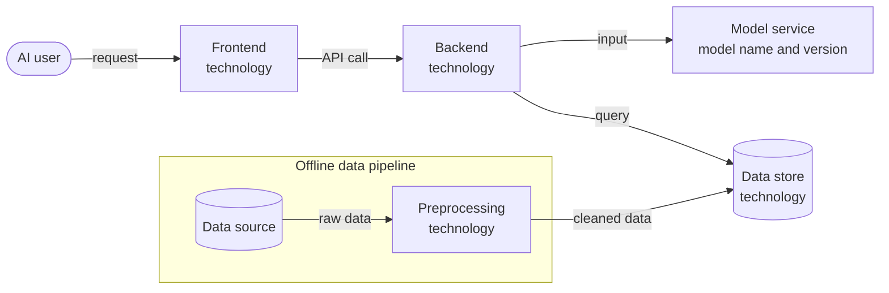
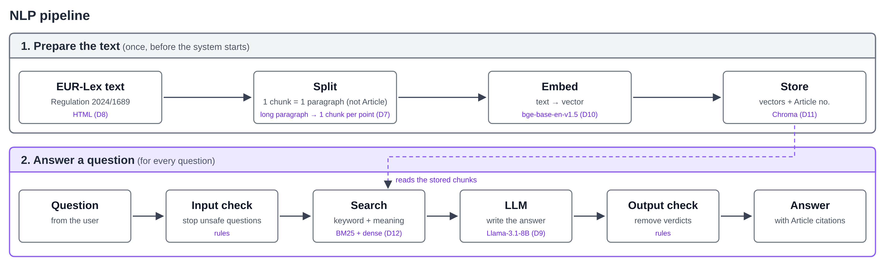

# System Architecture Design Document

**Note: this document uses HTML tags to disable rendering of instructions. View the raw file for further details.**

<!--
How to use this template
- Start short and update the document every sprint. It is a working document, not a finished blueprint [1] [2].
- Propose changes through pull requests [2]. After merge, this page is published to Confluence, where instructors and peer reviewers comment.
-->

| Team | Sprint | Status | Last updated | Updated by | 
|---|---|---|---|---|
| ELIZA | 1 | proposed | 2026-10-25 | Gözde Nur Özdemir (NLP part) |

<!--
Status [2]:
- proposed: drafted, waiting for feedback
- accepted: reviewed and agreed; work can start
- revised: changed after feedback or a new decision (see Change log)
- implemented: built as described
-->

## 1. Summary

<!--
One paragraph anyone can follow: what the system does, its main parts, and how they work together [1].
Link to the charter instead of restating it.
-->

## 2. Goals and non-goals

### Goals

<!-- The charter objectives this design serves, with links to their success criteria [1]. -->

### Non-goals

<!-- What this design leaves out on purpose [1]. -->

## 3. System architecture diagram

<!--
ISO/IEC 5338: 6.4.4 System architecture definition process.
Show which technologies you use and how they connect. Update the diagram as the design changes; give each version a number and date.
Label each box with the component and its technology. Label each arrow with what passes along it.

Use one tool and delete the other option below:
- Miro: https://miro.com/diagramming/software-architecture-diagram/
  Export the board as PNG into docs/images/, embed it, and link the board.
- Mermaid flowchart: https://mermaid.js.org/syntax/flowchart.html
  Write the diagram in a ```mermaid block.
-->

**Version:** v1 (yyyy-mm-dd)

**Option A: Miro**
[Miro board](https://miro.com/)

**Option B: Mermaid** (replace the example)



## 4. Components

<!-- One row per box in the diagram. -->

| Component | Responsibility | Technology and version | SBOM entry |
|---|---|---|---|
|  |  |  |  |

## 5. Design details

### Data pipeline

<!-- Sources, cleaning, labelling, splits, storage, and how data reaches the model. ISO/IEC 5338: 6.4.8 AI data engineering process. -->

**NLP pipeline** (v1, 2026-10-25; decisions D7–D12):



Diagram source: [nlp-pipeline-v1.svg](../docs/images/nlp-pipeline-v1.svg)

The knowledge base has one source: the consolidated text of Regulation (EU) 2024/1689 of 27/07/2026 (CELEX 02024R1689-20260727), downloaded once from EUR-Lex and stored with its file hash in the source manifest (deliverable D3). Only the in-scope provisions are used (C-01): Annex III point 3, Article 5(1)(f), Article 6, Articles 8–15, Article 16, Article 49, Article 50(1) and Article 113, together with the definitions in Article 3 that they rely on.

The text is **parsed by its own structure; there is no separate chunking step.** The regulation is already divided into short, self-contained units: Articles, numbered paragraphs, and points (a), (b), ... in Articles and Annexes. Parsing follows these headings, and each unit becomes one chunk. Chunk size and overlap are therefore not tuned.

| Step | What happens | Output |
|---|---|---|
| 1. Load | Read the stored source file (EUR-Lex HTML; the PDF is the fallback if the HTML does not mark the units, see D8). | Raw text |
| 2. Clean | Remove page headers and footers, amendment markers (▼B, ▼M1) and soft hyphens; join lines broken inside a sentence. | Clean text |
| 3. Parse | Find the headings in order: `Article N` and its title, numbered paragraphs (`1.`, `2.`, ...), points (`(a)`, `(b)`, ...), and `ANNEX III` with its numbered areas and points. A unit runs from one heading to the next. One numbered paragraph of an Article is one chunk (not the whole Article); a long paragraph with points (a), (b), ... (for example Article 6(3)) is split into one chunk per point. | One chunk per Article paragraph or Annex point |
| 4. Label | Attach metadata to each chunk: `article` or `annex`, `paragraph`, `point`, the Article or Annex title, the chapter, and `version_date` = 2026-07-27. The citation shown to the user (for example `Article 6(3)(a)`) is built from these fields. | Chunks with metadata |
| 5. Add heading text | Prefix each chunk with its place in the text, for example `Article 6 – Classification rules for high-risk AI systems – paragraph 3:`, so that a chunk such as "(a) the AI system is intended to perform a narrow procedural task;" still makes sense on its own. | Text that is embedded |
| 6. Check | Compare the chunks with the provision list of deliverable D3: every in-scope provision is present, and no chunk lacks an identifier (deliverable D5 acceptance criteria). Counts and the share of chunks corrected by hand go to `docs/eval/preprocessing.md`. | Chunk file + report |

The script is `rag/ingest.py`. It runs once, embeds the chunks (D10) and writes them to the vector store in `data/vector-store/` (D11); the stored source file stays unchanged in `data/`.


### RAG pipeline

<!--
ISO/IEC 5338: 6.4.9 Implementation process.
List each stage of the pipeline and the parameters it uses. config/rag.yaml holds the values; this table explains them and links the decision behind each one.
Models used as-is go in the AI SBOM. Write a model card (12-model-cards/, following Mitchell et al.) only if you train or fine-tune a model, and link it here.
-->

**Configuration:** `config/rag.yaml` at commit `<hash>` (yyyy-mm-dd)

| Stage | Parameter | Value | Decision |
|---|---|---|---|
| Chunking | Chunk size, overlap | No size-based chunking: one chunk per Article paragraph (not per Article) or Annex point; a long paragraph with points (a), (b), ... (for example Article 6(3)) is split into one chunk per point; heading text in front; identifier and version date as metadata | D7, D8 |
| Embedding | Model and version | `BAAI/bge-base-en-v1.5` (768 dimensions), via `sentence-transformers` | D10 |
| Vector store | Index type, distance metric | Chroma, saved on disk; cosine distance | D11 |
| Retrieval | Top-k, hybrid search, reranker | E1 baseline: dense top-k. E2: BM25 (`rank_bm25`) + dense, merged with Reciprocal Rank Fusion (k = 60). Top-k chosen by Recall@k on the `dev` split (candidates 3, 5, 8). No reranker | D12 |
| Generation | LLM and version, temperature, prompt template | Llama-3.1-8B-Instruct, 4-bit `Q4_K_M` (fallback Phi-4-mini-instruct `Q4_K_M`); temperature 0; at most 300 answer tokens; context window 4,096 tokens; prompt with one example answer (tested in the [model selection spike](../docs/spikes/model-selection-spike-gozde-nur.md)); rule-based input check before and verdict check after the model ([checks.py](../docs/spikes/model-selection/checks.py)) | D9 |

### Evaluation

<!-- Metrics, the baseline you compare against, and how validation data is kept separate from test data. ISO/IEC 5338: 6.4.11 Verification process. -->

### Interfaces

<!-- One row per arrow in the diagram. ISO/IEC 5338: 6.4.10 Integration process. -->

| From | To | What passes | Format or protocol |
|---|---|---|---|
|  |  |  |  |

### Deployment

<!-- Where each component runs (e.g. a laptop, a university server, a cloud service) at which stage (internal testing versus MVP) and how users reach the system. List the resources themselves in Facilities & Resources. ISO/IEC 5338: 6.4.12 Transition process. -->

## 6. Decisions

<!--
This section is the project's technical decision log. (ISO/IEC 5338: 6.3.3 Decision management process.)
One record per technology choice and per major design choice [2].
Also record later AI decisions here, such as retraining or resetting the model, or changing what it is specified to do.
Decisions that change the charter (scope, deliverables, milestones) go into a new charter version instead.
For a model choice, keep per-model details (version, used or rejected and why) in the AI-SBOM and link its row here.
List the simplest option you considered too, such as the baseline or "do nothing" [1].
If an experiment settled the choice, link its experiment card and AI SBOM row.
Do not rewrite a past decision. Mark it superseded and add a new record [2].
Copy the block below for each decision.
-->

<!-- D1–D6: architecture, web, database and deployment decisions (Kaan). D7–D12 below: NLP part (Gözde Nur). -->

### D7: Parse the regulation by its structure instead of size-based chunking

**Context:** Every answer must cite the exact Article, paragraph and point (O2), and every chunk must carry its identifier (deliverable D5). The regulation is already divided into short numbered units.

**Options considered:**

| Option | Pros | Cons |
|---|---|---|
| Fixed-size chunks (for example 500 tokens with overlap) | Simplest to code | Cuts through paragraphs and points; a chunk can mix two provisions, so its citation is unclear; size and overlap need tuning |
| Sentence splitting without structure | Keeps sentences whole | Loses the Article and point numbers needed for citations |
| **One chunk per Article paragraph or Annex point** | One clear identifier per chunk; nothing to tune; the gold sources of the evaluation set use the same units | Needs a parser for the headings; some units are long, some very short |

**Decision:** One chunk per Article paragraph or Annex point, with the heading text in front and the identifier and version date as metadata. An Article is not one chunk: Article 6, for example, gives one chunk per paragraph. A long paragraph with points (a), (b), ... is split into one chunk per point, so Article 6(3)(a) and 6(3)(b) are separate chunks.

**Why:** Citations come directly from the metadata, and retrieval can be scored per provision. Splitting at natural boundaries also worked better than fixed-size splitting on legal text in LegalBench-RAG [3].

**Consequences:** No chunk-size experiments. In the model selection spike, splitting Article 6(3) into its points helped the models name the right point. Whether short points are better merged into their paragraph is checked with Recall@k in Sprint 2.

**Evidence:** Source parsing task ([KAN-56](https://yarengursoy.atlassian.net/browse/KAN-56)); in the [model selection spike](../docs/spikes/model-selection-spike-gozde-nur.md), splitting Article 6(3) into its points helped the models name the right point.

**Owner and date:** Gözde Nur Özdemir, 2026-10-25

**Status:** proposed

### D8: Use the EUR-Lex HTML as the parsing input, with the PDF as fallback

**Context:** EUR-Lex publishes the consolidated text as HTML and PDF. The PDF text contains page headers, amendment markers and broken lines.

**Options considered:**

| Option | Pros | Cons |
|---|---|---|
| **HTML** | Articles, paragraphs and points are separate elements; no page breaks | Structure must be confirmed on the real file (A-05, R-12) |
| PDF (`pdftotext`) | The file the team reads | Headers, markers and broken lines must be cleaned; structure must be found from text patterns |

**Decision:** HTML; PDF only if the HTML does not mark the units.

**Why:** Fewer cleaning rules and fewer parsing errors.

**Consequences:** The source manifest (deliverable D3) records which file is used, with its hash.

**Evidence:** [KAN-56](https://yarengursoy.atlassian.net/browse/KAN-56)

**Owner and date:** Gözde Nur Özdemir, 2026-10-25

**Status:** proposed

### D9: LLM: Llama-3.1-8B-Instruct, with Phi-4-mini-instruct as fallback

**Context:** The LLM must be open-source and quantized (C-03) and run on a CPU (C-05). It must cite the right provision and give no verdict (C-08).

**Options considered:**

| Option | Passed in the spike (of 8) | Notes |
|---|---|---|
| Llama-3.2-3B-Instruct | 5 | Small and fast |
| Qwen3-4B (Apache-2.0) | 5 | In the first run it helped a user avoid the rules |
| Phi-4-mini-instruct (MIT) | 5 | Fastest; simplest licence |
| Qwen3-8B (Apache-2.0) | – | A "thinking" model: its reasoning used the whole answer limit, and it was the slowest |
| **Llama-3.1-8B-Instruct** (Llama 3.1 Community License) | 7 | Best answers; 2–3 times slower than Phi-4-mini |

**Decision:** Llama-3.1-8B-Instruct `Q4_K_M`, served by Ollama, temperature 0. Phi-4-mini-instruct `Q4_K_M` is the fallback.

**Why:** It gave the most correct answers, and it answers directly.

**Consequences:** The answer time on the deployment CPU is measured in Sprint 2; if it is too slow, the fallback is used (R-16). The machine size follows from this test. The licence and model card go into the AI SBOM (A-10).

**Evidence:** [Model selection spike](../docs/spikes/model-selection-spike-gozde-nur.md) (5 runs; notebooks and results in `docs/spikes/model-selection/`), [KAN-57](https://yarengursoy.atlassian.net/browse/KAN-57)

**Owner and date:** Gözde Nur Özdemir, 2026-10-25

**Status:** proposed

### D10: Embedding model: bge-base-en-v1.5

**Context:** The embedding model must be open-source and run on a CPU. The corpus is small (about 190 chunks) and in English (C-02).

**Options considered:** all-MiniLM-L6-v2 (very small, weaker on retrieval); bge-small-en-v1.5 (small, proposed in Spike 01); **bge-base-en-v1.5** (stronger on retrieval, still fast on a CPU for a small corpus; MIT licence).

**Decision:** bge-base-en-v1.5; bge-small-en-v1.5 is the faster alternative.

**Why:** With about 190 chunks, the larger model is still fast, and it finds the right provision more often.

**Consequences:** Checked with Recall@k on the dev split in the baseline experiment (E1).

**Evidence:** [KAN-58](https://yarengursoy.atlassian.net/browse/KAN-58); E1 experiment card (Sprint 2)

**Owner and date:** Gözde Nur Özdemir, 2026-10-25

**Status:** proposed

### D11: Vector store: Chroma

**Context:** The vector store must be free, run inside the RAG service and keep each chunk's metadata for the citation.

**Options considered:** NumPy array (simplest, but no metadata or saving); FAISS (fast, but metadata stored separately); **Chroma** (vectors, texts and metadata together; saves to disk).

**Decision:** Chroma in data/vector-store/, cosine distance.

**Why:** The identifier and version date come back with each result, so citations need no extra lookup. Speed is not a problem with about 190 chunks.

**Consequences:** ingest.py rebuilds the index when the chunks change.

**Evidence:** [KAN-58](https://yarengursoy.atlassian.net/browse/KAN-58)

**Owner and date:** Gözde Nur Özdemir, 2026-10-25

**Status:** proposed

### D12: Retrieval: dense baseline, then hybrid with RRF; no reranker

**Context:** Questions contain exact legal terms ("profiling", "Article 6(3)") as well as everyday descriptions ("a tool that calculates grades").

**Options considered:** **Dense top-k** (simplest; finds the same meaning but can miss exact terms); **hybrid BM25 + dense, merged with Reciprocal Rank Fusion** (also finds exact terms; RRF needs no weight tuning); a reranker (slower on a CPU, little gain on a small corpus).

**Decision:** E1 baseline: dense top-k. E2: BM25 + dense, merged with RRF (k = 60). Top-k is chosen by Recall@k on the dev split (candidates 3, 5, 8). No reranker for now.

**Why:** One change at a time, so each experiment shows its own effect.

**Consequences:** Two experiment cards in Sprint 2 (E1, E2). A reranker is tested only if Recall@k stays below the target.

**Evidence:** [KAN-63](https://yarengursoy.atlassian.net/browse/KAN-63); E1 and E2 experiment cards (Sprint 2)

**Owner and date:** Gözde Nur Özdemir, 2026-10-25

**Status:** proposed

## 7. Open design areas

<!-- Areas where a decision is still needed, and which spike in docs/spikes/ will settle it [2]. When the spike ends, record its outcome as a decision in section 6 and remove the area from this list. -->

NLP part:

- **Granularity of points:** long paragraphs are split at their points (D7); whether short points are better merged into their paragraph is settled by Recall@k on the `dev` split in E1.
- **Hybrid retrieval:** whether BM25 improves Recall@k over dense search (E1 versus E2, Sprint 2).
- **Answer time on CPU:** answer time of Llama-3.1-8B on the deployment CPU, measured in Sprint 2; if it is too slow, Phi-4-mini-instruct is used (D9, R-16).
- **Checks:** personal-data rules and the citation-ID check (KAN-49).

## 8. Change log

| Version | Date | Change | Pull request |
|---|---|---|---|
| v1 | 2026-10-25 | NLP part: data pipeline, NLP pipeline diagram, RAG pipeline table, decisions D7–D12 (Gözde Nur Özdemir) |  |

## Checklist before submitting

- [ ] Every box in the diagram has a row in Components, and every row has a box.
- [ ] Every arrow in the diagram has a row in Interfaces.
- [ ] Every technology in Components appears in the SBOM under the same name and version.
- [ ] Every technology in Components has a decision in section 6.
- [ ] Every relevant spike has a decision in section 6, or a note in Open design areas saying why not.
- [ ] The diagram version matches the latest change log entry.
- [ ] The configuration commit in section 5 is the one used for the latest results in `docs/eval/results.md`.

## References

[1] GitLab Inc. "Design document template" (`_template.md`). The GitLab Handbook. https://gitlab.com/gitlab-com/content-sites/handbook/-/blob/main/content/handbook/engineering/architecture/design-documents/_template.md

[2] GitLab Inc. "Architecture Design Workflow." The GitLab Handbook. https://handbook.gitlab.com/handbook/engineering/architecture/workflow/

[3] N. Pipitone and G. Houir Alami, "LegalBench-RAG: A Benchmark for Retrieval-Augmented Generation in the Legal Domain," arXiv:2408.10343, 2024.

Diagram tools: [Miro, software architecture diagrams](https://miro.com/diagramming/software-architecture-diagram/) · [Mermaid, flowchart syntax](https://mermaid.js.org/syntax/flowchart.html) · [Mermeid Live Editor (Open Source)](https://mermaid-editor-live.vercel.app/)
