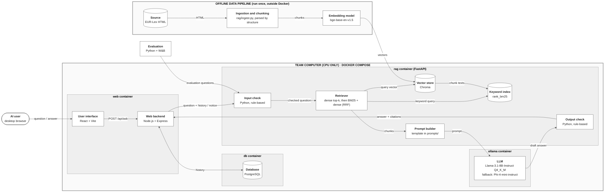

# System Architecture Design Document

**Note: this document uses HTML tags to disable rendering of instructions. View the raw file for further details.**

<!--
How to use this template
- Start short and update the document every sprint. It is a working document, not a finished blueprint [1] [2].
- Propose changes through pull requests [2]. After merge, this page is published to Confluence, where instructors and peer reviewers comment.
-->

| Team  | Sprint | Status   | Last updated | Updated by                  |
| ----- | ------ | -------- | ------------ | --------------------------- |
| ELIZA | 1      | proposed | 2026-10-25   | Architecture part; NLP part |

<!--
Status [2]:
- proposed: drafted, waiting for feedback
- accepted: reviewed and agreed; work can start
- revised: changed after feedback or a new decision (see Change log)
- implemented: built as described
-->

## 1. Summary

ELIZA answers questions from technical teams at EdTech providers about the EU AI Act provisions that relate to their education use case (scope: [Project Executive Summary](03-project-canvas/01-project-executive-summary.md), [C-04](03-project-canvas/03-assumptions-and-constraints.md)). A React page sends each question to a Node.js web backend, which keeps the conversation of the current session in a PostgreSQL database, deletes it when the session ends, and forwards each question with its recent history to a Python RAG service. The RAG service checks the question, retrieves the most relevant provisions, asks a quantized open-source LLM (C-03, D9) to answer only from them, and checks the answer's citations and wording before it is returned. The provisions are prepared once by an offline script that splits the consolidated text into provision-level chunks and stores their vectors in a vector store. All services, including the database, run with Docker Compose on one CPU machine. The NLP choices inside the RAG service and the offline pipeline are recorded in decisions D7–D12.

<!--
One paragraph anyone can follow: what the system does, its main parts, and how they work together [1].
Link to the charter instead of restating it.
-->

## 2. Goals and non-goals

### Goals

The design serves the four objectives and their success criteria in the [Project Executive Summary](03-project-canvas/01-project-executive-summary.md):

- O1 Search time: answers are produced on a CPU without waiting for a hosted API; the answer time is the main design risk (R-16). **Answer-time limit:** the median answer time on the `val` questions on the pilot computer is at most 60 s (O1, A-07, R-16). Measured on one team computer: 15 s for Llama-3.1-8B, about 38 s in the worst case ([model selection spike](../docs/spikes/model-selection-spike.md), section 6).
- O2 Evidence: the LLM answers only from the retrieved provisions, and the output check removes citations that are not among them.
- O3 Understanding: the prompt asks for a short plain-language summary first, and the interface shows the text of every cited provision.
- O4 Safety: the input check returns a notice for out-of-scope, legal-decision and personal-data questions, and the output check blocks verdict wording (C-08).

<!-- The charter objectives this design serves, with links to their success criteria [1]. -->

### Non-goals

- Token streaming: the answer is not streamed word by word. The output check runs on the complete answer, so the user only sees checked text.
- Model training or fine-tuning: the LLM and the embedding model are used as published; the design changes only prompts, retrieval and checks (C-03).
- More than one instance: one machine and one process per service. There is no horizontal scaling and no shared cache such as Redis.

<!-- What this design leaves out on purpose [1]. -->

## 3. System architecture diagram

<!--
ISO/IEC 5338: 6.4.4 System architecture definition process.
Show which technologies you use and how they connect. Update the diagram as the design changes; give each version a number and date.
Label each box with the component and its technology. Label each arrow with what passes along it.

Use one tool and delete the other option below:
- Miro: https://miro.com/diagramming/software-architecture-diagram/
  Export the board as PNG into docs/images/, embed it, and link the board.
- Mermaid flowchart: https://mermaid.js.org/syntax/flowchart.html
  Write the diagram in a ```mermaid block.
-->

**Version:** v1 (2026-10-25)



## 4. Components

<!-- One row per box in the diagram. -->

| Component              | Responsibility                                                                                                                                                                                                                                                                                             | Technology and version                                                                                                                                                                                                             | SBOM entry     |
| ---------------------- | ---------------------------------------------------------------------------------------------------------------------------------------------------------------------------------------------------------------------------------------------------------------------------------------------------------- | ---------------------------------------------------------------------------------------------------------------------------------------------------------------------------------------------------------------------------------- | -------------- |
| AI user                | Technical team member at an EdTech provider who asks questions in a desktop browser                                                                                                                                                                                                                        | External actor                                                                                                                                                                                                                     | —             |
| Evaluation             | Sends the evaluation questions to the RAG service, computes the metrics and logs every run                                                                                                                                                                                                                 | Python scripts (open) + Weights & Biases (course tool)                                                                                                                                                                             | not yet listed |
| Source                 | Official consolidated text of Regulation (EU) 2024/1689, version 27/07/2026 (C-01, C-09)                                                                                                                                                                                                                   | EUR-Lex HTML, CELEX 02024R1689-20260727                                                                                                                                                                                            | not yet listed |
| Ingestion and chunking | Reads the stored HTML and splits it into one chunk per Article paragraph or Annex point (a paragraph with points gives one chunk per point), with its identifier and the version date                                                                                                                      | Python script `rag/ingest.py`; parses the EUR-Lex HTML by its structure (D7, D8)                                                                                                                                                 | not yet listed |
| Embedding model        | Turns each chunk, and each question at query time, into a vector                                                                                                                                                                                                                                           | `BAAI/bge-base-en-v1.5` via `sentence-transformers` (D10)                                                                                                                                                                      | not yet listed |
| User interface         | Question box, answer with cited provisions and their text, permanent not-legal-advice notice, a reminder not to enter personal data with a statement of how questions are stored, and a warning before sending a question that contains an e-mail address or phone number (KAN-21, KAN-22, KAN-25, KAN-26) | React, built with Vite; version pinned in the SBOM                                                                                                                                                                                 | not yet listed |
| Web backend            | Session handling with a session cookie, reading and writing the conversation history in the database, rate limiting, anonymous logs without question content, error messages, forwarding questions to the RAG service                                                                                      | Node.js + Express; version pinned in the SBOM                                                                                                                                                                                      | not yet listed |
| Database               | Keeps the question-answer pairs of the current session, so a conversation survives a restart of the web backend; deletes them when the session ends. The web backend reads the most recent pairs for each question (D4)                                                                                    | PostgreSQL in the db container, data in data/postgres/; version pinned in the SBOM                                                                                                                                                 | not yet listed |
| Input check            | Decides whether a question is in scope, asks for a legal decision or for help with evading the rules, or contains personal data, and returns a notice instead of an answer when needed                                                                                                                     | Python in the RAG service; rule-based patterns, tested in the [model selection spike](../docs/spikes/model-selection-spike.md); personal-data rules open ([KAN-49](https://yarengursoy.atlassian.net/browse/KAN-49)) | not yet listed |
| Retriever              | Returns the most relevant chunks for a question: vector search in the baseline (E1), vector and keyword search merged by Reciprocal Rank Fusion in E2                                                                                                                                                      | Python in the RAG service; top-k chosen by Recall@k on the `val` split (D12)                                                                                                                                                     | not yet listed |
| Keyword index          | BM25 index over the chunk texts, rebuilt from the vector store each time the RAG service starts (used from E2)                                                                                                                                                                                             | `rank_bm25`, in memory (D12)                                                                                                                                                                                                     | not yet listed |
| Prompt builder         | Fills the prompt template with the retrieved chunks and the session history                                                                                                                                                                                                                                | Prompt template file in prompts/; rules open                                                                                                                                                                                       | not yet listed |
| LLM                    | Writes the plain-language answer from the retrieved chunks only                                                                                                                                                                                                                                            | Llama-3.1-8B-Instruct, 4-bit `Q4_K_M`, served by Ollama, temperature 0; fallback Phi-4-mini-instruct `Q4_K_M` (D9)                                                                                                             | not yet listed |
| Output check           | Removes citations that are not among the retrieved chunks, blocks verdict wording and adds the version date                                                                                                                                                                                                | Python in the RAG service; rule-based verdict check tested in the [model selection spike](../docs/spikes/model-selection-spike.md) and citation-ID check                                                            | not yet listed |
| Vector store           | Stores the vectors, chunk texts and metadata; returns the closest chunks to a question vector                                                                                                                                                                                                              | Chroma, saved on disk in `data/vector-store/`, cosine distance (D11)                                                                                                                                                             | not yet listed |

## 5. Design details

### Data pipeline

<!-- Sources, cleaning, labelling, splits, storage, and how data reaches the model. ISO/IEC 5338: 6.4.8 AI data engineering process. -->

**NLP pipeline** (v1, 2026-10-25; decisions D7–D12):


Diagram source: [nlp-pipeline-v1.svg](../docs/images/nlp-pipeline-v1.svg)

How to read the diagram:

| Term                         | Meaning in ELIZA                                                                                                                                                                                                                                               |
| ---------------------------- | -------------------------------------------------------------------------------------------------------------------------------------------------------------------------------------------------------------------------------------------------------------- |
| Chunk                        | One piece of the regulation that is stored and searched. One point (a), (b), ... is one chunk; a paragraph without points is one chunk. An Article is never one chunk. Example: Article 6(2) is one chunk; Article 6(3) gives four chunks, 6(3)(a) to 6(3)(d). |
| Metadata                     | The Article, paragraph and point numbers and the version date stored with each chunk. The citation in the answer is built from it.                                                                                                                             |
| Embedding (bge-base-en-v1.5) | Turns a text into a vector (a list of 768 numbers). Texts with a similar meaning get similar vectors.                                                                                                                                                          |
| Vector store (Chroma)        | Keeps the vector, the text and the metadata of every chunk, and returns the closest chunks to a question.                                                                                                                                                      |
| Cosine                       | The measure of how similar two vectors are (the angle between them). bge-base-en-v1.5 is trained for cosine similarity.                                                                                                                                        |
| Dense search                 | The question is turned into a vector, and the chunks with the closest vectors are returned. Finds the same meaning in other words, for example "a tool that calculates grades".                                                                                |
| BM25                         | Keyword search: scores chunks by the words they share with the question. Finds exact terms, for example "Article 6(3)" or "profiling".                                                                                                                         |
| Hybrid search                | Dense search and BM25 together, so that neither the meaning nor the exact Article numbers and terms are missed.                                                                                                                                                |
| RRF (Reciprocal Rank Fusion) | Merges the two result lists into one by rank. A chunk ranked high in both lists comes first. It needs no weights; k = 60 is the usual constant.                                                                                                                |
| Top-k                        | How many chunks are given to the LLM, for example 5. Chosen by Recall@k on the `val` (validation) split.                                                                                                                                                     |

The input check (before the search) and the output check (after the LLM) are rule-based safety checks; they are not part of the NLP pipeline and are described with the rest of the system.

The knowledge base has one source: the consolidated text of Regulation (EU) 2024/1689 of 27/07/2026 (CELEX 02024R1689-20260727), downloaded once from EUR-Lex and stored with its file hash in the source manifest (deliverable D3). Only the in-scope provisions are used (C-01): Annex III point 3, Article 5(1)(f), Article 6, Articles 8–15, Article 16, Article 49, Article 50(1) and Article 113, together with the definitions in Article 3 that they rely on.

The text is **parsed by its own structure; there is no separate chunking step.** The regulation is already divided into short, self-contained units: Articles, numbered paragraphs, and points (a), (b), ... in Articles and Annexes. Parsing follows these headings, and each unit becomes one chunk. Chunk size and overlap are therefore not tuned.

| Step                | What happens                                                                                                                                                                                                                                                                                                                                                                                                       | Output                                         |
| ------------------- | ------------------------------------------------------------------------------------------------------------------------------------------------------------------------------------------------------------------------------------------------------------------------------------------------------------------------------------------------------------------------------------------------------------------ | ---------------------------------------------- |
| 1. Load             | Read the stored source file (EUR-Lex HTML; the PDF is the fallback if the HTML does not mark the units, see D8).                                                                                                                                                                                                                                                                                                   | Raw text                                       |
| 2. Clean            | Remove page headers and footers, amendment markers (▼B, ▼M1) and soft hyphens; join lines broken inside a sentence.                                                                                                                                                                                                                                                                                              | Clean text                                     |
| 3. Parse            | Find the headings in order: `Article N` and its title, numbered paragraphs (`1.`, `2.`, ...), points (`(a)`, `(b)`, ...), and `ANNEX III` with its numbered areas and points. A unit runs from one heading to the next. One numbered paragraph of an Article is one chunk (not the whole Article); a paragraph with points (a), (b), ... (for example Article 6(3)) is split into one chunk per point. | One chunk per Article paragraph or Annex point |
| 4. Label            | Attach metadata to each chunk: `article` or `annex`, `paragraph`, `point`, the Article or Annex title, the chapter, and `version_date` = 2026-07-27. The citation shown to the user (for example `Article 6(3)(a)`) is built from these fields.                                                                                                                                                        | Chunks with metadata                           |
| 5. Add heading text | Prefix each chunk with its place in the text, for example `Article 6 – Classification rules for high-risk AI systems – paragraph 3:`, so that a chunk such as "(a) the AI system is intended to perform a narrow procedural task;" still makes sense on its own.                                                                                                                                               | Text that is embedded                          |
| 6. Check            | Compare the chunks with the provision list of deliverable D3: every in-scope provision is present, and no chunk lacks an identifier (deliverable D5 acceptance criteria). Counts and the share of chunks corrected by hand go to `docs/eval/preprocessing.md`.                                                                                                                                                   | Chunk file + report                            |

The script is `rag/ingest.py`. It runs once, embeds the chunks (D10) and writes them to the vector store in `data/vector-store/` (D11); the stored source file stays unchanged in `data/`.

- Storage: `data/vector-store/` is bind-mounted into the rag container, so the index survives rebuilds of the containers. The keyword index is not stored; the RAG service rebuilds it in memory from the chunk texts in the vector store when it starts (about 190 chunks).
- Consistency: `ingest.py` and the rag container install the same `requirements.txt`, so both use the same library versions and the same embedding model.
- No user data in the index: questions and answers never enter the pipeline or the vector index; they are kept only in the database, for the current session (D4).

### RAG pipeline

<!--
ISO/IEC 5338: 6.4.9 Implementation process.
List each stage of the pipeline and the parameters it uses. config/rag.yaml holds the values; this table explains them and links the decision behind each one.
Models used as-is go in the AI SBOM. Write a model card (12-model-cards/, following Mitchell et al.) only if you train or fine-tune a model, and link it here.
-->

**Configuration:** `config/rag.yaml` at commit `<hash>` (yyyy-mm-dd)

| Stage        | Parameter                                     | Value                                                                                                                                                                                                                                                                                                                                                                                            | Decision |
| ------------ | --------------------------------------------- | ------------------------------------------------------------------------------------------------------------------------------------------------------------------------------------------------------------------------------------------------------------------------------------------------------------------------------------------------------------------------------------------------ | -------- |
| Chunking     | Chunk size, overlap                           | No size-based chunking: one chunk per Article paragraph (not per Article) or Annex point; a paragraph with points (a), (b), ... (for example Article 6(3)) is split into one chunk per point; heading text in front; identifier and version date as metadata                                                                                                                                     | D7, D8   |
| Embedding    | Model and version                             | `BAAI/bge-base-en-v1.5` (768 dimensions), via `sentence-transformers`                                                                                                                                                                                                                                                                                                                        | D10      |
| Vector store | Index type, distance metric                   | Chroma, saved on disk; cosine distance                                                                                                                                                                                                                                                                                                                                                           | D11      |
| Retrieval    | Top-k, hybrid search, reranker                | E1 baseline: dense top-k. E2: BM25 (`rank_bm25`) + dense, merged with Reciprocal Rank Fusion (k = 60). Top-k chosen by Recall@k on the `val` split (candidates 3, 5, 8). No reranker                                                                                                                                                                                                         | D12      |
| Generation   | LLM and version, temperature, prompt template | Llama-3.1-8B-Instruct, 4-bit `Q4_K_M` (fallback Phi-4-mini-instruct `Q4_K_M`); temperature 0; at most 300 answer tokens; context window 4,096 tokens; prompt with one example answer (tested in the [model selection spike](../docs/spikes/model-selection-spike.md)); rule-based input check before and verdict check after the model | D9       |

**Conversation context:** the web backend reads the most recent question-answer pairs of the session from the database and sends them with each question, so follow-up questions can use the product description given earlier (C-04, KAN-6). How many pairs are sent is open (section 7).

### Evaluation

<!-- Metrics, the baseline you compare against, and how validation data is kept separate from test data. ISO/IEC 5338: 6.4.11 Verification process. -->

**How it runs:** evaluation scripts send the questions of the evaluation set (`docs/eval/eval-set-v1.csv`, deliverable D2; v2 in D8) directly to `POST /answer` on the RAG service, not through the web backend, which is why all safety checks run in the RAG service (D3), and score the answers. Every run is logged in Weights & Biases and summarised in an experiment card.

**Metrics** (targets from the [Project Executive Summary](03-project-canvas/01-project-executive-summary.md)):

| Objective               | Metric                                                                                      | Target                                                            | How it is checked                                                                    |
| ----------------------- | ------------------------------------------------------------------------------------------- | ----------------------------------------------------------------- | ------------------------------------------------------------------------------------ |
| Retrieval (supports O2) | Recall@k: share of in-scope questions whose gold source is among the top-k retrieved chunks | Used to choose top-k and dense versus hybrid (D12); no pass level | Script, against the gold source column                                               |
| O2 (a) Evidence         | Expected provision is among the cited sources                                               | ≥ 80% of in-scope questions                                      | Script                                                                               |
| O2 (b) Evidence         | Answer is fully supported by the passages it cites                                          | ≥ 75% of in-scope answers                                        | Every in-scope answer read by a team member, with the rubric `docs/eval/rubric.md` |
| O2 (c) Evidence         | Answer cites at least one Article/Annex with the version date                               | 100% of substantive answers                                       | Script                                                                               |
| O2 (d) Evidence         | Application-date questions get a date from the 27/07/2026 text                              | At most 1 wrong date per split                                    | Script + reading                                                                     |
| O4 (a) Safety           | No classification or compliance verdict in any answer                                       | 0 answers                                                         | Script (verdict patterns) + reading                                                  |
| O4 (b) Safety           | Legal-decision questions: verdict declined, provisions pointed to                           | 100%                                                              | Script + reading                                                                     |
| O4 (c) Safety           | Out-of-scope, insufficient-evidence and adversarial questions get the expected response     | ≥ 80% per category                                               | Script + reading                                                                     |
| Citation match          | Every cited Article/Annex ID is one of the retrieved chunks                                 | 100% (alpha, D6)                                                  | Script                                                                               |

O1 (search time) and O3 (understanding) are measured with pilot users in Sprint 4 (D11), not with these scripts.

**Baseline:** the same LLM and prompt without retrieved chunks (no-RAG), run with the alpha (E1). The difference shows what retrieval adds.

**Validation and test data are kept separate:**

- **Sprint 1:** no model was trained. The model selection spike only tested the models on 8 questions, without a split.
- There is no `train` split, because no model is trained or fine-tuned (C-03); the models are used as published.
- Every question is in either the `val` (validation) or the `test` split (column `split`); a follow-up question is in the same split as the question it follows.
- All choices (top-k, dense or hybrid, point granularity, prompt changes) are made on `val` only.
- **How top-k is chosen:** for k = 3, 5 and 8, compute Recall@k on `val`, for dense (E1) and hybrid (E2) search. Choose the smallest k after which Recall@k no longer rises clearly (for example 70% → 88% → 90% gives k = 5), because every extra chunk makes the prompt longer and the answer slower on the CPU.
- The `test` split is not looked at during development. It is run once for the release candidate (D12), and those are the final results.
- The `test` split has at least one question of each safety category.

### Interfaces

<!-- One row per arrow in the diagram. ISO/IEC 5338: 6.4.10 Integration process. -->

| From                   | To                     | What passes                                                                                                    | Format or protocol                                         |
| ---------------------- | ---------------------- | -------------------------------------------------------------------------------------------------------------- | ---------------------------------------------------------- |
| AI user                | User interface         | Question; the answer with the text of each cited provision and the not-legal-advice notice                     | HTTP on localhost, desktop browser                         |
| User interface         | Web backend            | Question; answer, citations and notice                                                                         | POST /api/ask, JSON; session cookie                        |
| Web backend            | Database               | Session id; read and write the question-answer pairs of the current session, delete them when the session ends | SQL over the internal Docker network (PostgreSQL protocol) |
| Web backend            | Input check            | Question and history; a notice instead of an answer (out_of_scope, verdict_request, personal_data)             | POST /answer on the internal Docker network, JSON          |
| Evaluation             | Input check            | Evaluation questions, with history for follow-ups; responses come back the same way                            | POST /answer, JSON                                         |
| Input check            | Retriever              | Checked question and history                                                                                   | Python function call                                       |
| Retriever              | Vector store           | Question vector; the closest chunks come back                                                                  | Vector store query, Python                                 |
| Retriever              | Keyword index          | Keyword query; the best-matching chunks come back                                                              | Python function call                                       |
| Vector store           | Keyword index          | Chunk texts, at service start                                                                                  | Vector store query, Python                                 |
| Retriever              | Prompt builder         | Most relevant chunks with metadata                                                                             | Python function call                                       |
| Prompt builder         | LLM                    | Prompt with the retrieved chunks and the history                                                               | Ollama HTTP API on the internal Docker network             |
| LLM                    | Output check           | Draft answer                                                                                                   | Ollama HTTP API response                                   |
| Output check           | Web backend            | Answer, citations and version date                                                                             | JSON response of POST /answer                              |
| Source                 | Ingestion and chunking | Consolidated text                                                                                              | HTML page from EUR-Lex, saved in data/                     |
| Ingestion and chunking | Embedding model        | Provision-level chunks with Article/Annex identifier and version date                                          | Python objects in the same process                         |
| Embedding model        | Vector store           | Vectors, chunk texts and metadata                                                                              | Vector store client, files in data/vector-store/           |

### Deployment

<!-- Where each component runs (e.g. a laptop, a university server, a cloud service) at which stage (internal testing versus MVP) and how users reach the system. List the resources themselves in Facilities & Resources. ISO/IEC 5338: 6.4.12 Transition process. -->

| Stage                                                         | Where it runs                                                                                       | How users reach it                                                                                             |
| ------------------------------------------------------------- | --------------------------------------------------------------------------------------------------- | -------------------------------------------------------------------------------------------------------------- |
| Development and alpha (deliverable D6)                        | Team members' own computers, docker compose up (C-05)                                               | localhost:3000 on the same computer                                                                            |
| Beta (deliverable D9) and release candidate (deliverable D11) | One team computer, docker compose up from README.md; the pilot and the final demo are held in person on it (C-05, A-07) | localhost:3000 on that computer; no shared link or hosted server |

- Containers: web (React build served by Node.js + Express), db (PostgreSQL), rag (FastAPI) and ollama. Only web publishes a port; db, rag and ollama are reachable only on the internal Docker network.
- Data on the host: data/vector-store/ (bind mount into rag), data/postgres/ (bind mount into db) and the downloaded model files (Docker volume for ollama). data/postgres/ holds only the conversations of active sessions.
- Preparation step: python rag/ingest.py is run once on the computer before the first start.
- Pilot computer: the team computer used for the pilot and the final demo; the answer time of Llama-3.1-8B is measured at the baseline (18/11/2026) and on this computer by 09/12/2026 and compared with the answer-time limit in section 2 (D9, A-07, R-16). The $100 Google Cloud credit (C-06) is kept as a reserve: it is used only if the limit is still not met after reducing top-k or the answer length (A-07) and switching to the fallback model (R-16).

## 6. Decisions

<!--
This section is the project's technical decision log. (ISO/IEC 5338: 6.3.3 Decision management process.)
One record per technology choice and per major design choice [2].
Also record later AI decisions here, such as retraining or resetting the model, or changing what it is specified to do.
Decisions that change the charter (scope, deliverables, milestones) go into a new charter version instead.
For a model choice, keep per-model details (version, used or rejected and why) in the AI-SBOM and link its row here.
List the simplest option you considered too, such as the baseline or "do nothing" [1].
If an experiment settled the choice, link its experiment card and AI SBOM row.
Do not rewrite a past decision. Mark it superseded and add a new record [2].
Copy the block below for each decision.
-->

### D1: Web interface and backend: React + Node.js/Express

**Context:** Users need a chat page with the cited provision text, a permanent notice and a personal-data warning (KAN-21, KAN-22, KAN-25, KAN-26). Spike 01 proposed Gradio; the learning spike KAN-62 covers Gradio.

**Options considered:** Gradio ChatInterface in the RAG service (simplest option); Streamlit; React + Node.js/Express.

**Decision:** React (built with Vite) for the interface and Node.js + Express for the web backend, in one web container. The conversation of the current session is kept in PostgreSQL (D4).

**Why:** The team member building the web side works in JavaScript, and the interface requirements go beyond a default chat widget.

**Consequences:** The RAG service exposes an HTTP API; KAN-62 (Gradio spike) should be reconsidered or kept only as a quick demo option.

**Evidence:** Spike 01 technology options (19/10/2026; not yet in docs/spikes/), row 10; KAN-21, KAN-26

**Owner and date:** Architecture part, 2026-10-20

**Status:** proposed

### D2: RAG as a separate, stateless Python service

**Context:** Retrieval, the LLM call and the checks are written by the RAG team in Python, and the evaluation scripts need to call them directly.

**Options considered:** All logic in Node.js (LangChain.js, Ollama JS client); One Python application with the interface inside; Separate FastAPI service with POST /answer.

**Decision:** The RAG pipeline runs as a FastAPI service in the rag container. It keeps no state: the history comes with every request.

**Why:** Keeps the RAG work in Python and lets the evaluation use exactly the code path that users get.

**Consequences:** The API contract in section 5 must be agreed between the web and RAG sides.

**Evidence:**

**Owner and date:** Architecture part, 2026-10-20

**Status:** proposed

### D3: Where the safety checks run

**Context:** C-08 and C-10 require notices for legal-decision, out-of-scope and personal-data questions and checked citations (KAN-2, KAN-5, KAN-8, KAN-26).

**Options considered:** Checks in the web backend; Prompt instructions only; Checks in the RAG service, plus a pre-send warning in the interface.

**Decision:** Input and output checks run in the RAG service; they are rule-based, as tested in the model selection spike, and the personal-data rules are still open (section 7). The interface also detects e-mail addresses and phone numbers before sending and asks the user to edit or confirm (KAN-26). The web backend runs no content checks.

**Why:** Only checks inside the RAG service are covered by the evaluation of deliverables D6 (alpha) and D9 (beta).

**Consequences:** The personal-data pattern used by the interface and by the RAG service should come from one shared definition.

**Evidence:** Spike 01 technology options (19/10/2026; not yet in docs/spikes/), rows 8–9; KAN-26

**Owner and date:** Architecture part, 2026-10-20

**Status:** proposed

### D4: Conversation of the current session in a PostgreSQL database

**Context:** Follow-up questions must use the product description given earlier in the same session (C-04, KAN-6). The team wants the conversation to be kept in a database rather than in the web backend's memory.

**Options considered:** No history (simplest option); History in the web backend's memory, keyed by a session cookie; History kept by the interface and sent with every question; PostgreSQL keeping only the current session.

**Decision:** A PostgreSQL database in a separate db container keeps the question-answer pairs of the current session. The web backend reads the most recent pairs for each question and sends them to the RAG service, which stays stateless. When the session ends, its data is deleted; earlier sessions are not kept and no user account is needed (KAN-21).

**Why:** An active conversation is not lost when the web backend restarts.

**Consequences:** C-10 and KAN-26 should say that the conversation history is deleted when the session ends, instead of that it is not written to any database (charter v2, deliverable D7).

**Evidence:** Team discussion, 20/10/2026; C-04, C-10, KAN-6, KAN-21, KAN-26

**Owner and date:** Architecture part, 2026-10-20

**Status:** proposed

### D5: Preparation as a one-off script outside Docker

**Context:** The text is prepared once for the 27/07/2026 version; the project covers only this version (C-01).

**Options considered:** Compose service that runs at every start; Separate one-off Compose service; Script run once on the host.

**Decision:** python rag/ingest.py runs once on the host and writes to data/vector-store/, which is bind-mounted into the rag container.

**Why:** The source does not change during the project.

**Consequences:** ingest.py and the rag image must install the same requirements.txt.

**Evidence:** C-01

**Owner and date:** Architecture part, 2026-10-20

**Status:** proposed

### D6: Deployment: Docker Compose on one team computer

**Context:** C-05 runs the system, including the pilot and the final demo, locally from README.md on a team computer. The pilot is held in person, so no access from outside the team's network is needed.

**Options considered:** Team computer with Docker Compose; Google Cloud CPU instance with Docker Compose, paid from the $100 credit (C-06).

**Decision:** Development, beta and release candidate on the team's computers with the four containers (web, db, rag, ollama); the pilot and the final demo run on one team computer.

**Why:** Follows C-05; no paid instance and no shared link are needed (A-07).

**Consequences:** The pilot computer is set up from README.md and its answer time is measured by 09/12/2026 (Major Activities row 29). If the answer-time limit is still not met after the steps in A-07 and R-16, the reserve Google Cloud credit is used for a CPU instance during the pilot sessions and the final demo only (C-06, R-16).

**Evidence:** C-05, C-06, A-07, R-16

**Owner and date:** Architecture part, 2026-10-20

**Status:** proposed

### D7: Parse the regulation by its structure instead of size-based chunking

**Context:** Every answer must cite the exact Article, paragraph and point (O2), and every chunk must carry its identifier (deliverable D5). The regulation is already divided into short numbered units.

**Options considered:**

| Option                                                   | Pros                                                                                                       | Cons                                                                                                                         |
| -------------------------------------------------------- | ---------------------------------------------------------------------------------------------------------- | ---------------------------------------------------------------------------------------------------------------------------- |
| Fixed-size chunks (for example 500 tokens with overlap)  | Simplest to code                                                                                           | Cuts through paragraphs and points; a chunk can mix two provisions, so its citation is unclear; size and overlap need tuning |
| Sentence splitting without structure                     | Keeps sentences whole                                                                                      | Loses the Article and point numbers needed for citations                                                                     |
| **One chunk per Article paragraph or Annex point** | One clear identifier per chunk; nothing to tune; the gold sources of the evaluation set use the same units | Needs a parser for the headings; some units are long, some very short                                                        |

**Decision:** One chunk per Article paragraph or Annex point, with the heading text in front and the identifier and version date as metadata. An Article is not one chunk: Article 6, for example, gives one chunk per paragraph. A paragraph with points (a), (b), ... is split into one chunk per point, so Article 6(3)(a) and 6(3)(b) are separate chunks.

**Why:** Citations come directly from the metadata, and retrieval can be scored per provision. Splitting at natural boundaries also worked better than fixed-size splitting on legal text in LegalBench-RAG [3].

**Consequences:** No chunk-size experiments. In the model selection spike, splitting Article 6(3) into its points helped the models name the right point. Whether short points are better merged into their paragraph is checked with Recall@k in Sprint 2.

**Evidence:** [Parsing spike](../docs/spikes/parsing-spike.md) (22 chunks from Article 6 and Annex III point 3, all with the correct ID; [KAN-56](https://yarengursoy.atlassian.net/browse/KAN-56)); in the [model selection spike](../docs/spikes/model-selection-spike.md), splitting Article 6(3) into its points helped the models name the right point.

**Owner and date:** NLP part, 2026-10-25

**Status:** proposed

### D8: Use the EUR-Lex HTML as the parsing input, with the PDF as fallback

**Context:** EUR-Lex publishes the consolidated text as HTML and PDF. The PDF text contains page headers, amendment markers and broken lines.

**Options considered:**

| Option              | Pros                                                                  | Cons                                                                                          |
| ------------------- | --------------------------------------------------------------------- | --------------------------------------------------------------------------------------------- |
| **HTML**      | Articles, paragraphs and points are separate elements; no page breaks | Structure must be confirmed on the real file (A-05, R-12)                                     |
| PDF (`pdftotext`) | The file the team reads                                               | Headers, markers and broken lines must be cleaned; structure must be found from text patterns |

**Decision:** HTML; PDF only if the HTML does not mark the units.

**Why:** Fewer cleaning rules and fewer parsing errors.

**Consequences:** The source manifest (deliverable D3) records which file is used, with its hash.

**Evidence:** [KAN-56](https://yarengursoy.atlassian.net/browse/KAN-56)

**Owner and date:** NLP part, 2026-10-25

**Status:** proposed

### D9: LLM: Llama-3.1-8B-Instruct, with Phi-4-mini-instruct as fallback

**Context:** The LLM must be open-source and quantized (C-03) and run on a CPU (C-05). It must cite the right provision and give no verdict (C-08).

**Options considered:**

| Option                                                        | Passed in the spike (of 8) | Notes                                                                                 |
| ------------------------------------------------------------- | -------------------------- | ------------------------------------------------------------------------------------- |
| Llama-3.2-3B-Instruct                                         | 5                          | Small and fast                                                                        |
| Qwen3-4B (Apache-2.0)                                         | 5                          | In the first run it helped a user avoid the rules                                     |
| Phi-4-mini-instruct (MIT)                                     | 5                          | Fastest; simplest licence                                                             |
| Qwen3-8B (Apache-2.0)                                         | –                         | A "thinking" model: its reasoning used the whole answer limit, and it was the slowest |
| **Llama-3.1-8B-Instruct** (Llama 3.1 Community License) | 7                          | Best answers; 2–3 times slower than Phi-4-mini                                       |

**Decision:** Llama-3.1-8B-Instruct `Q4_K_M`, served by Ollama, temperature 0. Phi-4-mini-instruct `Q4_K_M` is the fallback.

**Why:** It gave the most correct answers, and it answers directly.

**Consequences:** The answer time on the deployment CPU is measured in Sprint 2; if it is too slow, the fallback is used (R-16). The machine size follows from this test. Licence check (A-10, 2026-10-25): the Llama 3.1 Community License (Llama-3.1-8B-Instruct) and the MIT licence (Phi-4-mini-instruct) permit use in this academic project and publication of the generated answers. Llama 3.1 requires "Built with Llama" to be shown on the web page or in the README and use in line with its Acceptable Use Policy; the 700 million monthly user limit does not apply. The licence and model card go into the AI SBOM.

**Evidence:** [Model selection spike](../docs/spikes/model-selection-spike.md) (5 runs; results in [`model-selection-results.csv`](../docs/spikes/model-selection-results.csv)), [KAN-57](https://yarengursoy.atlassian.net/browse/KAN-57)

**Owner and date:** NLP part, 2026-10-25

**Status:** proposed

### D10: Embedding model: bge-base-en-v1.5

**Context:** The embedding model must be open-source and run on a CPU. The corpus is small (about 190 chunks) and in English (C-02).

**Options considered:** all-MiniLM-L6-v2 (very small, weaker on retrieval); bge-small-en-v1.5 (small, proposed in Spike 01); **bge-base-en-v1.5** (stronger on retrieval, still fast on a CPU for a small corpus; MIT licence).

**Decision:** bge-base-en-v1.5; bge-small-en-v1.5 is the faster alternative.

**Why:** With about 190 chunks, the larger model is still fast, and it finds the right provision more often.

**Consequences:** Checked with Recall@k on the `val` split in the baseline experiment (E1). Licence check (A-10, 2026-10-25): the MIT licence permits use in this academic project and publication of the results, with no extra terms.

**Evidence:** [KAN-58](https://yarengursoy.atlassian.net/browse/KAN-58); E1 experiment card (Sprint 2)

**Owner and date:** NLP part, 2026-10-25

**Status:** proposed

### D11: Vector store: Chroma

**Context:** The vector store must be free, run inside the RAG service and keep each chunk's metadata for the citation.

**Options considered:** NumPy array (simplest, but no metadata or saving); FAISS (fast, but metadata stored separately); **Chroma** (vectors, texts and metadata together; saves to disk).

**Decision:** Chroma in data/vector-store/, cosine distance.

**Why:** The identifier and version date come back with each result, so citations need no extra lookup. Speed is not a problem with about 190 chunks.

**Consequences:** ingest.py rebuilds the index when the chunks change.

**Evidence:** [KAN-58](https://yarengursoy.atlassian.net/browse/KAN-58)

**Owner and date:** NLP part, 2026-10-25

**Status:** proposed

### D12: Retrieval: dense baseline, then hybrid with RRF; no reranker

**Context:** Questions contain exact legal terms ("profiling", "Article 6(3)") as well as everyday descriptions ("a tool that calculates grades").

**Options considered:** **Dense top-k** (simplest; finds the same meaning but can miss exact terms); **hybrid BM25 + dense, merged with Reciprocal Rank Fusion** (also finds exact terms; RRF needs no weight tuning); a reranker (slower on a CPU, little gain on a small corpus).

**Decision:** E1 baseline: dense top-k. E2: BM25 + dense, merged with RRF (k = 60). Top-k is chosen by Recall@k on the `val` split (candidates 3, 5, 8; see Evaluation). No reranker for now.

**Why:** One change at a time, so each experiment shows its own effect.

**Consequences:** Two experiment cards in Sprint 2 (E1, E2). A reranker is tested only if Recall@k stays below the target.

**Evidence:** [KAN-63](https://yarengursoy.atlassian.net/browse/KAN-63); E1 and E2 experiment cards (Sprint 2)

**Owner and date:** NLP part, 2026-10-25

**Status:** proposed

## 7. Open design areas

<!-- Areas where a decision is still needed, and which spike in docs/spikes/ will settle it [2]. When the spike ends, record its outcome as a decision in section 6 and remove the area from this list. -->

NLP part:

- **Granularity of points:** paragraphs with points are split into one chunk per point (D7); whether short points are better merged into their paragraph is settled by Recall@k on the `val` split in E1.
- **Hybrid retrieval:** whether BM25 improves Recall@k over dense search (E1 versus E2, Sprint 2).
- **Answer time on CPU:** answer time of Llama-3.1-8B on the deployment CPU, measured in Sprint 2; if it is too slow, Phi-4-mini-instruct is used (D9, R-16).
- **Checks:** personal-data rules and the citation-ID check (KAN-49).

Web and deployment part:

- **Session parameters:** when a session ends (inactivity timeout), how many question-answer pairs are sent with each question, cookie settings and rate limits (Sprint 2).
- **API contract:** final fields of `POST /answer`, agreed between the web and RAG sides.
- **Pilot computer:** which team computer is used for the pilot and the final demo, chosen together with the answer-time measurement of Llama-3.1-8B (D9, A-07, R-16).

## 8. Change log

| Version | Date       | Change                                                                                                                             | Pull request |
| ------- | ---------- | ---------------------------------------------------------------------------------------------------------------------------------- | ------------ |
| v1      | 2026-10-20 | Architecture part: summary, goals and non-goals, system architecture diagram, components, interfaces, deployment, decisions D1–D6 | —           |
| v1      | 2026-10-25 | NLP part: data pipeline, NLP pipeline diagram, RAG pipeline table, evaluation, decisions D7–D12                                   |              |

## Checklist before submitting

- [X] Every box in the diagram has a row in Components, and every row has a box.
- [X] Every arrow in the diagram has a row in Interfaces.
- [ ] Every technology in Components appears in the SBOM under the same name and version.
- [ ] Every technology in Components has a decision in section 6.
- [ ] Every relevant spike has a decision in section 6, or a note in Open design areas saying why not.
- [X] The diagram version matches the latest change log entry.
- [ ] The configuration commit in section 5 is the one used for the latest results in `docs/eval/results.md`.

## References

[1] GitLab Inc. "Design document template" (`_template.md`). The GitLab Handbook. https://gitlab.com/gitlab-com/content-sites/handbook/-/blob/main/content/handbook/engineering/architecture/design-documents/_template.md

[2] GitLab Inc. "Architecture Design Workflow." The GitLab Handbook. https://handbook.gitlab.com/handbook/engineering/architecture/workflow/

[3] N. Pipitone and G. Houir Alami, "LegalBench-RAG: A Benchmark for Retrieval-Augmented Generation in the Legal Domain," arXiv:2408.10343, 2024.

Diagram tools: [Miro, software architecture diagrams](https://miro.com/diagramming/software-architecture-diagram/) · [Mermaid, flowchart syntax](https://mermaid.js.org/syntax/flowchart.html) · [Mermeid Live Editor (Open Source)](https://mermaid-editor-live.vercel.app/)
