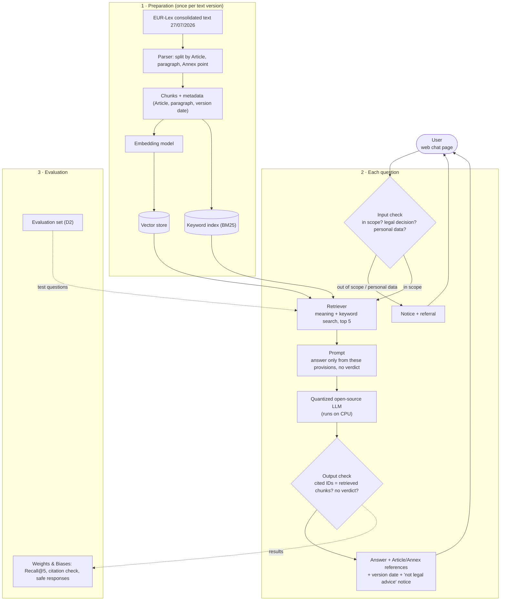

# ELIZA System Design v1 (draft)

**Status:** Draft for team review · **Date:** 18/10/2026 · **Deliverable:** D4 System Design v1 (due 28/10/2026)

ELIZA answers questions about the EU AI Act for developers of education AI products. It finds the relevant provisions in the consolidated text of 27/07/2026, explains them in plain language with Article and Annex references, and never gives a legal decision.

## Architecture

## Components

Every component is "open" until its test in [Spike 01](spikes/spike-01-technology-options.md) is done and an ADR is written.

| Component | Proposed technology | Status |
|---|---|---|
| Ingestion and parsing | Python + BeautifulSoup on the EUR-Lex HTML | Open → [Spike 01](spikes/spike-01-technology-options.md) row 1 |
| Chunking | One chunk per paragraph or Annex point | Open → Spike 01 row 2 |
| Embedding | bge-small-en-v1.5 | Open → Spike 01 row 3 |
| Vector store + keyword index | Chroma + BM25 | Open → Spike 01 rows 4–5 |
| Retriever | Meaning + keyword search, top 5 | Open → Spike 01 rows 3–5 |
| LLM | 3–4B open-source model, 4-bit quantized, via Ollama | Open → Spike 01 rows 6–7 |
| Input check | Keyword rules + classification prompt | Open → Spike 01 row 8 |
| Output check | Python citation-ID and verdict check | Open → Spike 01 row 9 |
| User interface | Gradio `ChatInterface` | Open → Spike 01 row 10 |
| Hosting | Google Cloud CPU instance, stopped when not in use | Open → Spike 01 row 11 |
| Evaluation | Weights & Biases + own scripts | Open → Spike 01 row 12 |

All parameters (chunk size, model names, top-k, prompt version) will live in `config/rag.yaml`, not in this page.

## How the design follows the charter

- **C-03, C-05:** open-source quantized LLM, running on a CPU
- **C-06, A-07:** one cloud instance, stopped when not in use
- **C-08, R-13:** input check and output check block legal decisions
- **C-09:** source and version date shown with every answer
- **C-10, R-12:** no user accounts; the conversation lives only in the session
